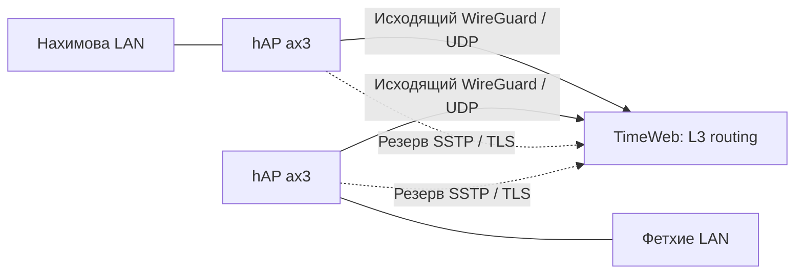
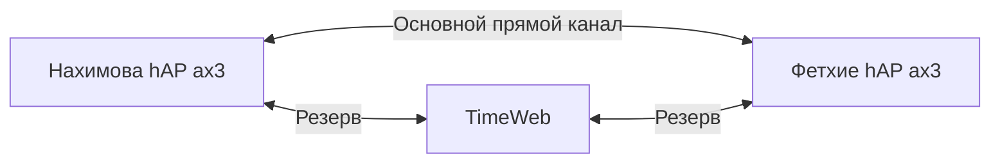

# Мост Нахимова 11 - Фетхие

## Статус и назначение

Проект постоянного site-to-site VPN, реализованный частично. 16 октября
отдельные WG-плечи обоих роутеров к TimeWeb и маршруты `192.168.88.0/24` ↔
`192.168.89.0/24` применены. Router tests и MacBook -> gateway Нахимова приняты
в сетевом объеме; входящие сервисы MacBook/приложения не приняты.
[Текущий changeset](Site_to_Site_LAN_Changeset.md),
[план](../tasks/PLAN-fethiye-site-to-site.md). Ниже целевая архитектура и
исторические исходные условия; удаленный Internet-выход, резервирование,
reboot/restore и прямой канал еще не реализованы.
Подготовительный IPIP-over-WG transport уже развернут в Local; пользователь
подтвердил обычный HTTPS после изменения. Это не включение Remote egress;
[точный текущий scope и ограничения](Site_to_Site_Egress_Changeset.md).

17 октября самостоятельно проверены два ограниченных прямых WG-кандидата
без изменений Deco: отдельный socket и дополнительный peer на существующем
socket. Краткий handshake/несколько пакетов проходили, затем передача
останавливалась. **Постоянный Direct не квалифицирован и не включён**;
вся тестовая конфигурация удалена, рабочая схема через TimeWeb сохранена.
[Результаты, ограничения и следующие варианты](../history/2026-10-17-direct-tunnel-feasibility.md).

18 октября владелец сохранил на Deco UDP 51972 -> `.68.117:51972` и DHCP
reservation MAC ether1 -> `.68.117`. Новый отдельный WG-кандидат прошёл
начальную аутентификацию, но после первой серии Нахимова 5/5 семь следующих
серий дали 0/5 в обе стороны. **Устойчивый Direct по-прежнему не квалифицирован**.
Кандидат полностью удалён, exports обоих роутеров/hub сверены с baseline;
старый путь до hub и удалённого LAN gateway по 5/5 с обеих площадок.
[Прямой тест после проброса Deco](../history/2026-10-18-direct-deco-forward.md).

Последующая packet-boundary диагностика локализовала потерю между исходящей
обработкой одного MikroTik и входящей другого. Смена только UDP source port
даёт краткий повторный успех; 16 нейтральных UDP-пакетов одной tuple через
тот же проброс проходят. Избирательная внешняя фильтрация/DPI вероятна, но
точный middlebox и отличие от специфической ошибки upstream NAT не доказаны.
Ничего постоянного не изменено, TimeWeb и исходные exports сохранены.
[Доказательства и предел вывода](../history/2026-10-18-direct-path-diagnosis.md).

19 октября: после owner-created TCP443 -> `.68.117:5443` прямой SSTP прошёл
mutual TLS, HTTP200, negative CA/reconnect и ordinary interval1s ICMP10/10
в обе стороны. Быстрые200ms пробы дали timeouts при RTT до294ms, поэтому
строгая/долговременная квалификация не заявлена. Кандидаты удалены полностью,
TimeWeb/LAN/egress не менялись, постоянного SSTP нет.
[Ограниченный SSTP trial](../history/2026-10-19-sstp-direct-trial.md).

Позднее19 октября отдельный30min активный SSTP soak прошёл без unexpected
disconnects: ICMP305/305 и DF1400 35/35 в каждую сторону,364 новых HTTP checks
без ошибок, три reconnect и negative CA/recovery PASS. Все изменения удалены,
TimeWeb остался исходным. Transport acceptance относится к этому окну;
постоянная SSTP-интеграция (routing/boot/recovery/console) и Direct client egress
ещё не реализованы.
[Длительный SSTP протокол](../history/2026-10-19-sstp-direct-soak.md).

Требования:

- Двусторонний доступ между локальными сетями без VPN на каждом устройстве.
- Возможность выхода в интернет через провайдера другой площадки.
- Автоматическое восстановление после перезапусков и отказов транспорта.
- Резервирование на случай блокировок, без гарантии их обхода.
- Сохранение действующих VPN, Smart Split и доступа к Нахимова.

Под мостом здесь понимается маршрутизируемое соединение L3, не общий
Ethernet-сегмент. DHCP и broadcast остаются локальными; discovery устройств
между площадками автоматически не появляется. EoIP/L2 нужен только при
отдельно подтвержденном требовании, которого сейчас нет.

## Исходные условия

**16 октября, исходное состояние перед VPN:** MikroTik подключен за Deco по
ether1, WAN DHCP `.117`. В 10:46 Europe/Istanbul заводская LAN
`192.168.88.0/24` изменена на `192.168.89.0/24`; Router PASS, MacBook получил
новый IP, пользователь подтвердил интернет и WebFig. Нахимова остается `.88.0/24`. Deco остается без
изменений по решению пользователя. [Аудит и baseline](../hosts/fethiye/MikroTik_hAP_ax3_Initial_Audit.md).

**Уточнение 15 октября 2026:** приложение Deco подтверждает публичный PPPoE
IPv4 Фетхие, совпавший с внешним адресом проверки. Прежнее условие «нет
публичного IP на обеих площадках» более не актуально для Фетхие. Входящая
доступность и статичность IP не проверены. Прямой WireGuard с исходящим
подключением из Нахимова - кандидат после теста UDP и согласования port
forward на Deco либо миграции PPPoE на MikroTik. IPv6 в Deco отключен;
возможности провайдера неизвестны. Подробности и LAN inventory:
[уточненный паспорт Фетхие](../hosts/fethiye/network-passport.md).

Срез действующей сети до подключения MikroTik: [паспорт Фетхие от 15 октября
2026](../hosts/fethiye/network-passport.md). LAN `192.168.68.0/24`; на
обследованном Mac нет глобального IPv6/default route. WAN Deco и IPv6
провайдера на этом раннем этапе еще не проверялись; уточнения выше отменяют
прежнее предположение об отсутствии публичного IPv4 в Фетхие.

| Площадка | Состояние |
| --- | --- |
| Нахимова 11 | Действующий hAP ax3; LAN `192.168.88.0/24`; существующее плечо `wg-home` до TimeWeb |
| Фетхие | Deco LAN `192.168.68.0/24`, за ним hAP ax3; отдельная LAN `192.168.89.0/24`, MacBook DHCP/Internet/WebFig приняты, VPN не создан |
| Публичный IPv4 | На PPPoE Deco Фетхие подтвержден; на Нахимова по информации владельца отсутствует; входящий UDP Фетхие не проверен |
| TimeWeb | Предпочтительный промежуточный узел по решению владельца |

Для Фетхие выбрана `192.168.89.0/24` после проверки live-маршрутов Нахимова,
TimeWeb и сохраненных конфигураций; диапазон применен с разрешения владельца.
Проверка VPN guards и прикладного доступа еще впереди.
Текущие сведения: [общая архитектура](overview.md),
[реестр конфигурации](../registry/configuration.md),
[доступ к узлам](../operations/access.md).

Зарубежный VPS обсуждался как промежуточный резерв, но отвергнут владельцем:
ожидается повышенный риск блокировки доступа с Нахимова. Это основание
выбора архитектуры, не измеренная гарантия доступности TimeWeb.

## Вариант A: оба плеча через TimeWeb

Оба роутера инициируют подключения, поэтому публичные IPv4 на площадках
не требуются. TimeWeb маршрутизирует LAN-трафик и транзит до выбранного
интернет-выхода, но сам не становится этим выходом.

Предлагаемые транспорты:

- Основной: WireGuard / UDP на каждом плече.
- Резерв: SSTP / TLS, предпочтительно TCP 443, если испытания подтвердят работу.
- Плечи независимы: Нахимова может использовать SSTP, Фетхие - WireGuard.

SSTP - проектное предложение, не уже доступный сервис TimeWeb. TCP 443 на
существующем IP используется REALITY. Нельзя разместить второй listener на
том же IP/порту без отдельного проверенного механизма. Рассмотреть дополнительный
IP TimeWeb либо другой порт; наличие IP и совместимость еще не проверены.
Для SSTP обязательны проверка сертификата/имени сервера и защищенная
аутентификация; проверки не отключать ради подключения.

Ограничения: TimeWeb остается единой точкой отказа. Разные протоколы на одном
сервере резервируют транспорт, но не отказ хоста, провайдера или блокировку IP.
SSTP на TCP 443 не равнозначен обычному HTTPS и не гарантирует обход DPI.

Существующее `wg-home` можно рассмотреть для повторного использования только
после аудита routing/firewall и recovery contracts. Не добавлять LAN или
default routes в действующий контур вслепую.

## Вариант B: прямой канал и резерв через TimeWeb

Прямой путь убирает TimeWeb из передачи основного трафика. Отсутствие
публичных IPv4 не исключает его, но требует одного из следующих условий.

| Решение | Условия и ограничения |
| --- | --- |
| WireGuard по глобальному IPv6 | Глобальные IPv6 на обеих площадках, маршруты и доступный UDP; адреса могут быть динамическими, требуется обновление endpoint |
| ZeroTier / UDP NAT traversal | Может установить прямой обмен через NAT; строгий/symmetric NAT и фильтрация UDP могут помешать; отдельно проверять DIRECT/RELAY |
| WireGuard с внешним координатором | Возможный эксперимент с UDP hole punching и обновлением endpoint; не штатная автоматика обычного WireGuard RouterOS; не гарантирует работу через CGNAT |
| Публичный IPv4 или проброс порта | Альтернатива при изменении условий провайдера; локальный проброс не устраняет CGNAT провайдера |

ZeroTier поддерживается на ARM/ARM64 MikroTik, включая архитектуру hAP ax3.
Служебные серверы координации не обязательно передают пользовательский трафик:
при DIRECT он идет между площадками. При RELAY это уже не прямое соединение.
Нельзя считать TCP fallback или собственный relay ZeroTier доступным на
RouterOS без проверки конкретной реализации/версии. Приемка включает проверку
зависимости от внешней координации при холодном старте.

MikroTik Back to Home не считать гарантированным прямым site-to-site каналом:
при недоступном роутере используется relay MikroTik. Существующее домашнее
плечо проекта через TimeWeb не следует смешивать с одноименной функцией BTH.

## Проверка IPv6 Нахимова: 12 октября 2026

Проверен живой роутер через существующий SSH alias, модель hAP ax3 и serial
сверены с реестром. Проверка только чтение; конфигурация не менялась.

- `disable-ipv6=no`, `forward=yes`.
- В адресах только link-local `fe80::/64` и loopback `::1/128`.
- Глобального адреса и default route `::/0` нет.
- DHCPv6-клиенты и IPv6 pools отсутствуют.
- На WAN `ether1` есть link-local сосед с признаком router; это не доказательство
  предоставления глобального IPv6 провайдером.
- `accept-router-advertisements=yes-if-forwarding-disabled` при `forward=yes`:
  автоматическое получение адреса через RA/SLAAC сейчас не задействовано.
- Три ping к `2606:4700:4700::1111` завершились `no route`, ответов нет.
- Отдельного IPv6 input-разрешения для WireGuard нет; действует WAN drop.

Вывод: сейчас прямой IPv6-канал использовать нельзя. Не установлено, что
провайдер вообще не предоставляет IPv6: он может быть просто не настроен.
Следующий согласуемый тест - выяснить SLAAC/DHCPv6 условия и проверить
получение адреса только на WAN, без раздачи IPv6 домашней LAN. Затем проверить
внешнюю достижимость UDP и IPv6 Фетхие. Не включать RA на всех интерфейсах.

## Интернет-выход и защита от петель

Обратное направление аналогично: Фетхие -> выбранный канал -> Нахимова ->
NAT на WAN Нахимова -> российский интернет. NAT между LAN по умолчанию не нужен.

Для каждой площадки независимо выбирается Local или Remote site, с возможными
исключениями для устройств. Переключение транспорта не меняет выбранный
интернет-выход. На TimeWeb резервный транзит должен идти к нужной площадке,
а не в собственный WAN или существующий FX/CEN outbound.

Нужны отдельные routing tables/rules для локально инициированного трафика и
транзита; корректные обратные маршруты, исключения FastTrack, MTU/MSS и
фиксация VPN endpoint/control traffic на собственном WAN. Трафик, пришедший
для интернет-выхода с другой площадки, не отправлять обратно в VPN.
Одновременный взаимный Remote site допустим только с такой изоляцией.

DNS и IPv6 должны соответствовать выбранному выходу, без скрытого обхода VPN.
При потере обоих каналов режим Remote site по умолчанию fail-closed: не
переключаться незаметно на Local. Fail-open разрешается отдельной настройкой.

## Резервирование и управление

Стартовые параметры для испытаний, не утвержденные эксплуатационные SLA:

- Проверять каждый канал отдельно, привязывая probes к его пути.
- Разделять готовность транспорта, доступность удаленной LAN и удаленного WAN.
- Начать с трех последовательных отказов с интервалом 10 секунд; учитывать
  timeout probes, а не обещать строгое переключение за 30 секунд.
- Возвращаться на основной после 2-3 минут устойчивого восстановления.
- Согласовать обратные маршруты на обеих сторонах; предотвратить flapping.
- Не требовать ручного запуска после reboot; записывать переходы и причины.

Handshake или running-интерфейс не доказывают передачу полезного трафика.
Переключение может оборвать действующие сессии; бесшовность не обещается.

Предлагаемый интерфейс будущего управления:

- Площадки: отдельно Нахимова и Фетхие.
- Internet gateway: Local / Remote site, default и исключения для устройств.
- Режим канала: Auto / Direct / TimeWeb; Direct недоступен до квалификации.
- Для плеча TimeWeb: Auto / UDP / TLS, с фактически наблюдаемым транспортом.
- Статусы LAN reachability и Internet egress, timestamp, причина отказа,
  текущий путь и журнал последних переключений.

Если SSTP блокируется, рассмотреть внешний Linux-шлюз с REALITY/WSS, исходящим
на TimeWeb. Это отдельный следующий этап: дополнительное оборудование,
контроль автозапуска и безопасности. Amnezia-SOCKS не переносится напрямую
на RouterOS; container-вариант требует отдельной квалификации.

## Последовательность реализации и приемка

1. Сверить live Нахимова, NAT/IPv6 провайдеров и свободные LAN/VPN диапазоны.
2. Выбрать и испытать прямой канал: сначала IPv6, затем ZeroTier при необходимости.
3. Проверить SSTP endpoint на TimeWeb и конфликт TCP 443; согласовать решение.
4. Создать независимый пилот Фетхие, сохраняя старые VPN и management route.
5. Проверить LAN в обе стороны и оба internet egress на одном тестовом устройстве.
6. Испытать отказ UDP, прямого пути, TimeWeb и WAN каждой площадки; проверить
   возврат, отсутствие петель, DNS/IPv6 и поведение fail-closed.
7. Проверить reboot каждого узла, смену адреса, скорость и MTU крупных пакетов.
8. После приемки расширить охват устройств и закрепить эксплуатационный runbook.

Перед изменениями - свежие backups и точный rollback. Любое изменение
действующих tunnels/routing проходит [agent workflow](../operations/agent-workflow.md):
registry, monitoring, recovery contracts и console read-back обновляются
согласованно. Секреты и полные конфигурации остаются в `.local`, не в документе.

## Открытые вопросы

- Есть ли доступный глобальный IPv6 у обоих провайдеров?
- Каковы NAT и фильтрация UDP, достижим ли DIRECT через ZeroTier?
- Где разместить SSTP на TimeWeb без конфликта с REALITY?
- Какие устройства требуют Remote site и разрешен ли им fail-open?
- Нужен ли discovery между LAN, помимо доступа по IP/DNS?
- Какие измеренные скорость и задержка приемлемы для резервного канала?

## Первичные источники

- [RouterOS WireGuard](https://manual.mikrotik.com/docs/virtual-private-networks/wireguard/).
- [RouterOS SSTP](https://help.mikrotik.com/docs/spaces/ROS/pages/2031645/SSTP).
- [IPv6 Settings](https://help.mikrotik.com/docs/spaces/ROS/pages/103841817/IP%2BSettings).
- [Policy Routing](https://help.mikrotik.com/docs/spaces/ROS/pages/59965508/Policy%20Routing).
- [ZeroTier на RouterOS](https://help.mikrotik.com/docs/spaces/ROS/pages/83755083/ZeroTier).
- [ZeroTier: протокол и NAT traversal](https://docs.zerotier.com/protocol/).
- [ZeroTier: ограничения NAT](https://docs.zerotier.com/corporate-firewalls/).
- [MikroTik Back To Home](https://help.mikrotik.com/docs/spaces/ROS/pages/197984280/Back%2BTo%2BHome).
