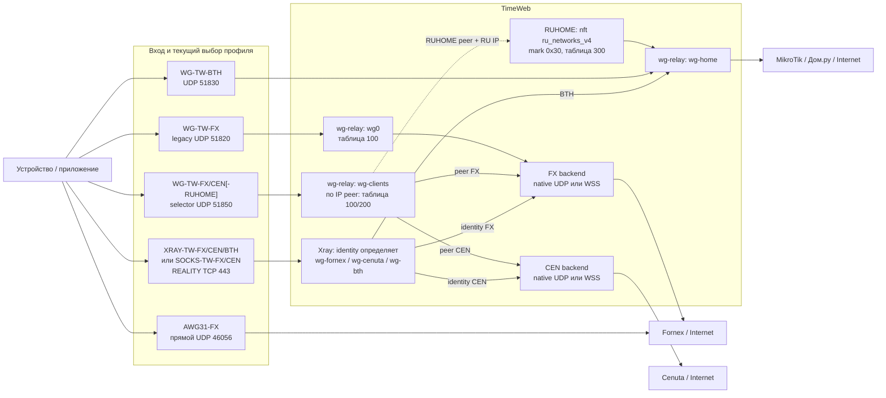
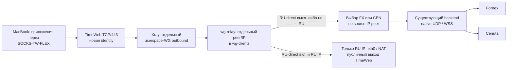

# Универсальный SOCKS-маршрут через TimeWeb

## Статус и источники

Пилот для MacBook **развернут на сервере 23.09.2026, но ещё не принят на клиенте**. Старые клиентские профили и их server identities не менялись; один новый профиль выпущен отдельно. Исходный срез ниже сделан до пилота, около 07:08 UTC: [TimeWeb_VPN_Registry](<../registry/tunnels.md>) (тогда 62 файла), [VPN_HLD](<overview.md>), [TimeWeb_VLESS_REALITY_Architecture_and_Plan](<TimeWeb_VLESS_REALITY_Architecture_and_Plan.md>), локальные клиентские JSON и read-only проверка TimeWeb. Наличие файла или server identity не доказывает передачу трафика.

В live Xray: один VLESS/REALITY inbound TCP/443, 12 identities, три userspace-WG outbound (wg-fornex, wg-cenuta, wg-bth), маршрутизация по user, общий DNS и завершающее правило blocked. Routing domainStrategy = AsIs. Прямого Internet-outbound нет. Host guard разрешает Xray UID только текущие WG endpoints, loopback WSS, закрепленный REALITY target и ответы входящих соединений; остальное отбрасывает. В wg-relay есть policy tables 100 (FX), 200 (CEN), 300 (дом) и nft-set ru_networks_v4 для части обычных WG-клиентов. На момент проверки Fornex backend был native, Cenuta backend - backup/WSS. Это состояние на момент проверки, а не желаемая настройка.

## Базовая схема до пилота: все семейства маршрутов

Стрелки к FX и CEN после backend-узла означают **альтернативы**, а не дублирование одного потока. При обычном WG выход уже привязан к адресу peer/профилю. При REALITY выход привязан к server identity. SOCKS-TW-* - локальный SOCKS-вход в клиентском приложении, а не отдельный серверный протокол или системный full-tunnel: обслуживаются только приложения, направившие трафик в proxy. Неудачный XRAY-TW-FX-TUN-S-MacBook.json в рабочие пути не включен.

| Текущий вариант | Файлов | Выход для обычного Internet | RU IP | Без переимпорта |
| --- | ---: | --- | --- | --- |
| WG-TW-FX, legacy | 15 | FX | Через FX; legacy RU override пуст | Только общий FX backend UDP/WSS |
| WG selector FX-RUHOME | 6 | FX | Через BTH/дом | Общий FX backend UDP/WSS |
| WG selector CEN-RUHOME | 10 | CEN | Через BTH/дом | Общий CEN backend UDP/WSS |
| WG selector CEN без RUHOME | 2 | CEN | Через CEN | Общий CEN backend UDP/WSS |
| WG-TW-BTH | 3 | Дом.ру | Дом.ру | FX/CEN backend не участвует |
| REALITY FX, XRAY/SOCKS | 5 | FX по трем server identities | Через FX | Общий FX backend UDP/WSS; SOCKS FX переиспользует identity XRAY FX устройства |
| REALITY CEN, XRAY | 3 | CEN | Через CEN | Общий CEN backend UDP/WSS |
| REALITY CEN, SOCKS | 3 | CEN по отдельным identities | Через CEN | Общий CEN backend UDP/WSS |
| REALITY BTH, XRAY | 3 | Дом.ру | Дом.ру | FX/CEN backend не участвует |
| AWG31-FX | 11 | FX напрямую, минуя TW | Через FX | TW backend не участвует |
| REALITY FX-TUN | 1 | Намечен FX, но клиентский тест не прошел | Не принят | Не считать рабочим вариантом |

Итого: 36 WG + 15 REALITY JSON (из них один TUN не принят) + 11 AWG31 = 62 выпущенных файла. Для REALITY 15 файлов соответствуют 12 server identities. Переключение backend UDP/WSS относится к общему uplink FX/CEN; для смены FX/CEN или RU-политики на обычном профиле сейчас требуется смена профиля либо ручное изменение server policy, не штатный переключатель.

Приемка неодинакова: базовые REALITY FX/CEN/BTH подтверждались пользователем на MacBook/iPhone, SOCKS-TW-CEN-MacBook принят отдельно; новые SOCKS-профили Mac Mini/iPhone ожидают импорта и проверки. Таблица показывает **существующие варианты маршрутизации**, а не утверждает, что все профили одновременно подключены или приняты.

## Пилот FLEX

Новый профиль MacBook: `SOCKS-TW-FLEX-S-MacBook.json`. В нем неизменны вход REALITY на TimeWeb и локальный SOCKS; **выход FX/CEN и RU-direct не записываются в клиентском имени и не требуют переимпорта при переключении**. Созданы отдельные server identity `macbook-socks-flex` и WG peer `10.50.50.39/32`: старые FX/CEN профили не переназначались.

Именно wg-relay видит IP-пакеты после Xray WG-инкапсуляции и имеет FX/CEN uplinks и общий ru_networks_v4. Глобальный Xray domainStrategy оставлен AsIs. **Сквозной путь подтвержден временным локальным Xray с этим JSON**, но импорт и системное поведение AmneziaVPN на MacBook ещё не проверены.

| Поле | Значения | Эффект |
| --- | --- | --- |
| Зарубежный выход | FX / CEN | Меняет выделенную таблицу маршрута peer (`410` MacBook, `412` iPhone); старые identities не меняются |
| RU-direct | Выкл. / вкл. | Выкл.: RU следует за FX/CEN. Вкл.: IP из ru_networks_v4 выходит непосредственно через TimeWeb; остальное следует за FX/CEN |
| Backend FX/CEN | native UDP / WSS | Существующий **общий для всех пользователей данного uplink** переключатель; не настройка одного FLEX-профиля |

Один FLEX-профиль обеспечивает четыре комбинации FX/CEN x RU-direct **для одного устройства**, но не заменяет обычный WG, AWG31, BTH и не делает SOCKS системным VPN. В частности, RU-direct дает публичный IP TimeWeb, а существующий RUHOME - домашний IP Дом.ру; это разные пользовательские результаты. Каждому устройству нужны собственные identity и peer/IP, иначе исключение одного устройства изменит маршрут всех. Число профилей уменьшается, серверная конфигурация и ответственность за нее растут.

## Реализация и текущий режим 23.09.2026

- Клиентский файл: `.local/clients/Sergey/MacBook/SOCKS-TW-FLEX-S-MacBook.json` (секретный файл вне Obsidian). Вход: VLESS/REALITY TCP/443, локальный SOCKS; отдельная identity `macbook-socks-flex`. На сервере Xray добавлен только новый outbound `wg-flex-macbook` к `172.19.0.2:51850/UDP`, приватная адресация `10.50.50.39/32`. Ключи и UUID здесь не публикуются.
- Relay: `wg-clients` имеет новый peer `.39`; таблица `410` содержит только default через выбранный FX (`wg1`) или CEN (`wg-up-cenuta`). Правила `from 10.50.50.39 lookup 410` с приоритетом 239 и `prohibit` с приоритетом 240 исключают fallback в main. Маркер `0x39` для RU-direct выбирает таблицу `411` (только eth0) с отдельным `prohibit`; mark ставится лишь для `.39` и IP из существующего `ru_networks_v4`.
- Отдельная nft-таблица `flex_macbook` разрешает `.39` только через FX/CEN или через eth0 с маркером RU и запрещает прочий forward; NAT также ограничен `.39`. При recreate `wg-clients` вводит quarantine DROP для `.39` в `PreUp`, до загрузки peer; `timeweb-flex-macbook.timer` каждые 30 с сверяет и восстанавливает правила, снимая quarantine только после read-back. Если список RU недоступен при RU-direct=on, состояние не подтверждается и quarantine остаётся. Режим FX/CEN и RU-direct сохранён в `/var/lib/vpn-uplink-pilot/flex-macbook.json`.
- Узкое разрешение Xray UID к внутреннему `172.19.0.2:51850/UDP` внесено в host guard. BTH recovery-контракт обновлён: он принимает только известные native/WSS endpoint для FX/CEN и хеширует остальной Xray-конфиг; текущие фиксированные FLEX RPDB-правила включены в оба допустимых набора. BTH timer снова активен, `--check` проходит.
- Управление: консоль TimeWeb через `ssh -N timeweb-console` и [http://127.0.0.1:19118/](http://127.0.0.1:19118/), раздел `SOCKS-TW-FLEX`. POST защищён loopback Host/Origin/CSRF проверками и серверным read-back, результат пишется в audit. Backend native/WSS остаётся общим и управляется соседними плашками.
- Перед изменением сохранён VERIFIED backup TimeWeb `2026-09-23T074453Z_current-config`; итоговый VERIFIED backup после сквозного теста, исправления нового outbound и `PreUp` quarantine — `2026-09-23T082407Z_current-config`. Проверены Xray-конфиг, service status, policy route FX/CEN, route с RU-mark, локальный HTTP POST и BTH-контракт. Временный Xray с тем же новым JSON и отдельным локальным SOCKS-портом дал HTTPS-ответ: FX `103.75.126.143`, CEN `89.252.153.129`; RU-direct=on дал HTTP 302 от `ya.ru` и рост счётчика eth0 с mark `0x39`, при этом нероссийский `api.ipify.org` оставался через CEN. При RU-direct=off `ya.ru` через CEN вышел по счётчику CEN, но запрос истёк через 20 с; `api.ipify.org` через CEN продолжал отвечать. Это **не** означает приемку поведения AmneziaVPN на MacBook, DNS-утечек, отказных сценариев или реального reboot.

## Расширение до нескольких устройств 23.09.2026

- Выпущен `.local/clients/Sergey/iPhone/SOCKS-TW-FLEX-iPhone12.json`. Это отдельная Xray identity `iphone12-socks-flex`, userspace-WG outbound `wg-flex-iphone12` и peer `10.50.50.40/32`; MacBook `.39` и прежние профили не переназначены. Импорт на iPhone и сквозной трафик клиента пока не подтверждены.
- Контроллер использует таблицы `410` (MacBook) и `412` (iPhone) для FX/CEN; source rules 239/240 и 241/242 с завершающим `prohibit`. Для RU-direct iPhone используется отдельный mark `0x40`, правила 186/187 и существующая таблица `411`. Собственная nft-таблица `flex_iphone12` ограничивает forward/NAT; `PreUp` создает quarantine, который снимается только после read-back. За восстановление отвечает `timeweb-flex-iphone12.timer`.
- `/var/lib/vpn-uplink-pilot/flex-fleet.json` хранит общие `Gateway` и `RU-direct` и независимые исключения на устройство. `Default` в конкретном поле означает наследование глобального значения этого поля. Изменение глобального значения не стирает явные исключения. Контроллер применяет изменения к затронутым peers, проверяет их и при ошибке пытается вернуть уже измененные; межустройственная атомарность уровня ядра не обещается.
- Консоль показывает общую политику и счетчики активности/доступности маршрутов, а в `Devices` - активность, effective values и исключения каждого устройства. `Active` означает подписанное Xray access-событие за 90 секунд; `Inactive` не означает отказ сервера. Адрес peer и состояние маршрута показаны отдельно. Действующее значение при этой сверке: общий `Cenuta / RU-direct OFF`, оба устройства `Default`.
- Monitoring guard принимает только два разрешенных default route для каждой из таблиц `410`/`412` и точные новые RPDB-правила. Проверка guard вернула `VALID`; BTH recovery-контракт дополнен новым Xray outbound и правилами. Проверены серверные переключения обоих полей iPhone и возврат к `Default` без изменения MacBook. Проверка реального трафика iPhone остается отдельным шагом.

## Безопасность и границы

- Прямой RU-выход с IP TimeWeb - **новое исключение** из существующего запрета прямого выхода REALITY. Не расширять host guard Xray UID до произвольного Internet: Xray видит только дополнительный внутренний WG endpoint, а RU-direct разрешается в relay только для выделенного peer и ru_networks_v4.
- Новый Xray outbound к внутреннему wg-clients endpoint (172.19.0.2:51850/UDP в проверенном срезе) потребует узкого разрешения в host guard и обновления его ожидаемого контракта. Без него профиль не заработает; широкое разрешение на весь Docker bridge недопустимо.
- Для нового source IP необходимы явные FORWARD/NAT-правила на FX, CEN и RU-direct, запрет private/reserved/адресов VPS и завершающее prohibit до main, чтобы потеря policy rule **не отправляла трафик через TimeWeb по умолчанию**. Отдельно проверить обратный путь и отсутствие прямого выхода при отказе обоих uplinks. IPv6 в пилоте блокировать, пока для него нет проверенной политики.
- ru_networks_v4 - список IP, не распознаватель российских сайтов. CDN, зарубежные IP российских сервисов, смена DNS-ответов и устаревший список дадут расхождения. Общий DNS Xray продолжит работать по существующей схеме FX/CEN; RU-direct не обещает российский DNS и не распространяется на трафик приложений вне SOCKS.
- Российские сервисы могут по-разному относиться к IP VPS и домашнему IP; успешный маршрут до RU-адреса не доказывает, что сервис примет запрос. Этот результат нужно проверять отдельно от сетевой доступности.
- Переключение маршрута применяется к **новым соединениям**. Старые TCP-сессии могут оборваться или оставаться на прежнем пути; бесшовную миграцию нельзя обещать. Никакого автоматического failover FX/CEN в первом пилоте.
- При добавлении peer/policy проверить persistent-конфигурацию контейнера и контракт bth-recovery: его несоответствие может удалить BTH peer. Нельзя менять live-правила отдельно от этого контракта и rollback.

## Управление и проверка

Для ручного пилота расширить существующую loopback-only консоль vpn-uplink-console отдельным разделом «SOCKS-маршрут»: текущее устройство/identity, FX или CEN, RU-direct on/off, фактические таблица/счетчики/публичный IP и время последней проверки. Доступ оставить через существующий SSH port-forward; серверный обработчик - только allowlist фиксированных действий и устройства, без произвольных команд. CSRF, подтверждение изменения, single-flight lock, журнал, проверка состояния после применения и автоматический откат при несовпадении обязательны. Хранить желаемое состояние отдельно от измеренного, сохранять его после reboot и показывать unknown, а не ложное FX, при partial state. Xray API наружу не публиковать. Текущий SSH-путь к TimeWeb не гарантирован против любой блокировки: доступность управления нужно измерять отдельно от доступности трафика; резервный канал управления потребует отдельного решения.

Перед сменой FX/CEN проверять доступность выбранного uplink и сквозной HTTPS через него, а после - фактический route, счетчики и внешний IP новым соединением. При неуспехе оставить прежнее состояние или откатить его, показать конкретную ошибку; зеленое «выполнено» только после подтверждения результата. Это не должно автоматически менять backend native/WSS.

Для резервного доступа к **той же** консоли предпочтителен второй SSH-маршрут через уже имеющийся зарубежный хост (ProxyJump), без публикации web/API-порта. Это только кандидат: сначала read-only проверить, что выбранный хост достижим из сети оператора, что от него доступен SSH TimeWeb, и что существующие host keys/права подходят. Если проверка не пройдет, нельзя заявлять консоль устойчивой к блокировке; отдельный защищенный management-путь проектируется позже. UI должна явно показывать, по какому каналу открыта консоль.

Порядок проверки пилота (пункты 1-2 выполнены на сервере; клиентские и отказные тесты остаются открыты):

1. Снять и проверить backup Xray, relay, nft/RPDB, консоли и recovery-контракта; подготовить точный откат. Локально проверить Xray-конфиг и правила на fixture, в том числе потерю route/table/listener.
2. Добавить **одну** новую identity и peer/IP, не переназначая старые. Однократный контролируемый рестарт Xray для публикации профиля может кратко затронуть существующие REALITY-сессии; запланировать окно и проверить старые выходы после него.
3. На MacBook проверить SOCKS-приложение: при RU-direct=off внешний IP FX, затем CEN; для RU-адреса при on - публичный IP TimeWeb, при off - выбранный FX/CEN. Проверить отдельно домен и literal IPv4, DNS, ответы и счетчики обоих направлений.
4. Негативные тесты: private/VPS IP, IPv6, недоступный backend, пропавшее правило, restart Xray и recreate wg-relay; прямой выход для non-RU всегда запрещен. Проверить, что старые WG/REALITY/BTH/AWG профили не изменили поведение.
5. Отдельно проверить наследование текущего native/WSS транспорта на обеих зарубежных ветках. Его переключение влияет и на старых пользователей, поэтому такой тест требует отдельного окна/подтверждения. Зафиксировать результаты и только затем решать, расширять ли пилот на Mac Mini и iPhone.

Этот документ фиксирует развернутый серверный пилот, а не подтверждает его сквозную работоспособность. Смена backend native/WSS затрагивает старых пользователей и не входит в приемку FLEX без отдельного окна. Второй независимый management-канал против блокировок пока не реализован; существующая SSH-консоль остаётся единственным подтверждённым способом управления.

## Технические основания

- [Xray Routing](https://xtls.github.io/en/config/routing): порядок правил, user, domainStrategy, выбор outbound. Глобальная смена AsIs в общем процессе затронула бы поведение других identities, поэтому RU-классификацию предлагается выполнять после WG в relay.
- [Xray DNS](https://xtls.github.io/en/config/dns): IP-based routing зависит от DNS-стратегии и не гарантирует, что фактический адрес соединения совпадет с адресом, использованным при классификации. В пилоте классифицируются реальные IP-пакеты relay.
- [Xray API](https://xtls.github.io/config/api.html): динамические routing actions существуют, но дополнительная публичная управляющая поверхность для этого пилота не нужна.
- [WireGuard cryptokey routing](https://www.wireguard.com/): отдельный peer связывает ключ с допустимым IP-источником.
- [Linux ip-rule](https://man7.org/linux/man-pages/man8/ip-rule.8.html): последовательность policy rules и действие prohibit позволяют сделать маршрут fail-closed перед таблицей main.
- [nftables sets](https://netfilter.org/projects/nftables/manpage.html): именованные наборы позволяют управлять адресным RU-правилом, не переписывая остальные правила.
