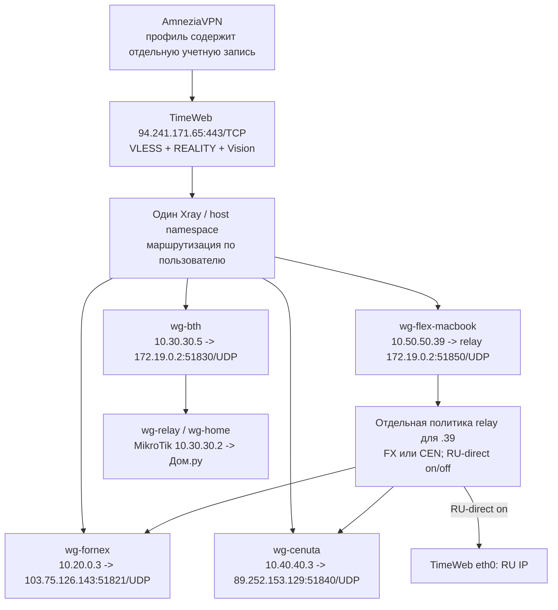

# TimeWeb REALITY: архитектура и состояние реализации

## Решение

Альтернативный вход для компьютера/телефона: AmneziaVPN -> **TimeWeb TCP/443** -> выбранный WG outbound Xray -> **Fornex / Cenuta / MikroTik BTH**. Обычные WG-туннели остаются самостоятельной системой. Для старых REALITY-профилей прямой выход пользовательского Internet-трафика с IP TimeWeb запрещен. Отдельный пилотный `SOCKS-TW-FLEX-S-MacBook.json` допускает RU-direct с TimeWeb только при явном включении.

Это **работающая реализация**, не предложение установки. Базовый read-only срез VPS снят 13 сентября в 14:45 UTC; runtime Cenuta WSS и новые SOCKS identity дополнительно проверены 22 сентября. MacBook Sergey и iPhone 12 Sergey ранее функционально проверены пользователем на трех базовых выходах; `SOCKS-TW-CEN-MacBook` отдельно подтвержден после исправления WSS. Пилот FLEX развернут 23 сентября и проверен синтетическим SOCKS-клиентом, но импорт в AmneziaVPN на MacBook и системный маршрут еще не приняты пользователем. Полная эксплуатационная матрица остается открытой.

Версии приложений по сообщению пользователя: macOS AmneziaVPN **5.0.1.5**, iPhone **5.0.2.1**. В этом ревью установленные приложения не переустанавливались и повторно не инспектировались.

## Реальная топология

В исходном проекте предполагался отдельный BTH worker с собственным DNS-контекстом. **Он не развернут и не нужен для текущей реализации.** BTH обслуживается тем же Xray, используя отдельный встроенный WG outbound. Нет локального SOCKS-hop и службы `xray-timeweb-bth`.

## Компоненты и параметры

| Компонент | Размещение / контракт |
| --- | --- |
| Xray | TimeWeb host, `/opt/timeweb-reality/xray`, `/opt/timeweb-reality/config.json` |
| systemd | `xray-timeweb-reality.service`, active/enabled; user `reality-fornex`, UID 10001 |
| Вход | IPv4 `94.241.171.65:443/TCP`; `reality-in`; 13 client identities: по FX/CEN/BTH для MacBook Sergey, iPhone 12 Sergey и Mac Mini M4 Sergey; отдельные `SOCKS-TW-CEN` identity для всех трех устройств; отдельная identity FLEX для MacBook Sergey |
| REALITY target | Закрепленный `23.12.156.37:443`, serverName `www.apple.com`; автоматической смены IP нет |
| WG outbound | `wg-fornex`, `wg-cenuta`, `wg-bth`, `wg-flex-macbook`; MTU 1380, workers 1, ForceIPv4; пятый outbound `blocked` не является WG |
| WSS fallback | Для Fornex и Cenuta контроллер переключает синхронно relay WG и соответствующий userspace-WG outbound Xray; Cenuta может автоматически войти в резерв после квалифицированных сбоев native UDP, возврат в native только вручную; частичное переключение считается недоступным |
| Запрет fallback | `blocked` blackhole; неизвестный/неразрешенный маршрут не получает обычный Freedom-direct |
| Ограничения процесса | MemoryMax 256 MiB, CPUQuota 50%; около 15 MiB MemoryCurrent в дополнительной проверке |
| Fornex | Новый peer `10.20.0.3/32` в существующем `wg-exit`, source guards |
| Cenuta | Новый peer `10.40.40.3/32` в host `wg-cenuta`, source guards |
| BTH | Peer `10.30.30.5/32` в TimeWeb `wg-home`, guards на TimeWeb и адресные правила MikroTik |
| Recovery | `bth-recovery.timer` + oneshot; контракт, проверка, ограниченное восстановление каждые 120 секунд |
| FLEX pilot | Выделенный peer `.39` и RPDB/nft-политика на relay; `timeweb-flex-macbook.timer` сверяет её каждые 30 секунд; ручные переключатели FX/CEN и RU-direct в loopback-консоли |

Старые WG uplinks `.1` Fornex и `.2` Cenuta не заменены. Глобальные маршруты host и WG-клиентские policy rules не используются как способ выбора Xray-выхода.

## Ручной резерв uplink TimeWeb -> Fornex

Для обоих выходов на Fornex развернут ручной резерв на случай блокировки UDP между TimeWeb и Fornex: relay `wg-relay/wg1` и userspace WireGuard outbound `wg-fornex` процесса Xray. Основной путь остаётся `103.75.126.143:51821/UDP`; резерв инкапсулирует те же WireGuard-пакеты в `mTLS WSS TCP/8443` и на Fornex разрешает единственное назначение `127.0.0.1:51821` (`wg-exit`). Локальные UDP-listener различны: `127.0.0.1:51921` в namespace relay и `127.0.0.1:51923` на host для Xray. `TCP/443` не используется: он принадлежит `amnezia-xray`.

Выбор пока только ручной: на TimeWeb `sudo timeweb-fornex-wg-transport backup` включает резерв для **обоих** контуров, `native` возвращает оба на основной endpoint, `status` показывает relay и Xray endpoint. Перед переключением контроллер проверяет доступность обоих WSS-listener, carrier route Fornex через `eth0`, валидирует Xray config и перезапускает Xray. При ошибке Xray он возвращает Xray и relay на native UDP; состояние `partial` не публикуется как корректный backup. Автоматический failover намеренно не включен и будет отдельным этапом с наблюдаемостью и гистерезисом.

## DNS и маршрутизация

1. Идентичность профиля выбирает выход для обслуживаемого Internet-трафика.
2. Private destinations, IPv6 и адреса трех VPS блокируются политикой REALITY. BTH здесь означает Internet через дом, **не доступ к LAN и администрированию**.
3. RU -> Дом.ру split старых WG-профилей не наследуется фиксированными REALITY-профилями. Исключение: пилот FLEX может направлять RU IP прямо через TimeWeb `eth0` при явном включении; это не Дом.ру и не влияет на другие профили.
4. Встроенный DNS Xray общий: `UseIPv4`, два DoH-сервера, разрешенный fallback. `dns-fornex` идет к `1.1.1.1` через Fornex; `dns-cenuta` к `1.0.0.1` через Cenuta.
5. Поэтому внутреннее разрешение имен не изолировано по выбранной стране. BTH может использовать зарубежный DNS, что отдельно разрешено пользователем. Обещание «весь DNS BTH идет через Дом.ру» неверно.
6. DNS-сервер, показанный macOS `scutil --dns`, не определяет фактический путь пакета. Нужны route и одновременный capture на физическом интерфейсе/выходе.

## Firewall и жизненный цикл

Host nft-таблица `inet reality_fornex` ограничивает UID 10001: три native WG endpoint, внутренний FLEX endpoint `172.19.0.2:51850/UDP`, закрепленный target, loopback WSS endpoints `127.0.0.1:51923` (Fornex) и `127.0.0.1:51924` (Cenuta), а также ответы входящих TCP/443. Прочий исходящий трафик этого UID блокируется. Историческое имя таблицы не означает единственный Fornex-выход. Добавление или смена Xray endpoint требует синхронного изменения `guard.nft` и `guard.expected`; отсутствие разрешения для `51924` блокирует handshake Xray, хотя WSS-сервис остается healthy. Дополнительная `inet flex_macbook` и терминальные RPDB prohibit-правила ограничивают только peer `.39`.

Для нового BTH peer конфигурация WG runtime-only. `bth-recovery` проверяет актуальный контейнер, namespace и контракт состояния, а затем восстанавливает только собственные объекты. `restored=false` в успешном цикле означает, что восстановление не требовалось. Не отключать recovery вместе с остановленным сборщиком мониторинга.

При изменении Xray/guard/маршрутов контракт recovery может перестать совпадать. Нужны свежие backup/audit и новое согласованное поколение; нельзя автоматически переподписывать неизвестный drift. Детали и порядок отката: [TimeWeb_REALITY_Backup_and_Rollback](<../operations/TimeWeb_REALITY_Backup_and_Rollback.md>).

**Последствие несовпадения:** штатный recovery при ошибке после закрепления namespace удаляет собственный BTH peer `.5` (fail-closed), не просто пишет warning. В контракт входит весь RPDB `ip -j rule`, поэтому даже добавление selector WG-клиента может отключить REALITY BTH на следующем цикле. Режим `--check` не выполняет это удаление. Такие изменения требуют согласованного обслуживания/обновления контракта и проверки всех затронутых путей.

## Этапы и доказательства

| Этап | Выполнено | Граница приемки |
| --- | --- | --- |
| 1. Read-only audit | VPS, контейнеры, ресурсы, исходные маршруты | Датированный срез 12 сентября, дополнен свежим 13 сентября |
| 2. Backup | Конфигурационные архивы трех VPS, хеши и чтение | Не образы дисков; полный restore drill не выполнен |
| 3. Локальный Linux lab | Изоляция, REALITY/userspace WG, положительные и отрицательные fixtures | Лаборатория не доказывает клиентский маршрут из Турции |
| 4. Fornex peer/guards | Отдельный `10.20.0.3`, точечные apply/rollback | Не изменяет старый WG peer |
| 5–6. Публичный Xray и профили | TCP/443, Fornex, MacBook/iPhone exports | Функционально подтверждены пользователем |
| 7. Клиентская диагностика | Cisco, CNN, повторный Speedtest DL 29.31 / UL 6.72 Mbps; DNS-проверки MacBook | Предыдущие timeout/UL 0.00 не объяснены доказательно |
| 8. Cenuta | Peer, guards, синхронный WSS для relay/Xray, три `SOCKS-TW-CEN` identity | MacBook SOCKS принят в работе 2026-09-22; Mac Mini/iPhone 12 ожидают импорта и приемки |
| 9. BTH | Третий outbound, правила MikroTik, два профиля | Оба устройства работают по сообщению пользователя |
| FLEX pilot | Четвертый WG outbound, отдельный relay peer, FX/CEN и RU-direct переключатели | Синтетический SOCKS-тест FX/CEN и RU-on пройден; импорт и системная приемка MacBook открыты |
| Recovery | Контракт и 120-секундный timer; адресный тест восстановления | Не полный reboot/recreate regression |
| Документация | Текущая архитектура, реестры, master/runtime и открытые gates | Пилот 23 сентября изменил runtime; финальный проверенный backup `2026-09-23T082407Z_current-config` |

Исторические журналы с результатами конкретных тестов находятся в `docs/history/TimeWeb_REALITY_*.md`; более поздний функциональный успех не превращает предыдущий неудачный тест в успешный.

## Что еще не закрыто

- Импорт и проверка каждого профиля на всех нужных ОС/типах сети, включая наличие реального IPv6.
- Полная матрица DNS/IPv6 leak и fail-closed при отказах входа, каждого WG-выхода и DNS.
- Проверка перезапуска Xray, reboot TimeWeb и пересоздания wg-relay с сохранением старых клиентов.
- Независимая проверка аварийных консолей и полного восстановления из backup.
- Длительный baseline; краткие HTTPS и Speedtest не доказывают отсутствие периодических зависаний.
- Поддерживаемый универсальный механизм выдачи/отзыва REALITY-профилей. Этапные генераторы им не являются.
- Долговременная ротация закрепленного target, credentials и recovery-контракта по проверенному change-плану.
- Возобновление мониторинга/истории только отдельным согласованным этапом.

Часть тестов сознательно отложена пользователем. Не отмечать их пройденными ради закрытия плана.

## Порядок дальнейших изменений

1. Указать точный объект изменения и ожидаемый пользовательский результат.
2. Снять актуальные конфиги, hash, namespace identity и независимый SSH; создать свежую восстанавливаемую копию.
3. Подготовить локальный master/diff в System, точный rollback и ограниченные проверки.
4. После согласования применить только свой diff. Не запускать старые `prepare/deploy` поверх текущего поколения.
5. Сравнить runtime/persistent, старые peers и пользовательский путь; обновить документацию с фактическим исходом.

Мастер-копии и этапные ограничения: [VPN_Configuration_Registry](<../registry/configuration.md>). Все устройства: [TimeWeb_VPN_Registry](<../registry/tunnels.md>). Общая схема с обычным WG/AWG: [VPN_HLD](<overview.md>).
