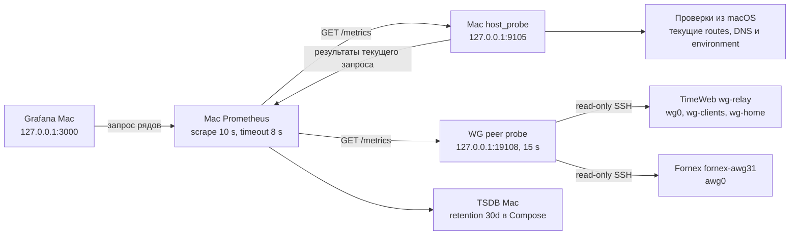

## Назначение и текущий статус

Архитектура **локального мониторинга запросов Mac**, сверенная с master:
[System/vpn-connectivity](<../../services/monitoring/vpn-connectivity/README.md>).
Операционная сводка: [VPN_Connectivity_Monitoring_Quick_Guide](<../operations/VPN_Connectivity_Monitoring_Quick_Guide.md>).
Отдельный серверный контур: [TimeWeb_Uplink_Pilot_Quick_Guide](<../operations/TimeWeb_Uplink_Pilot_Quick_Guide.md>).

Проверка 2026-09-15 подтвердила работающие Grafana, Prometheus и targets
`macbook-wg-peer`, `vpn-host-probe`, `timeweb-uplink-pilot`. Локальный
LaunchAgent `com.sergey.wg-peer-probe` читает server-side counters TimeWeb
WireGuard и Fornex AWG31 и формирует device-first metrics. Это подтверждает
работающий поток данных, но не приемку всех профилей/клиентов.

Снимок 2026-09-13 14:45:01 UTC (source reference not migrated)
с отсутствующими listeners остается историческим ограниченным аудитом:
пустой `local_docker` в нем не был доказательством отсутствия контейнеров.

Полная исходная версия с прежними планами и таблицами:
[agents/history/VPN_Connectivity_Monitoring_Architecture_Before_Review_2026-09-13](<../history/VPN_Connectivity_Monitoring_Architecture_Before_Review_2026-09-13.md>).
Исторические `utun4`, `10.8.1.3`, Fornex Amnezia и симптомы коротких
обрывов не являются текущей конфигурацией или новым диагнозом.

## Реализованный поток данных

Стрелки описывают локальный master, не факт запущенных процессов.
Probe находится на macOS, а не в Docker namespace. Но он не проверяет
тождественность своего маршрута пути браузера/приложения и не привязывает
запросы к заранее доказанному VPN-интерфейсу.

`metrics()` при каждом запросе получает default route и `ifconfig`,
параллельно запускает пять проверок, затем отдельно запрашивает public IPv4.
Нет отдельного scheduler, атомарного кэша последнего цикла, durable journal
или гарантии ответа менее секунды. Timeout/system DNS могут растянуть запрос;
10 s scrape не означает точный интервал завершенных наблюдений.

TimeWeb exporter устроен иначе: он читает готовую SQLite/health, не запускает
пробы по запросу. Его scrape в локальном Prometheus **30 s**, серверный
interval **120 s**. Эти числа нельзя переносить на Mac host probe.

## Метрики и фактические проверки

- `vpn_probe_up{check}`: gateway ping, external ICMP к 1.1.1.1,
  системный `getaddrinfo(api.ipify.org)`, HTTPS GET и небольшой HTTPS POST.
- `vpn_probe_latency_seconds{check}`: elapsed выполнения проверки,
  не чистый RTT. Отдельного throughput-теста нет.
- `vpn_probe_internet_up`: только curl GET exit, не кворум DNS/ICMP/upload.
- `vpn_probe_tunnel_up`: найден UP `utun`, не WG handshake.
- `vpn_probe_route_info`: default gateway/interface/IP, выбранный при обходе
  UP `utun`, public IPv4 и display name из карты адресов.

- `vpn_wg_peer_*`: наличие server peer, возраст/epoch handshake, WG/AWG
  counters, скорость и activity с labels устройства, тоннеля и `source`.
- `vpn_xray_client_*`: последнее access-событие Xray, его возраст и activity
  для подписанных MacBook/iPhone клиентов. Журнал не содержит счетчиков байтов
  на клиента, поэтому эти серии не дают IN/OUT.
- `vpn_device_*`: один выбранный active tunnel для каждого наблюдаемого
  устройства. Выбор — самое новое наблюдение: handshake WG/AWG младше 180 s
  либо access-событие Xray младше 90 s; при быстром переключении приоритет
  у более нового события. Последнее Xray-событие продолжает храниться для
  диагностики, но по истечении 90 s не делает карточку активной. Недавний
  access выделяется жёлтым и не доказывает открытое клиентское соединение.
- `vpn_flex_route_*`: отдельный read-only SSH-опрос `timeweb-flex-macbook status`
  возвращает проверенный FX/CEN и RU-direct для выделенного MacBook peer.
  Суффикс маршрута у активного `SOCKS-TW-FLEX` показывается только при свежем
  read-back; после 45 s без него маршрут неизвестен. Настройка маршрута сама
  по себе не делает профиль активным и не доказывает клиентскую связность.
- `vpn_source_observation_fresh`: freshness отдельного server source;
  отказ TimeWeb WG, Fornex AWG или TimeWeb Xray не обнуляет другие срезы.
  Последний срез остается видимым до 45 s, а скорость после source failure
  начинается с новой пары WG/AWG-счетчиков.

Эти серверные метрики являются server-side наблюдением. Они не заменяют
`vpn_probe_errors_total`, здоровье полного клиентского пути или timestamp
успеха каждой прикладной проверки.

HTTPS GET/POST не используют проверку ожидаемого HTTP-кода/body:
curl exit 0 может включать HTTP 4xx/5xx. POST с `vpn_probe=1` не измеряет
качество исходящего канала для видеосвязи.
Системный DNS не является специально направленной проверкой resolver через WG.

## Профили и границы доказанности

`SITE_PROFILE` и `EGRESS_PROFILE` являются заданными оператором labels.
Default `nakhimova_domru / fornex_amnezia` не подтверждает площадку/транспорт.
Одинаковый gateway на двух площадках не позволяет автоматически их различить.

Выбор последнего UP `utun` в выводе не подтверждает маршрут к цели.
Public IPv4 определяет совпадение с локальной картой адресов, но не протокол.
Например, прежнее имя Fornex Amnezia может соответствовать адресу, используемому
другим транспортом. Не делать из него вывод о текущей REALITY/WG-архитектуре.

Главный dashboard показывает фиксированные карточки **всех 21 устройств** из
[TimeWeb_VPN_Registry](<../registry/tunnels.md>), а не отдельные карточки для каждого профиля. Каждая
карточка находится после графиков и показывает один текущий наблюдаемый тоннель
TimeWeb WG, TimeWeb Xray/REALITY или Fornex AWG31 либо отсутствие активного
наблюдаемого тоннеля. Drill-down передает device и показывает его текущий
тоннель и все наблюдаемые WG/AWG/Xray-серии. Список устройств, 36 TimeWeb WG,
11 Fornex AWG31 peer и 13 подписанных TimeWeb Xray identity хранится в
`config/inventory/observations.json`, который
используют и exporter, и генератор dashboard; изменение реестра требует
синхронной правки inventory. Для Xray/REALITY выбор использует подписанное
access-событие, а не handshake: idle Xray-профиль без нового трафика не может
быть доказанно признан активным. Даже access младше 90 s является лишь
наблюдением серверного запроса, не проверкой текущего состояния VPN-клиента.

Профиль `SOCKS-TW-FLEX-S-MacBook.json` учитывается как одна Xray identity,
несмотря на четыре комбинации серверного маршрута. В карточке и DrillDown
комбинация видна как `SOCKS-TW-FLEX · FX/CEN · RU TW/FX/CEN`, только когда
активен этот профиль и read-back контроллера свеж. Файлы `SOCKS-TW-FX` на
Mac Mini и iPhone могут использовать ту же Xray identity, что их
`XRAY-TW-FX` файлы; число файлов и число наблюдаемых identity различаются.

DOWN отдельного ICMP/DNS не доказывает общий отказ Интернета.
UP GET не доказывает доступность всех сайтов, UDP, DNS/IPv6 leak protection,
fail-closed и стабильность браузера. Отсутствие scrape является отсутствием
наблюдения. Успех monitoring health не является успешной клиентской пробой.

## Хранение и безопасность

Local Compose задает **30d** Prometheus retention; это конфигурация, не
подтвержденные 30 дней coverage. Без работающих Mac/probe/Prometheus нет новых
точек; восстановление просмотра не восстанавливает пропущенные измерения.

Фактические master bind mounts: `./data/prometheus`, `./data/grafana`
в Dropbox System. Живые данные не перенесены вне файловой синхронизации.
Образы `prom/prometheus:latest` и `grafana/grafana:latest` не закреплены.
Перенос хранилищ и фиксация версий требуют отдельного изменения runtime.

Порты в конфигурации опубликованы на loopback. Аудит не обнаружил TCP listeners
на 3000/9090/9105/19106; доступность из контейнеров и другие порты не проверены.
Нельзя объявлять общую WAN/LAN-изоляцию доказанной по одному YAML или пустому
выводу ограниченного аудита. Probe не читает VPN-конфиги/ключи.
В Obsidian хранятся только документация и sanitized evidence.

## Открытая приемка

- Локальная доступность с exit codes/stderr и проверка фактически загруженных agents.
- Сопоставление labels, реального транспорта, конкретной цели и маршрута.
- Scrape duration/timeouts при отказах DNS/HTTPS; риск перекрытия запросов.
- Семантика HTTP-кодов/body и freshness, прежде чем считать зеленый индикатор
  строгой прикладной доступностью.
- Длительный baseline, сохранение gaps, восстановление истории из backup.
- Per-client byte counters для Xray/REALITY: для них потребуется отдельная
  безопасная реализация Xray Stats API на loopback с контролируемым рестартом
  сервиса; текущий access-журнал дает только недавнюю активность.
- Контролируемая проверка короткого обрыва: обнаружение не гарантировано
  одной настройкой 10 s.

Дальнейший порядок: [VPN_Connectivity_Monitoring_Implementation_Plan](<../reference/VPN_Connectivity_Monitoring_Implementation_Plan.md>).
В документационном ревью изменены только Markdown; проверки сети и runtime
не запускались.
