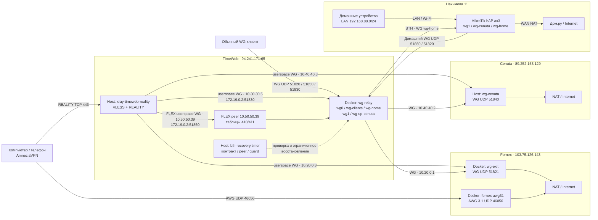

# VPN: общая архитектура

19 октября добавлен постоянный независимый SSTP/TCP443 между роутерами,
без изменения TimeWeb. Контроллер 3.0.0 объединяет маршруты устройств обеих
площадок в локальной вкладке Device routing: Нахимова permanent reservations
(Standard/Cenuta/Fornex/Direct), Фетхие Wi-Fi регистрации (Standard/Direct).
Назначение взаимоисключающее, с явной Apply и durable intent/readback.
Обратный выход проверен с роутера, клиентская приёмка Нахимова недоступна.
Direct не выбран; исходные четыре Cenuta и три Standard Нахимова сохранены,
Фетхие Standard. Автоматического fallback нет.
[Runbook и границы](../operations/Direct_SSTP.md).
История WG/IPIP и временных проверок ниже не заменяет этот текущий статус.

Site-to-site между Нахимова 11 и управляемой LAN Фетхие: 16 октября поднята
маршрутизируемая IPv4-связь через отдельный TimeWeb host WG.
[Текущий LAN changeset и границы приемки](Site_to_Site_LAN_Changeset.md).
Для Internet-выхода создан IPIP внутри WG; ограниченный тест MacBook через
Нахимова и возврат Local приняты по IPv4/HTTPS, сейчас Local.
[Результаты и границы приемки](Site_to_Site_Egress_Changeset.md).
Для прежнего WG/IPIP постоянный/обратный клиентский Internet-выход и
автоматическое резервирование не принимались. Состояние установленного
прямого SSTP описано выше; [целевой проект](Nakhimova_Fethiye_Site_to_Site_Design.md)
разделяет принятые и оставшиеся этапы. Deco остаётся основным роутером Фетхие.
18 октября владелец добавил UDP51972 forward и DHCP reservation MikroTik;
неустойчивым остался именно Direct WireGuard, не последующий SSTP/TCP443:
[локализация потери WG и границы вывода](../history/2026-10-18-direct-path-diagnosis.md).

## Хранилище После Переноса

С 10 октября рабочие исходники и документация находятся в этом Git checkout.
Секреты, профили, свежие host snapshots, backups и runtime — в исключённой
из Git `.local`; [реестр конфигурации](../registry/configuration.md) и
[правила хранения](../operations/storage-and-transfer.md) задают актуальные пути.
Ни клиентские identities, ни live routing при переносе не менялись.
FLEX fleet включает MacBook, iPhone 12 и MacMini; старые схемы ниже являются
датированным топологическим срезом, не текущей телеметрией. Проверенные
backup и monitoring результаты: [migration report](../migration/2026-10-10-execution-report.md).

## Границы достоверности

Серверный срез: **2026-09-13, 14:45 UTC**. Проверены SSH, процессы, контейнеры, WG peers, маршруты, native nftables и локальные профили. Срез хранится в `services/transport/documentation-audit-20260913/live.json`. В рамках ревью рабочая конфигурация не менялась.

Это не полная эксплуатационная приемка. При первоначальном ревью RouterOS SSH завершился timeout; в следующем этапе свежий export получен 16:02:58 UTC и включен в проверенный backup, см. [VPN_Maintenance_and_Backup](<../operations/maintenance-and-backup.md>). Описание правил MikroTik ниже основано на ранее прочитанном after-export и материалах BTH: сохранение нового export не заменяет его полный смысловой аудит.

При подготовке [шести интерактивных схем](<VPN_Diagrams.md>) из этого свежего export и runtime-проверок 23.09 отдельно сверены группы устройств, mangle, маршруты и backend UDP/WSS для FX/CEN. Это целевая проверка изображенной маршрутизации, не полный аудит RouterOS. Каталог содержит общую топологию, WG/RPDB, REALITY/DNS, домашний Smart Split, BTH и переключение транспорта; исходные JSON хранятся в System.

Полная схема действующих семейств профилей и отдельного FLEX-пилота: [TimeWeb_Universal_SOCKS_Route_Design](<TimeWeb_Universal_SOCKS_Route_Design.md>). FLEX развернут для MacBook 23.09; сквозная клиентская приемка ожидается.

## Три способа подключения

Из домашней LAN основной путь начинается с MikroTik: он поднимает WG до TimeWeb и выбирает Cenuta/Fornex либо прямой Дом.ру по Smart Split. Внешний доступ с компьютера/телефона является отдельным сценарием. Оба показаны в [общей топологии](<diagrams/01-topology.html>); все шесть схем собраны в [HTML-индексе](<diagrams/index.html>).

| Вход | Сервер входа | Транспорт | Выбор выхода |
| --- | --- | --- | --- |
| Обычный WireGuard | TimeWeb | Клиентский UDP 51820 / 51850 / 51830; FX/CEN backend: UDP или mTLS WSS | Профиль и server policy rules: Fornex, Cenuta, BTH; для части профилей RU split |
| VLESS + REALITY / SOCKS | TimeWeb | TCP 443, клиент AmneziaVPN; FX/CEN backend: UDP или mTLS WSS | Обычные identity: Fornex / Cenuta / BTH. FLEX MacBook: серверный выбор FX/CEN и RU-direct; SOCKS - локальный вход клиента |
| AmneziaWG 3.1 | Fornex напрямую | UDP 46056 | Только Fornex, без TimeWeb |

**Обычный WG сохранен. Удален только AWG 2.0 на Fornex.** Имя профиля в приложении не доказывает транспорт или выход; проверяются endpoint, серверная идентичность и внешний IP.

## Размещение модулей

Xray использует четыре встроенных userspace-WG outbound, включая выделенный FLEX MacBook. **Отдельного BTH worker и промежуточного SOCKS-сервера нет:** `SOCKS-TW-*` - это локальный SOCKS-вход, который создает клиентское приложение после импорта профиля. BTH recovery является служебным восстановителем, а не процессом передачи трафика. RU-direct FLEX выходит с публичного IP TimeWeb, не с домашнего IP; этот путь не показан как отдельный зарубежный сервер.

## Backend transport FX/CEN

Для `UP-F`, `UP-C`, `R-F` и `R-C` клиентский профиль не изменяется при переключении транспорта. В обычном режиме TimeWeb использует external UDP endpoint Fornex/Cenuta. В резервном режиме контроллер направляет relay и host Xray на разные loopback WSS endpoint, которые идут по mTLS WSS/TCP 8443 до того же зарубежного выхода. `BTH` через `wg-home` не участвует в этом механизме.

Переход на WSS для Fornex выполняется вручную. Cenuta может перейти на WSS после двух подтвержденных сбоев; возврат в native UDP выполняется вручную после отдельной проверки. Схема и список loopback endpoint: [backend transport FX/CEN](<diagrams/06-transport-switch.html>).

## Реестр транспортных связей

| ID | Источник / локальный адрес | Назначение | Размещение / назначение |
| --- | --- | --- | --- |
| WG-L | Клиенты `10.10.10.0/24` | TimeWeb UDP 51820 | `wg-relay/wg0`, legacy Fornex |
| WG-S | Клиенты `10.50.50.0/24` | TimeWeb UDP 51850 | `wg-relay/wg-clients`, selector и RU split |
| WG-H | Клиенты `10.30.30.3`, `.4`, `.6` | TimeWeb UDP 51830 | `wg-relay/wg-home`, прежний WG BTH |
| HOME-C | MikroTik `wg-cenuta`, `10.50.50.24` | TimeWeb UDP 51850 | Домашний Smart Split через `wg-clients` и Cenuta |
| HOME-F | MikroTik `wg1`, `10.10.10.24` | TimeWeb UDP 51820 | Домашний Smart Split через `wg0` и Fornex |
| HOME-H | MikroTik `wg-home`, `10.30.30.2` | TimeWeb UDP 51830 | Домашнее плечо BTH; полезный трафик идет от TimeWeb домой |
| UP-F | TimeWeb `10.20.0.1` | Fornex UDP 51821, `10.20.0.2` | `wg1 -> wg-exit/wg0` |
| UP-C | TimeWeb `10.40.40.2` | Cenuta UDP 51840, `10.40.40.1` | `wg-up-cenuta -> wg-cenuta` |
| R-F | Xray `10.20.0.3/32` | Fornex UDP 51821 | Outbound `wg-fornex` |
| R-C | Xray `10.40.40.3/32` | Cenuta UDP 51840 | Outbound `wg-cenuta` |
| R-H | Xray `10.30.30.5/32` | `172.19.0.2:51830` | Outbound `wg-bth -> wg-home -> MikroTik` |
| R-FLEX | Xray `10.50.50.39/32` | `172.19.0.2:51850` | Outbound `wg-flex-macbook -> wg-clients`; table 410 выбирает FX/CEN, RU-mark 0x39 направляет только RU IP в table 411 / TimeWeb; ожидает сквозной приемки |
| A-F | Клиенты `10.83.1.0/24` | Fornex UDP 46056 | Прямой AWG 3.1, 11 peers |

Число клиентских экспортов не равно сумме peers на интерфейсах: peers включают серверные связки и MikroTik. Полный перечень: [TimeWeb_VPN_Registry](<../registry/tunnels.md>).

## Маршрутизация обычного WG

В namespace `wg-relay`:

- Таблица `100`: default через `10.20.0.2 dev wg1`, Fornex.
- Таблица `200`: default через `wg-up-cenuta`, Cenuta.
- Таблица `300`: default через `wg-home`, MikroTik / Дом.ру.
- Приоритеты `180/181` сохраняют маршруты к клиентским сетям через main.
- Приоритет `190`: mark `0x30` в таблицу 300.
- Приоритет `219`: legacy `10.10.10.0/24` в таблицу 100.
- Правила `220–238`: адреса selector-клиентов в таблицы 100/200.
- Приоритет `300`: входящий `wg-home` в таблицу 300.

**RU split действует в native nftables `inet ru_bth`.** Пустой вывод `iptables-save -t mangle` не означает отсутствие маркировки. В `clients_v4` находятся `10.50.50.20–23` и `.26–37`; для них назначения из `ru_networks_v4` получают mark `0x30`. `.24/.25/.38` не входят в этот список. В данном срезе `legacy_clients_v4` пуст.

Эти правила не наследуются Xray и прямым AWG. Домашний Smart Split на MikroTik является еще одним, отдельным уровнем выбора маршрута.

## REALITY: выход и DNS

Обычные профили Fornex, Cenuta и BTH выбирают outbound по идентичности пользователя Xray; для них смена выхода выполняется выбором другого профиля. Выделенная FLEX identity MacBook направляет трафик в один WG peer, а FX/CEN и RU-direct выбираются на TimeWeb без переимпорта. Автоматического failover FX/CEN в FLEX нет. Для BTH прикладной Internet-трафик идет через MikroTik / Дом.ру; приватные подсети в REALITY заблокированы общей политикой.

Встроенный DNS Xray общий: `UseIPv4`, DoH `1.1.1.1` через Fornex и `1.0.0.1` через Cenuta; fallback разрешен. Это **не изолированный DNS для каждого профиля**. Внутренний DNS BTH также может выходить через зарубежный узел; пользователь разрешил произвольный DNS для BTH. Прямые DNS-запросы клиента и внутреннее разрешение имен Xray нужно проверять раздельно.

На MacBook ранее подтверждены запросы к обоим резолверам через utun без наблюдаемого прямого DNS на en0; это ограниченный тест, а не гарантия отсутствия утечек на всех устройствах и сетях.

## Защита от прямого выхода

- Host Xray работает как `reality-fornex` (UID 10001); firewall ограничивает его исходящие соединения.
- Разрешены четыре WG endpoint, включая узкий внутренний `172.19.0.2:51850/UDP` для FLEX, закрепленный REALITY target `23.12.156.37:443` и ответы установленных входящих TCP/443.
- Остальное исходящее от этого UID блокируется. Имя таблицы `inet reality_fornex` историческое: она обслуживает все три выхода.
- Дополнительные source guards стоят для REALITY-источников на Fornex, Cenuta и в namespace TimeWeb.
- `bth-recovery.timer` раз в 120 секунд проверяет контракт текущего BTH и может восстановить собственные peer/guard. Контракт принимает только известные native/WSS endpoint для FX/CEN, хеширует весь остальной Xray-конфиг и оба полных набора RPDB с фиксированными FLEX-правилами. Старый manifest не должен применяться к произвольно измененной конфигурации.

При ошибке контракта после закрепления namespace штатный recovery удаляет свой peer `.5`, закрывая BTH. Контракт включает весь набор policy rules; изменение selector-клиентов способно вызвать такой отказ на следующем цикле. Это зависимость текущей реализации, а не полная независимость BTH от старого WG.

Проверка постоянного drift не является универсальным монитором временного изменения и возврата (ABA). Полный reboot/recreate regression не принят. Подробнее: [TimeWeb_REALITY_Backup_and_Rollback](<../operations/TimeWeb_REALITY_Backup_and_Rollback.md>).

## Ресурсы

Срез 13 сентября, не нагрузочный тест:

| Хост | vCPU | RAM / доступно | Диск / свободно |
| --- | --- | --- | --- |
| TimeWeb | 1 | 1967 / 1448 MiB | 29 / 18 GiB приблизительно |
| Fornex | 1 | 1967 / 1401 MiB | 20 / 11 GiB приблизительно |
| Cenuta | 1 | 1968 / 1644 MiB | 48 / 44 GiB приблизительно |

На TimeWeb Xray ограничен 256 MiB и 50% CPU; измеренный MemoryCurrent около 15 MiB. BTH recovery ограничен 96 MiB, 20% CPU, 32 tasks и 30 секундами. AWG 3.1 на Fornex ограничен 256 MiB. Эти лимиты не означают гарантированную пропускную способность.

## Мониторинг и документация

Grafana/Prometheus на Mac не являются частью передачи VPN-трафика. Локальные порты 3000/9090/9105/19106 не слушали в данном срезе. Серверный pilot и история имеют отдельные ограничения: [TimeWeb_Uplink_Pilot_Quick_Guide](<../operations/TimeWeb_Uplink_Pilot_Quick_Guide.md>). BTH recovery не следует останавливать как «мониторинг».

- Клиенты и статус выдачи: [TimeWeb_VPN_Registry](<../registry/tunnels.md>).
- Мастер-копии, runtime, backups и статус скриптов: [VPN_Configuration_Registry](<../registry/configuration.md>).
- REALITY: [TimeWeb_VLESS_REALITY_Architecture_and_Plan](<TimeWeb_VLESS_REALITY_Architecture_and_Plan.md>).
- AWG: [Fornex_AWG31_Operations](<../operations/Fornex_AWG31_Operations.md>).
- Администрирование: [Host_Access_Guide](<../operations/access.md>).
- Итог сверки и оставшиеся риски: [VPN_Documentation_Review_2026-09-13](<../history/VPN_Documentation_Review_2026-09-13.md>).
