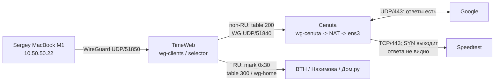

## Последняя проверка: guard-пробы 11:41 UTC

TimeWeb -> Cenuta через установленный `guardctl.sh`: gstatic HTTP 204
за 0.470666 s, Cloudflare HTTP 200 за 0.490434 s. Peer ping 2/2.
Fornex: HTTP 204/200 за 0.205550/0.213386 s, peer ping 2/2.
До/после `VALID generation=5`; отдельный targets snapshot с реальными
TTL, без продления старого или изменения routing. Это положительная
разовая проверка с RTNL watcher; постоянного collector пока нет.

Полный отчет и проверка обнаружения исходного отказа:
[TimeWeb_Uplink_Collector_Local_Implementation_2026-09-11](<TimeWeb_Uplink_Collector_Local_Implementation_2026-09-11.md>).
Evidence: `services/monitoring/timeweb-uplinks/evidence/20260911T114146Z-collector-live-verification/`.

## Предыдущая проверка: восстановление 11:12-11:14 UTC

2026-09-11 пользователь сообщил о возможном восстановлении после действий
поддержки. Агент проверил: TCP/TLS к тем же Google/Speedtest IPv4 теперь
работают непосредственно с Cenuta и через TimeWeb -> Cenuta. Прямые
HTTP-ответы 301/301/200 за 0.441/0.234/0.748 s, через uplink за
0.694/0.511/1.275 s. Два повтора с обычным DNS и redirects через uplink:
Google HTTP 200 за 1.142/1.181 s, Speedtest HTTP 200 за 1.214/1.159 s.
Внешний IP обеих HTTPS-проб `89.252.153.129`; все 10 HTTP-проверок успешны.

TimeWeb curl принудительно привязан `--interface if!wg-up-cenuta`, route
table 200/source `10.40.40.2` проверены. Это ручные curl-пробы, не запуск
постоянного collector и не повторное использование просроченного DNS manifest.
Guard check `VALID generation=5` до/после. WG/SSH/nftables активны,
failed units 0, handshake MacBook M1 свежий. Нагрузочный speed test не запускался.

Отказ на момент этой проверки устранен. Кто и что изменил у провайдера,
не установлено; связь с обращением в поддержку не доказана. Агент ничего
не устанавливал, не менял и не перезапускал. Длительную стабильность и
полную браузерную загрузку всех ресурсов на MacBook отдельно не проверяли.

Evidence в том же System-каталоге: `20260911T111205Z-recovery-check.json`.
Ниже сохранена исходная история диагностики отказа 10:19-10:37 UTC;
она не описывает последнее работающее состояние.

## Задача и границы

Пользователь сообщает: на Sergey MacBook активен Cenuta, google.com
открывается медленно, speedtest.net не загружается. Проверяется реальный
клиент `10.50.50.22`, без переключения профиля, перезапуска VPN или изменения
маршрутов/firewall. Связанный журнал: [Восстановление_доступа](<../reference/Восстановление_доступа.md>).

Код и captures:
`services/monitoring/timeweb-uplinks/diagnostics/20260911-macbook-selective-access/`.

## Методика разбора

Два синхронных ограниченных capture: TimeWeb 10:21:11-10:23:41 UTC,
Cenuta 10:21:13-10:23:43 UTC. Сохраняются текстовые заголовки, не HTTP body;
snaplen 96, kernel drops 0. TimeWeb фильтруется по клиенту 10.50.50.22;
после SNAT на Cenuta сверяются destination, порт, TCP sequence и время.
В Cenuta capture также попадают другие пользователи relay и собственные
пробы: общий объем нельзя приписывать MacBook без корреляции.

Первый parser допускал произвольное число октетов: IP без порта в ICMP
строке ошибочно делился на трехоктетный IP и порт. Такие промежуточные
UDP-строки исключить из выводов. Предотвращающее правило: ровно четыре
октета с IPv4Address validation, отдельные TCP/UDP/DNS и ICMP записи;
обязательный отрицательный fixture для ICMP без портов. Raw captures
не меняются, после исправления пересчитывается производная сводка.

TCP flags рассматриваются как набор: `SEW` тоже является исходным SYN,
а `S.` является SYN-ACK. Fixtures проверяют оба варианта SYN. Итоговая
сводка ниже пересчитана с учетом ECN; ранние промежуточные числа не использовать.
При корреляции повторных SYN нельзя превращать число совпадений по времени
в процент потерь: один sequence повторяется несколько раз.

## Итог

**Cenuta работает частично: UDP/443 с реального MacBook передается в обе
стороны, но проверенные новые TCP-соединения не устанавливаются.**
Для отдельного контролируемого TCP-соединения Cenuta -> TimeWeb:22
подтверждена потеря SYN-ACK на обратном участке между сетевыми интерфейсами
двух VPS. Конкретный промежуточный узел и причина потерь не установлены.
Формулировки «весь Cenuta VPN недоступен» и «доказана блокировка РКН»
из этих измерений не следуют.

## Клиент и маршрутизация

| Параметр | Проверенное значение |
| --- | --- |
| Устройство | Sergey MacBook M1 |
| Конфиг | `sergey-macbook-m1-cenuta-domru.conf` |
| WG IPv4 | `10.50.50.22/32` |
| Endpoint клиента на TimeWeb в 10:19:15 UTC | `194.61.140.217:60679` |
| Последний handshake клиента в этом снимке | 10:18:36 UTC |
| Маршрут обычного внешнего IPv4 | rule 222, table 200, `wg-up-cenuta` |
| Исключение RU | mark `0x30`, rule 190, table 300, `wg-home` |
| DNS в конфиге | `1.1.1.1`, `8.8.8.8` |
| MTU WG / MSS в клиентских SYN | 1420 / 1380 |

Реестр: [TimeWeb_VPN_Registry](<../registry/tunnels.md>). `wg-relay` PID 1181; существующие probe
guards не изменялись. Финальная проверка 10:37:01 UTC: `VALID generation=5`.

## Google и Speedtest

За окно TimeWeb 10:21:11-10:23:41 UTC:

| Наблюдение | Результат |
| --- | --- |
| Google `142.251.153.119:443`, UDP | 1343 исходящих и 1812 входящих пакетов |
| Полученные UDP payload bytes от этого Google IP | 2 033 971 байт, сумма длин пакетов, не уникальные байты приложения |
| Speedtest, TCP/443 | 15 различных потоков с SYN; 110 SYN-пакетов с учетом повторов и ECN |
| Ответы TCP с проверенных Speedtest IP клиенту | 0, включая SYN-ACK |
| TCP на интерфейсах Cenuta в основном capture | Только исходящие SYN/SEW; входящих TCP в фильтре не наблюдалось |
| TCP-ответы на TimeWeb клиенту | Только `178.238.124.142:443`, адрес входит в RU-исключения |

Проверенные адреса Speedtest: `104.17.147.22`, `104.17.148.22`,
`151.101.2.219`, `151.101.66.219`, `151.101.130.219`.
Они соответствовали DNS для `speedtest.net` / `www.speedtest.net`.
Реальный обмен Google UDP/443 виден на обеих сторонах Cenuta:
`wg-cenuta` и `ens3`, до и после NAT. Это не случай обхода Cenuta.

UDP/443 согласуется с QUIC/HTTP/3; HTTP/3 использует QUIC, а QUIC работает
поверх UDP. Сам HTTP-протокол браузера не расшифровывался, поэтому QUIC/HTTP/3
здесь является интерпретацией, а не результатом чтения HTTP-заголовков.
Источники: [RFC 9114](https://www.rfc-editor.org/rfc/rfc9114.html),
[RFC 9000](https://www.rfc-editor.org/rfc/rfc9000.html).

Такое различие объясняет возможность открытия Google при отказе TCP curl.
Медленная загрузка может быть связана с ожиданием TCP-ресурсов/fallback, но
браузерный waterfall и измерение скорости в этой проверке не собирались.
Использованный на VPS curl 8.5.0 не имеет HTTP3 в Features.

### Сквозная корреляция SYN

Один и тот же пакет к `104.17.147.22:443`, sequence `3818550955`:

| Epoch timestamp | Где замечен | Source |
| --- | --- | --- |
| 1789122081.826893 | TimeWeb, `wg-clients In` | `10.50.50.22:57733` |
| 1789122081.898279 | Cenuta, `wg-cenuta In` | `10.40.40.2:57733` |
| 1789122081.898298 | Cenuta, `ens3 Out` | `89.252.153.129:57733` |

SYN действительно проходит клиентский WG, relay, uplink и NAT Cenuta.
Аналогичные примеры для других Speedtest IP находятся в `packet-summary.json`.

### Контроль без клиента и без TimeWeb relay

В 10:23:05-10:23:40 UTC прямые curl с Cenuta, с фиксированным IP через
`--resolve`, `--http1.1`, connect timeout 6 s:

| Цель | С Cenuta | С Fornex к тому же IP, HTTPS |
| --- | --- | --- |
| `google.com`, `192.178.24.174` | TCP/80 и TCP/443 timeout | HTTP 301, 0.285 s |
| `speedtest.net`, `151.101.130.219` | TCP/80 и TCP/443 timeout | HTTP 301, 0.041 s |
| `www.speedtest.net`, `104.17.147.22` | TCP/443 timeout | HTTP 200, 0.302 s, 204859 bytes |

Контроль Fornex выполнен в 10:23:35 UTC. Это загрузка HTTP-страниц/redirect,
не запуск нагрузочного speed test. DNS исключен из этих сравнений фиксированным
IP, а TLS даже не начинается на Cenuta. SYN мал; уменьшение MTU не обосновано
как средство исправления именно наблюдаемого отказа TCP handshake.

## Точный контроль обратного TCP пути

В 10:35:57-10:36:08 UTC выполнен `nc` из Cenuta к `94.241.171.65:22`.
Capture TimeWeb стартовал после READY 10:35:37 UTC на 35 секунд, capture
Cenuta создан 10:35:56 UTC на 12 секунд: нужные окна пересекаются.

| Точка наблюдения | SYN Cenuta -> TimeWeb | SYN-ACK TimeWeb -> Cenuta |
| --- | --- | --- |
| Cenuta `ens3` | 6 отправлено | 0 получено |
| TimeWeb `eth0` | Те же 6 получено | 9 отправлено с учетом повторов |

Один поток: `89.252.153.129:42878 -> 94.241.171.65:22`, SYN sequence
`646758583`. TimeWeb отвечает SYN-ACK с ack `646758584`. Первый SYN:
Cenuta 10:35:57.044639; TimeWeb 10:35:57.083940; ответ TimeWeb
10:35:57.084049. Ни одного входящего пакета в capture Cenuta нет.
Kernel drops в обоих захватах: 0.

Это локализует потерю ответов **между выходом из гостевой ОС TimeWeb и
входом в гостевую ОС Cenuta** для этого TCP-потока. Причиной могут быть
внешний firewall/security group, фильтрация/ошибка провайдерской сети или
другой промежуточный узел. Это не доказательство конкретного оператора
блокировки и не определяет направление потерь для всех возможных потоков.

Дополнительное наблюдение: MSS SYN между точками меняется с 1460 на 1436.
Место переписывания не определено; само по себе это не доказывает причину отказа.
На Cenuta `tc` не показал ingress/egress filters, qdisc TX drops=0,
TX errors/dropped=0; накопленных RX dropped=19 нельзя приписать этому тесту.

### Ограничения управляющего теста

- Первая попытка TCP/22 дала непересекающиеся окна и не используется для
  сравнения сторон. Последующий автоматический запуск устранил этот дефект.
- Во второй попытке локальный wrapper завершился по 30 s SSH timeout,
  но оба удаленных capture успели выполниться и сохраниться. В 10:37 UTC
  получены их содержимое и tcpdump counters; вывод основан на этих файлах,
  а не на коде возврата wrapper. SSH к Cenuta при повторном чтении успешен.
- Только для контролируемого TCP/22 известны обе внешние стороны.
  Для Speedtest доказан выход SYN через Cenuta и отсутствие видимого ответа,
  но захват на сервере Speedtest отсутствует.

## Что исключено и что остается открытым

- Полный отказ WG или всего UDP не подтверждается: идет реальный обмен.
- В TimeWeb не потеряна привязка MacBook к Cenuta; сквозные SYN подтверждают маршрут.
- Сбой воспроизводится напрямую с Cenuta, без клиентского WG и probe guards.
- DNS-ответы клиент получает; это не доказывает идеальное качество DNS,
  но не объясняет отсутствие ответа на уже отправленный IPv4 SYN.
- Успешный TCP к `178.238.124.142` не опровергает сбой Cenuta: адрес входит
  в `178.238.112.0/20` набора `ru_networks_v4`, обслуживаемого BTH/Home.
- В клиентском конфиге есть `::/0`; IPv6 default в relay отсутствует.
  Возможную задержку IPv6 fallback отдельно не измеряли. Она не объясняет
  подтвержденную потерю IPv4 SYN-ACK.
- Проверка не устанавливает длительность/периодичность сбоя и не измеряет
  пропускную способность. Предыдущие результаты не переносятся на все время суток.

## Дальнейшие действия

1. Передать Cenuta время в UTC, TCP tuple и парные captures: попросить
   проверить доставку входящих SYN-ACK, внешние ACL/security groups и NAT/conntrack
   платформы. Не ограничиваться ответом «SSH и ping работают».
2. Для восстановления работы использовать проверенный Fornex-профиль после
   согласования переключения. В рамках этой диагностики клиент не переключался.
3. После ответа поддержки повторить фиксированные TCP-тесты и двухсторонний
   захват, затем проверить Google/Speedtest с MacBook. Только после этого
   объявлять Cenuta исправной.

## Evidence и изменения

В указанном выше каталоге System:

- `timeweb/client.capture`, `cenuta/egress.capture`, соответствующие stderr
  и snapshots counters; текстовые сетевые метаданные без HTTP body/секретных ключей.
- `packet-summary.json`, `analyze_captures.py`, `observations.json`.
- `tcp22-control-v2-recovery.json`: обе стороны финального TCP/22 теста,
  таймстампы, counters и финальная проверка guards.
- `capture_timeweb.sh`, `capture_cenuta.sh`, `fetch_captures.py`,
  `tcp22_control.py`: ограниченные диагностические скрипты, не постоянные службы.
- `archive-checksums.json`; `timeweb.tar.gz` SHA256
  `d7c57a8670cc369d19f0b3bb45189930f6d1d3739bd96b0ea144ddc0a109602e`;
  `cenuta.tar.gz` SHA256
  `047481ff610bac1b41907d4a3e3e46d7aa09d55bb1692963da6e020fc3344e98`.
  Эти два архива относятся к основному 150 s capture, без позднего TCP/22 теста.

Удаленные артефакты сохранены в `/root/cenuta-macbook-diag-20260911T101915Z/`
на каждом VPS. Пакеты не устанавливались, конфигурации, NAT/firewall, маршруты,
клиентские файлы и сервисы не изменялись/не перезапускались. Менялись только
диагностические артефакты и документация. Все запущенные captures ограничены
timeout и завершены. Локальные Python-скрипты запускались из
`python3`.

## Дополнение: firewall в панели провайдера

2026-09-11 пользователь прислал скриншот Firewall Settings. Incoming:
protocol all, ports all-all, source 0.0.0.0/0. Outgoing: protocol all,
ports 0-0, source 0.0.0.0/0. Видимые правила выглядят разрешающими.

В [спецификации CloudStack](https://cwiki.apache.org/confluence/plugins/viewsource/viewpagesrc.action?pageId=30738435)
для ALL диапазон destination ports не задается. Cenuta использует
[CloudStack/KVM](https://www.cenuta.com/cloud-bulut-sunucu). Интерпретация 0-0
как отображения неприменимого диапазона вероятна, но не подтверждена API
конкретной панели. Нельзя объявлять это правилом «разрешен только порт 0».
Также нельзя по скриншоту доказать, что правила корректно применены в сети.
Подробная фиксация: [Восстановление_доступа](<../reference/Восстановление_доступа.md>). Настройки не менялись;
провайдеру следует проверить виртуальный маршрутизатор/ACL и доставку SYN-ACK.
