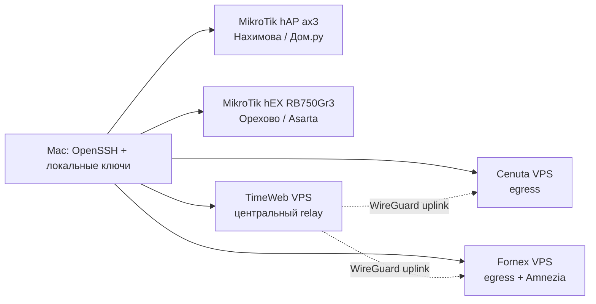

> Historical storage snapshot. Current paths and access: [Quick Guide](../quick-start.md).


## Назначение

Это единая инструкция по доступу к текущим MikroTik и VPN-хостам с локального
Mac. Документ предназначен для человека и для Claude Code: здесь собраны
команды, правила проверки подлинности сервера, ограничения учетных записей и
правила безопасной работы.

Полные конфигурации WireGuard, private keys, preshared keys, QR-коды и backup
файлы в этот документ не копируются. Они хранятся во внешнем
Dropbox System (source reference not migrated).

## Модель доступа



Для SSH используются два разных типа ключей:

- **клиентский SSH private key** на Mac доказывает право входа;
- **SSH public key** зарегистрирован на сервере или роутере;
- **server host key** в `known_hosts` подтверждает, что подключение идет к
  ожидаемому серверу.

X.509/TLS-сертификаты для обычного SSH-входа не требуются. Сертификаты,
перечисленные в карточке Fornex, относятся к BeAdmin/Web-интерфейсам и не
заменяют SSH-ключи: [Fornex_Parameters](<../hosts/fornex/Fornex_Parameters.md#сертификаты-и-ключевые-файлы>).

## Реестр узлов

| Узел | Сеть / провайдер | Адрес | SSH-пользователь | Локальный ключ | Особенность |
| --- | --- | --- | --- | --- | --- |
| MikroTik hAP ax3 | Нахимова / Дом.ру | `192.168.88.1` | `codex` | `.local/ssh/codex_mikrotik_20260704` | RouterOS 7.22.1; адрес совпадает с Орехово |
| MikroTik hEX RB750Gr3 | Орехово, Детская 11 / Asarta | `192.168.88.1` | `codex_audit` | `.local/ssh/codex_mikrotik_orekhovo_audit_rsa` | RouterOS 6.47; нужен RSA и отдельный `known_hosts` |
| TimeWeb | VPS / TimeWeb | `94.241.171.65` | `root` | `.local/ssh/codex_timeweb_audit_20260628` | Центральный Docker WireGuard relay |
| Cenuta | VPS / Cenuta | `89.252.153.129` | `ubuntu` | `.local/ssh/codex_cenuta_audit_20260628` | Host key недавно изменился; использовать scoped trust store |
| Fornex | VPS `34-278098` / Fornex | `103.75.126.143` | `root` | `.local/ssh/codex_fornex_audit_20260628` | Старый WireGuard и AmneziaWG работают параллельно |

### Критически важное совпадение адресов

`192.168.88.1` принадлежит двум географически разным площадкам. Это не один
роутер и не одна сеть:

- в сети Нахимова это hAP ax3, текущая домашняя площадка и Дом.ру;
- в сети Орехово это hEX RB750Gr3, площадка Детская 11 и Asarta.

Нельзя выбирать роутер только по IP. Сначала нужно убедиться, к какой сети
подключен Mac, затем использовать соответствующий SSH-ключ и trust store.
Нельзя заменять общую запись `192.168.88.1` в `.local/ssh/known_hosts` при
переключении между площадками.

## Локальные ключи и host keys

### SSH client keys

Private keys должны оставаться только в `~/.ssh/` и не должны попадать в
Obsidian, `.local/clients`, Git или сообщения. Публичные части можно использовать
для проверки fingerprint и загрузки на устройство:

- Нахимова hAP ax3: `.local/ssh/codex_mikrotik_20260704` и
  `.local/ssh/codex_mikrotik_20260704.pub`.
- Орехово RSA fallback: `.local/ssh/codex_mikrotik_orekhovo_audit_rsa` и
  `.local/ssh/codex_mikrotik_orekhovo_audit_rsa.pub`.
- Орехово неиспользуемый для RouterOS 6.47 Ed25519: `.local/ssh/codex_mikrotik_orekhovo_audit`.
- TimeWeb: `.local/ssh/codex_timeweb_audit_20260628` и
  `.local/ssh/codex_timeweb_audit_20260628.pub`.
- Cenuta: `.local/ssh/codex_cenuta_audit_20260628` и
  `.local/ssh/codex_cenuta_audit_20260628.pub`.
- Fornex: `.local/ssh/codex_fornex_audit_20260628` и
  `.local/ssh/codex_fornex_audit_20260628.pub`.

Для private key проверить только наличие и права, не выводя содержимое:

```bash
ls -l .local/ssh/codex_timeweb_audit_20260628
chmod 600 .local/ssh/codex_timeweb_audit_20260628
ssh-keygen -y -f .local/ssh/codex_timeweb_audit_20260628 >/dev/null
```

Последняя команда проверяет, что private key читается; она не должна печатать
ключ в отчет.

### Host-key files

- Основной trust store: `.local/ssh/known_hosts`.
- Отдельный trust store Cenuta после смены ключа: `.local/ssh/known_hosts_cenuta`. Создан `2026-08-16`, текущий рабочий.
- Временный trust store Cenuta, использовался до `2026-08-16`:
  `.local/ssh/known_hosts_cenuta_temp`. Не рабочий.
- Отдельный trust store Орехово: `.local/ssh/known_hosts_orekhovo`.

Fingerprint ключа хоста Орехово:

```text
SHA256:sN9lcdCa6o8b7MCx64L0YAss4/DP8k8i86W9CVSgSkk
```

Fingerprint текущего ED25519 ключа Cenuta:

```text
SHA256:30upF9x9nsySi8j1b2kb6mk5KVD3tesu5rMnZBR/eSE
```

Он получен после смены SSH host key; текущий рабочий trust store
`known_hosts_cenuta` использован при успешной SSH-сверке 2026-09-13.
Исторический `known_hosts_cenuta_temp` не использовать. Никогда не отключать
проверку ключа через `StrictHostKeyChecking=no` ради обхода ошибки идентификации.

RSA fingerprint клиентского ключа Орехово:

```text
SHA256:JcfoqEcOcZju0oqm8gJYsBYx+8Uc5Nsg0cuMpmDzjKk
```

## Общая процедура перед подключением

1. Подтвердить OS и сетевой контекст Mac. Для MikroTik проверить, к какой
   площадке подключен Mac, а не только наличие маршрута к `192.168.88.1`.
2. Проверить наличие нужного private key и права `600`.
3. Для обычного SSH использовать `IdentitiesOnly=yes`, чтобы агент не
   перебирал все ключи из Keychain.
4. Для production-хостов использовать `ConnectTimeout=10` и
   `StrictHostKeyChecking=yes`.
5. При изменении host key остановиться и получить подтверждение провайдера или
   владельца площадки. Не использовать `ssh-keygen -R` автоматически.
6. Сначала выполнить read-only identity check: hostname, OS/RouterOS version,
   serial/model или другой признак нужного узла.
7. Перед изменениями сделать backup/export и зафиксировать имя backup в
   журнале. Для этой задачи никакие изменения на хостах не предполагаются.

Базовая проверка SSH-среды на Mac:

```bash
command -v ssh
ssh -V
test -r .local/ssh/codex_timeweb_audit_20260628
test "$(stat -f '%Lp' .local/ssh/codex_timeweb_audit_20260628)" = 600
```

Проверка записи host key в scoped-файле:

```bash
ssh-keygen -F 89.252.153.129 -f .local/ssh/known_hosts_cenuta
ssh-keygen -F 192.168.88.1 -f .local/ssh/known_hosts_orekhovo
```

`ssh-keyscan` только получает ключ с сервера. Он не подтверждает, что сервер
подлинный. Полученный fingerprint нужно сравнить с данными провайдера или с
доверенным предыдущим backup, и только после этого использовать его в
`known_hosts`.

## Подключение к каждому узлу

### 1. MikroTik hAP ax3 — Нахимова / Дом.ру

Подключаться этой командой только когда Mac находится в сети Нахимова либо
имеет подтвержденный маршрут именно к этой площадке:

```bash
ssh -i .local/ssh/codex_mikrotik_20260704 \
  -o IdentitiesOnly=yes \
  -o ConnectTimeout=10 \
  codex@192.168.88.1
```

После входа минимальная read-only идентификация:

```routeros
/system identity print
/system resource print
/system routerboard print
```

Ожидаемые признаки: hAP ax3 и RouterOS 7.22.1. Если вывод похож на hEX,
RouterOS 6.47 или другой serial, соединение остановить: это, вероятно,
площадка Орехово.

Особые правила:

- не менять адрес `192.168.88.1` только для исправления доступа агента;
- текущие RouterOS exports/backups хранить в
  `System/Mikrotik/current/router` и `.local/backups`;
- для VPN сначала читать `/interface wireguard print`, peers, routes, mangle,
  NAT и address lists;
- перед записью обязательно делать свежий export и binary backup;
- не запускать команды с записью, если пользователь просил только аудит.

Связанные документы: [Current_Mikrotik_hAP_ax3_Config](<../hosts/nakhimova/Current_Mikrotik_hAP_ax3_Config.md>),
[MikroTik_Quick_Guide](<../quick-start.md>).

### 2. MikroTik hEX RB750Gr3 — Орехово, Детская 11 / Asarta

Рекомендуемый SSH-вызов:

```bash
ssh -i .local/ssh/codex_mikrotik_orekhovo_audit_rsa \
  -o IdentitiesOnly=yes \
  -o UserKnownHostsFile=.local/ssh/known_hosts_orekhovo \
  -o StrictHostKeyChecking=yes \
  -o PubkeyAcceptedAlgorithms=+ssh-rsa \
  -o PasswordAuthentication=no \
  -o ConnectTimeout=10 \
  codex_audit@192.168.88.1
```

Короткий вариант через уже настроенный alias:

```bash
ssh mikrotik-orekhovo
```

Проверка после входа:

```routeros
/system identity print
/system resource print
/system routerboard print
/user print detail where name=codex_audit
```

Известные признаки этой площадки:

- identity `MikroTik Root`;
- board `hEX`, model `RB750Gr3`, serial `8AFF0A501C19`;
- RouterOS `6.47`;
- провайдер Asarta;
- LAN `192.168.88.0/24`.

Ограничения `codex_audit`:

- группа имеет `ssh,read`;
- запрещены `write`, `policy`, `sensitive`, `password`, `reboot`, `test`,
  `winbox`, `web`, `api` и другие права, не нужные для чтения;
- `/ping`, traceroute и другие активные проверки могут требовать право
  `test`; его не добавлять без отдельного согласования;
- backup/export от имени read-only пользователя не считать доступными;
  административный backup выполняет владелец с отдельной учетной записью;
- не использовать `admin` для регулярного анализа.

RouterOS 6.47 требует RSA-клиент и legacy-совместимость `ssh-rsa`. Поэтому
нельзя заменять эту команду на Ed25519-вариант без обновления RouterOS и
повторной проверки.

Связанные документы: [Orekhovo_Detskaya_11_MikroTik](<../hosts/orekhovo/Orekhovo_Detskaya_11_MikroTik.md>),
[Orekhovo_Detskaya_11_Router_Configuration](<../hosts/orekhovo/Orekhovo_Detskaya_11_Router_Configuration.md>).

### 3. TimeWeb — центральный relay

```bash
ssh -i .local/ssh/codex_timeweb_audit_20260628 \
  -o IdentitiesOnly=yes \
  -o StrictHostKeyChecking=yes \
  -o ConnectTimeout=10 \
  root@94.241.171.65
```

Read-only первичная проверка:

```bash
hostnamectl
uptime
docker ps --format 'table {{.Names}}\t{{.Status}}\t{{.Ports}}'
docker exec wg-relay wg show
```

Роль узла:

- центральный Docker-контейнер `wg-relay` для обычного WG;
- host `xray-timeweb-reality.service` на TCP/443: Fornex/Cenuta/BTH;
- `bth-recovery.timer` поддерживает runtime-only BTH peer/guard по контракту;
- compose `/opt/wg/docker-compose.yml`;
- интерфейсы `wg0`, `wg-home`, `wg-clients`, `wg1`, `wg-up-cenuta` находятся
  внутри контейнера;
- клиентские конфиги и генераторы описаны в [TimeWeb_Parameters](<../hosts/timeweb/TimeWeb_Parameters.md>);
- текущие полные конфиги после изменений синхронизируются в
  `.local/clients`.

Правила:

- не искать WireGuard-интерфейсы только в host namespace: проверять их внутри
  `wg-relay`;
- старые изменяющие операции `/opt/wg-router/commands.sh` теперь заблокированы,
  recreate fallback удален; просмотр работает. Новое изменение клиентского
  контура требует fresh backup, preflight и отдельно подготовленного текущего
  diff с учетом BTH-контракта: [VPN_Maintenance_and_Backup](<../operations/maintenance-and-backup.md>);
- создание/удаление клиента выполняется только после проверки реестра и
  синхронизации актуального `.conf` в Dropbox System;
- при диагностике сопоставлять `wg show`, counters, handshake и реальный
  тестовый трафик; свежий handshake сам по себе не доказывает доступ в
  Интернет;
- не выводить private/preshared keys в отчет.

Штатные команды обычного WG внутри TimeWeb; `show-client` выводит секретный
config/QR и используется только в приватном терминале:

```bash
/usr/local/bin/wg-status
/opt/wg-router/commands.sh sessions
/opt/wg-router/commands.sh show-client
```

Связанные документы: [TimeWeb_Parameters](<../hosts/timeweb/TimeWeb_Parameters.md>), [TimeWeb_Client_Creation](<../operations/TimeWeb_Client_Creation.md>),
[TimeWeb_VPN_Registry](<../registry/tunnels.md>), [Восстановление_доступа](<../reference/Восстановление_доступа.md>).

### 4. Cenuta — Turkish egress

На Mac настроен alias в `~/.ssh/config`. Обычный вход:

```bash
ssh cenuta
```

Прежняя команда тоже работает благодаря тому же блоку `Host cenuta 89.252.153.129`:

```bash
ssh ubuntu@89.252.153.129
```

Оба варианта проверены реальным входом 2026-09-11. Используются пользователь
`ubuntu`, ключ `.local/ssh/codex_cenuta_audit_20260628`, отдельный
`.local/ssh/known_hosts_cenuta`, `IdentitiesOnly yes`, `StrictHostKeyChecking yes`,
`UpdateHostKeys no`; парольный вход и agent forwarding отключены на стороне
этого SSH-клиента для Cenuta. Серверные настройки не менялись.
Настройка действует только на этом Mac, не внутри SSH-сеанса на VPS.

Рабочий вариант: отдельный trust store `.local/ssh/known_hosts_cenuta`.
Он создан `2026-08-16`; вход повторно проверен `2026-09-11 08:46 UTC`.
Временный `_temp` больше не использовать; история перехода находится в
[Восстановление_доступа](<../reference/Восстановление_доступа.md>).

Полная команда для диагностики или другого Mac с этими же локальными путями:

```bash
ssh -i .local/ssh/codex_cenuta_audit_20260628 \
  -o IdentitiesOnly=yes \
  -o UserKnownHostsFile=.local/ssh/known_hosts_cenuta \
  -o StrictHostKeyChecking=yes \
  -o UpdateHostKeys=no \
  -o ConnectTimeout=10 \
  ubuntu@89.252.153.129
```

Без блока Cenuta в локальном SSH-конфиге короткая команда использует общий
`known_hosts`. Там сохраняются прежние ключи этого адреса, поэтому до
настройки блока она выдавала `REMOTE HOST IDENTIFICATION HAS CHANGED`.
Общий файл оставлен без изменений. Предъявленный ED25519
`SHA256:30upF9x9nsySi8j1b2kb6mk5KVD3tesu5rMnZBR/eSE` совпадает с записью
отдельного store и ранее наблюдавшимся ключом; повторный вход со строгой
проверкой успешен. Это не новая смена относительно отдельного store и
не ошибка пароля. При любом другом fingerprint остановиться для проверки.
Общий файл ключей не очищать ради подавления предупреждения. Совпадение
сохраненного ключа не объясняет причину первоначальной смены в августе.

Проверка 2026-09-11 08:54 UTC: `sudo passwd -S ubuntu` возвращает
`ubuntu L 2026-06-22 0 99999 7 -1`. Статус `L` означает блокировку пароля,
а не запрет входа по SSH-ключу. Эффективные настройки SSH для подключения
с собственного адреса сервера: `passwordauthentication yes`,
`pubkeyauthentication yes`, `usepam yes`. Разрешение метода в SSH не
снимает блокировку пароля учетной записи. Когда и кем она установлена,
не выяснено; дата в выводе не является доказательством даты блокировки.

Команду подключения выше выполнять на Mac. При приглашении
`ubuntu@VM-...:~$` пользователь уже на Cenuta: повторный
`ssh ubuntu@89.252.153.129` подключает сервер к самому себе и не использует
приватный ключ с Mac. Копировать приватный ключ на VPS не нужно.
Для текущего доступа разблокировать пароль не требуется.

Read-only проверка после входа:

```bash
hostnamectl
uptime
sudo systemctl status wg-quick@wg-cenuta nftables --no-pager
sudo wg show wg-cenuta
curl -4 --max-time 10 https://api.ipify.org
```

Особые правила:

- VPS использует host-level `wg-quick@wg-cenuta` и `nftables`, Docker для этой
  роли не используется;
- интерфейс `wg-cenuta` слушает `51840/udp`;
- пользователь `ubuntu` имеет passwordless sudo, но команды с `sudo` все равно
  считать потенциально изменяющими состояние и выполнять только по задаче;
- смена host key уже происходила, поэтому нельзя принимать новый ключ без
  внешней проверки;
- текущий доверенный store: `.local/ssh/known_hosts_cenuta` (создан `2026-08-16`).
  Временный `.local/ssh/known_hosts_cenuta_temp` больше не является рабочим;
  подтверждение смены host key от провайдера остается открытым вопросом и
  не отменяет использования постоянного store;
- не использовать `StrictHostKeyChecking=no` и не удалять записи из общего
  `known_hosts` автоматически.

Связанные документы: [Cenuta_Parameters](<../hosts/cenuta/Cenuta_Parameters.md>), [Восстановление_доступа](<../reference/Восстановление_доступа.md>).

### 5. Fornex: WG egress и AWG 3.1

```bash
ssh -i .local/ssh/codex_fornex_audit_20260628 \
  -o IdentitiesOnly=yes \
  -o StrictHostKeyChecking=yes \
  -o ConnectTimeout=10 \
  root@103.75.126.143
```

Read-only первичная проверка:

```bash
hostnamectl
uptime
docker ps --format 'table {{.Names}}\t{{.Status}}\t{{.Ports}}'
docker ps --format '{{.Names}}' | while read c; do echo "--- $c"; docker exec "$c" wg show 2>/dev/null || true; done
```

Роли:

- старый WireGuard exit: Docker `wg-exit`, UDP `51821`;
- прямой AWG 3.1: Docker `fornex-awg31`, UDP `46056`, 11 peers;
- старый `amnezia-awg2` удален 2026-09-13; не использовать UDP 46055;
- `wg-exit` обслуживает обычный WG и REALITY Fornex; его не перезапускать ради AWG;
- действующие контуры не останавливать во время диагностики без отдельного решения;
- VPS ID в панели: `34-278098`;
- текущая спецификация: [Fornex_Parameters](<../hosts/fornex/Fornex_Parameters.md>).

Сертификаты BeAdmin для SSH-входа не нужны; их актуальность этим ревью не проверялась.
Не копировать `/etc/ssl/...`, private keys WireGuard или Amnezia в Obsidian.

## Передача файлов

Полные конфиги передавать только в Dropbox System. Например, после создания
клиента на TimeWeb:

```bash
scp -i .local/ssh/codex_timeweb_audit_20260628 \
  -o IdentitiesOnly=yes \
  root@94.241.171.65:/root/wg-client-exports/<client-name>-cenuta.conf \
  .local/clients/
```

После копирования:

```bash
chmod 600 .local/clients/<client-file>.conf
```

Не копировать полные `.conf` в Obsidian, `Downloads` без необходимости или в
исторические agent-документы. В Obsidian фиксировать только имя, назначение,
IP и статус, если это не раскрывает секреты.

Для старого RouterOS 6.47 может потребоваться legacy SCP-режим:

```bash
scp -O -i .local/ssh/codex_mikrotik_orekhovo_audit_rsa \
  -o IdentitiesOnly=yes \
  -o UserKnownHostsFile=.local/ssh/known_hosts_orekhovo \
  codex_audit@192.168.88.1:<file> ${SYSTEM_ROOT}/Mikrotik/current/orekhovo-router/
```

Если RouterOS не разрешит чтение файла через `codex_audit`, не подбирать пароль
и не использовать `admin` автоматически: административный перенос выполняет
владелец вручную после отдельного согласования.

## Политика изменений

Для любых изменений на production-хостах соблюдать порядок:

1. Прочитать текущие параметры и соответствующую карточку узла.
2. Выполнить read-only проверку доступности, identity и состояния сервисов.
3. Создать backup/export во внешнем `System/Mikrotik`.
4. Записать план и команду изменения до выполнения.
5. Выполнить одну операцию, проверить результат, затем переходить к следующей.
6. Обновить текущий документ состояния и журнал работы.
7. Для WireGuard-клиента синхронизировать полный конфиг в
   `.local/clients` и проверить, что реестр соответствует файлу.

При запросе пользователя «ничего не менять» разрешены только чтение,
диагностика и сохранение отдельного evidence-файла. Команды `apt upgrade`,
`systemctl restart`, `wg syncconf`, `docker compose up`, изменение firewall,
удаление клиента и редактирование RouterOS считаются изменениями.

## Инструкция для агента Claude Code

### Инструменты

Claude Code должен использовать локальные инструменты так:

- **`Bash`** — локальные `ssh`, `scp`, `ssh-keygen`, `ssh-keyscan`, `docker`,
  `networksetup`, а также одноразовые удаленные команды через SSH;
- **`Read`** — чтение `AGENTS.md`, `docs/agent/CONVENTIONS.md`, этого runbook,
  карточки конкретного узла и журналов;
- **`Grep`** — поиск актуальных команд, IP, имен конфигов и host-key правил;
- **`Glob`** — поиск документов и локальных `.pub`/`known_hosts` файлов без
  чтения private key;
- **`Edit`** — изменение Markdown-документов. Не заменять `Edit` shell-командой
  `cat > file` или массовым неидемпотентным скриптом;
- **`AskUserQuestion`** — запрос подтверждения при несовпадении host key,
  необходимости права `test`, изменении production или неясном сетевом
  контексте.

Специальный «SSH-инструмент» не нужен: Claude Code вызывает системный OpenSSH
через `Bash`. Учетные данные берутся только из локального `~/.ssh` и Keychain,
а не из текста prompt. Не использовать браузерную панель провайдера как замену
проверке SSH, если нет отдельной задачи работать с UI.

### Порядок действий агента

1. Прочитать `AGENTS.md`, `docs/agent/CONVENTIONS.md`, этот документ и
   связанный host-state документ.
2. Найти точный узел по имени, IP, площадке и ключу. Для адреса
   `192.168.88.1` обязательно выбрать `home` или `orekhovo` по сетевому
   контексту.
3. Проверить наличие ключа:

   ```bash
   test -r .local/ssh/codex_cenuta_audit_20260628
   test "$(stat -f '%Lp' .local/ssh/codex_cenuta_audit_20260628)" = 600
   ```

4. Подключиться с `IdentitiesOnly=yes`, `ConnectTimeout=10` и правильным
   `UserKnownHostsFile`.
5. Выполнить одну короткую read-only команду идентификации. Не начинать с
   перезапуска сервиса, обновления пакетов или просмотра секретного конфига.
6. Сохранить краткий результат в ответе и, если задача требует, в
   соответствующем Obsidian-журнале без private/preshared keys.
7. Для live-диагностики собрать коррелированные данные: время, handshake,
   counters, маршрут и реальный тест трафика. Не делать вывод о доступности
   только по одному handshake.
8. При изменении сначала выполнить backup и остановиться на approval gate.
   После подтверждения выполнять команды по одной, читать результат и только
   затем продолжать.

### Шаблоны вызовов Claude Code

Одноразовая проверка TimeWeb:

```bash
ssh -i .local/ssh/codex_timeweb_audit_20260628 \
  -o IdentitiesOnly=yes \
  -o BatchMode=yes \
  -o ConnectTimeout=10 \
  root@94.241.171.65 'hostname; date -u; docker ps --format "{{.Names}} {{.Status}}"'
```

Одноразовая проверка Cenuta через временный trust store:

```bash
ssh -i .local/ssh/codex_cenuta_audit_20260628 \
  -o IdentitiesOnly=yes \
  -o UserKnownHostsFile=.local/ssh/known_hosts_cenuta \
  -o StrictHostKeyChecking=yes \
  -o BatchMode=yes \
  -o ConnectTimeout=10 \
  ubuntu@89.252.153.129 'hostnamectl --static; sudo wg show wg-cenuta'
```

Одноразовая проверка Орехово:

```bash
ssh -i .local/ssh/codex_mikrotik_orekhovo_audit_rsa \
  -o IdentitiesOnly=yes \
  -o UserKnownHostsFile=.local/ssh/known_hosts_orekhovo \
  -o StrictHostKeyChecking=yes \
  -o PubkeyAcceptedAlgorithms=+ssh-rsa \
  -o PasswordAuthentication=no \
  -o BatchMode=yes \
  -o ConnectTimeout=10 \
  codex_audit@192.168.88.1 '/system identity print'
```

Для интерактивной RouterOS-сессии Claude Code должен использовать TTY/PTY,
если это поддерживает его shell-инструмент. Если интерактивная сессия недоступна,
использовать короткие одноразовые вызовы SSH и не пытаться эмулировать ввод
паролей через shell.

### Что агенту запрещено

- выводить `cat ~/.ssh/private_key`, `cat *.conf`, `wg showconf` с секретами или
  переменные окружения с ключами;
- использовать `StrictHostKeyChecking=no`, `UserKnownHostsFile=/dev/null` или
  автоматически принимать изменившийся fingerprint;
- удалять запись из `known_hosts`, если причина смены ключа не подтверждена;
- использовать RSA compatibility для любого узла, кроме старого RouterOS
  Орехово;
- выполнять destructive/change-команды без явного подтверждения пользователя;
- считать успешный SSH handshake или WireGuard handshake доказательством
  полноценного доступа в Интернет;
- параллельно выполнять несколько операций записи на production-хостах;
- сохранять private keys, preshared keys и полные client configs в Obsidian или
  в отчетах.

### Обработка ошибок

| Ошибка | Действие агента |
| --- | --- |
| `REMOTE HOST IDENTIFICATION HAS CHANGED` | Остановиться, получить текущий fingerprint, сравнить с провайдером/владельцем, не удалять запись автоматически |
| `Permission denied (publickey)` | Проверить user, private key, права `600`, `IdentitiesOnly`; не переходить сразу к паролю |
| `Connection timed out` | Проверить маршрут/порт/площадку, сохранить точный результат; не менять firewall вслепую |
| `Connection refused` | Зафиксировать, что узел доступен, но сервис не слушает порт; проверить панель/сервис read-only |
| RouterOS `no matching ... ssh-rsa` | Для Орехово использовать RSA-команду с `PubkeyAcceptedAlgorithms=+ssh-rsa` |
| Попался не тот MikroTik на `192.168.88.1` | Завершить сессию, проверить сетевой контекст и использовать правильный scoped `known_hosts` |
| Команда требует пароль или права записи | Не подбирать пароль; остановиться и запросить пользователя/approval |

## Минимальный чек-лист завершения аудита

- [ ] Указаны площадка, provider, IP, user и фактически использованный key.
- [ ] Host key проверен через правильный `known_hosts`.
- [ ] Подтверждены hostname/identity, OS или RouterOS version и модель.
- [ ] Не выведены private keys, preshared keys, QR-коды и полные configs.
- [ ] Для production изменения не выполнялись без approval.
- [ ] Если были изменения, создан backup и обновлены соответствующие
      `System/Mikrotik` и `.local/clients`.
- [ ] Результат и ограничения зафиксированы в текущем host-state или журнале.

## Связанные документы и внешнее хранилище

- [MikroTik_Quick_Guide](<../quick-start.md>) — короткие операционные команды.
- [TimeWeb_Parameters](<../hosts/timeweb/TimeWeb_Parameters.md>) — текущая схема центрального relay.
- [TimeWeb_Client_Creation](<../operations/TimeWeb_Client_Creation.md>) — создание и синхронизация клиентов.
- [TimeWeb_VPN_Registry](<../registry/tunnels.md>) — реестр клиентских конфигураций.
- [Cenuta_Parameters](<../hosts/cenuta/Cenuta_Parameters.md>) — Cenuta host-level WireGuard и host-key incident.
- [Fornex_Parameters](<../hosts/fornex/Fornex_Parameters.md>) — Fornex WireGuard, AmneziaWG и сертификаты BeAdmin.
- [Current_Mikrotik_hAP_ax3_Config](<../hosts/nakhimova/Current_Mikrotik_hAP_ax3_Config.md>) — Нахимова hAP ax3.
- [Orekhovo_Detskaya_11_MikroTik](<../hosts/orekhovo/Orekhovo_Detskaya_11_MikroTik.md>) — площадка Орехово и доступ.
- [Orekhovo_Detskaya_11_Router_Configuration](<../hosts/orekhovo/Orekhovo_Detskaya_11_Router_Configuration.md>) — схема правил hEX.
- [Восстановление_доступа](<../reference/Восстановление_доступа.md>) — журнал восстановления Cenuta.
- docs/agents README (source reference not migrated) — правила для агентских документов.
- Dropbox System (source reference not migrated) — полные конфиги, backups, keys и
  технические evidence-файлы вне Obsidian.
