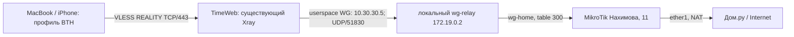

# REALITY BTH: запуск 2026-09-13

## Статус

Развернут работающий пилот BTH для MacBook Sergey и iPhone Sergey.
Серверная CLI-проверка выполнена, импорт в Amnezia на устройствах еще не принят.
**Новый relay peer runtime-only:** reboot или пересоздание wg-relay отключит
BTH до нового аудита и восстановления peer/защит. Автоматического reapply нет.
Постоянный wg-home.conf не изменялся; старые WG peers не перезапускались.

По поправке пользователя отдельный BTH worker не устанавливался. Серверное
разрешение имен использует существующий общий DNS через Fornex/Cenuta.
DNS-запросы, поступающие как пользовательский трафик BTH, идут через дом.
Автоматического переключения пользовательского egress между странами нет.

## Изменения

- Xray: новый wg-bth outbound, два независимых UUID, явное правило user -> wg-bth.
  Fornex/Cenuta UUID, outbounds и DNS сохранены. Первым outbound остается blackhole.
- Host nft: в собственной таблице reality_fornex добавлено разрешение UID Xray
  только к 172.19.0.2 UDP/51830. Перезапущен только xray-timeweb-reality.
- В namespace net:[4026532282], PID 1181: новая таблица inet reality_b5
  запрещает source 10.30.30.5 обращаться в INPUT, к private/служебным адресам
  и выходить через интерфейс, отличный от wg-home. Guard установлен до peer.
- MikroTik: отдельная цепочка REALITY-B5, input drop для нового source,
  private/management drop и разрешение только через ether1; завершающий drop.
  Jump расположен перед прежними forward-правилами. Адресный mangle accept
  исключает новый source из старых VPN marking policies. Другие адреса не затронуты.
- Старый wg-relay StartedAt остался 2026-07-10T00:10:37.662464526Z.

## Проверки

Новый Xray JSON и nft-таблицы проверены до применения, nft в isolated namespace.
Применение защищал 180-секундный таймер отката TimeWeb. После положительных
smoke/transfer проверок изменения committed. Конфигурации сверены с System.

| Проверка | Результат |
| --- | --- |
| IP через BTH | 5.18.237.241, HTTP 200; соответствует наблюдаемому домашнему endpoint |
| Российский сайт ya.ru с redirect | HTTP 200, около 1 с |
| Download 1 МиБ Cloudflare | HTTP 200, 1048576 байт, 1.722 с |
| Upload 1 МиБ Cloudflare | HTTP 200, 2.445 с |
| http://192.168.88.1 через профиль | curl 52, 0 байт |
| Удален только новый WG peer | BTH curl 28, 0 байт; Fornex и Cenuta HTTP 200 и свои IP |
| Peer восстановлен | BTH IP 5.18.237.241 и ya.ru HTTP 200 |

Счетчик REALITY-B5-WAN на MikroTik растет при пробах, подтверждая проход нового
source через дом. /tool fetch MikroTik запрещен device-mode; режим не меняли.
Отдельный независимый HTTP echo непосредственно с роутера не выполнен.

Первый тест ya.ru ошибочно требовал 200 без следования HTTP 302; тест исправлен
на ограниченный redirect. Один повторный ipify-запрос дал connect timeout.
Последующие запросы прошли; первопричина единичного таймаута не установлена,
длительная стабильность этим не доказана.

Артефакты services/transport/timeweb-reality:

- stage9-test-20260913T135500: положительный smoke.
- stage9-test-20260913T135514: transfer/private.
- stage9-test-20260913T135557: отказ нового peer.
- stage8-test-20260913T135604: Fornex/Cenuta во время отказа BTH.
- stage9-test-20260913T135623: восстановление BTH.

Это локальные Xray/SOCKS пробы через публичный REALITY, не Amnezia/TUN acceptance.
Удаление table 300, пересоздание namespace, reboot, проверка DNS private-name
и длительный baseline здесь не проводились. Нулевой объем private-запроса
не является полной проверкой всех обходов. HTTP 200 upload не проверяет хеш тела.

## Мастер и откат

Мастер: services/transport/timeweb-reality/stage9_bth.py, stage9_control.sh,
test_stage9.py. Защищенный stage9-bth содержит before/after, manifest,
router export, ключи и клиентские файлы. Секреты не переносятся в Obsidian.

Backup TimeWeb: .local/backups/timeweb/2026-09-13T1049Z_pre-reality/backup.tar.gz,
15767580 байт, SHA256 b949ac6d4f0f9c994997cd9b3a3e98e5badd82f1becdbff96b056d659c1d71d8.
Проверены архив, хеши и неизменность source; это не full-machine restore drill.
router.before.rsc является текстовым export с чувствительными данными (права 600),
а не бинарным RouterOS backup. Откат адресный, не полный импорт export.

Порядок отката из master через python3 -B:
stage9_bth.py rollback, затем stage9_bth.py router-rollback. Сначала прекращается
новый трафик и восстанавливается Xray, потом снимаются адресные защиты роутера.
Таймер TimeWeb сам возвращает Xray/peer/relay-guard; безопасные router source guards
при автоматическом откате остаются до явного router-rollback.
Старый manifest нельзя использовать после изменения namespace или конфигурации.

## Следующий этап

Импорт BTH на обоих устройствах и проверка IP/сайтов. Затем отдельно завершить
постоянное восстановление BTH с проверкой поколения и защит, не блокируя
Fornex/Cenuta при недоступности домашнего канала. Пока не обещать автозапуск BTH.
