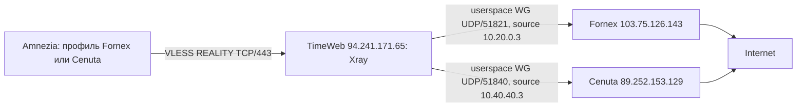

# REALITY: второй выход Cenuta, 2026-09-13

## Выполнено

После согласования пользователя добавлен отдельный userspace WireGuard outbound
`wg-cenuta` в существующий Xray на TimeWeb. Вход REALITY TCP/443 сохранен.
Новые UUID назначены отдельно MacBook Sergey и iPhone. Существующие идентификаторы
и выход Fornex не изменены. Автоматического переключения пользовательского выхода нет.

Cenuta: добавлен peer `10.40.40.3/32` в runtime и постоянную конфигурацию
`wg-cenuta`. Старый peer `.2` не удалялся. Создана отдельная nft-таблица
`inet reality_c3`: блокирует доступ нового source к самому серверу, частным
сетям, адресам VPS и выходу не через ens3. Существующие forward/NAT сохранены.
Guard включен в постоянный nftables.conf и PreUp WG; перезагрузка не проверялась.

TimeWeb: расширена только собственная таблица `inet reality_fornex`, добавлены
outbound и маршрутизация новых пользователей. Перезапущен только
`xray-timeweb-reality.service`; старый `wg-relay` сохранил StartedAt
`2026-07-10T00:10:37.662464526Z`.

DNS: основной DoH 1.1.1.1 через Fornex, резервный DoH 1.0.0.1 через Cenuta,
timeoutMs=3000, без прямого системного DNS. Резервирование настроено, но
отдельный cold-cache fault test основного DNS на этом этапе не выполнен.

## Проверки и артефакты

Мастер-копия: `services/transport/timeweb-reality/`.
Секретные before/after и manifest: `stage8-cenuta/`, не копировать в Obsidian.
Удаленный staging обоих хостов: `/var/backups/timeweb-reality/stage8-cenuta`.

Перед применением проверены Xray JSON и nft-конфигурации в отдельном namespace.
На каждом сервере был вооружен 180-секундный таймер точного отката. После
положительных smoke-проверок оба изменения committed; оба таймера inactive.
Runtime-файлы сверены с локальными after-копиями; canonical guards скачаны
локально, manifest обновлен. Новая установка пакетов не выполнялась.

| Проверка | Fornex | Cenuta |
| --- | --- | --- |
| ipify + Cloudflare trace | HTTP 200, 103.75.126.143 | HTTP 200, 89.252.153.129 |
| Download 1 МиБ | HTTP 200, 1.750 с | HTTP 200, 2.418 с |
| Upload 1 МиБ, ответ HTTP | 200, 2.535 с | 200, 3.095 с |
| Запрос private IP | Нет ответа приложения, curl 52 | Нет ответа приложения, curl 52 |
| Имя с private IP | Timeout, 0 байт | Timeout, 0 байт |

Smoke: `stage8-test-20260913T114501/report.json`.
Extended: `stage8-test-20260913T114521/report.json`.
Время каталогов локальное UTC+03. Это проверки локальным Xray/SOCKS клиентом
через публичный REALITY listener, а не проверка Amnezia/TUN на устройстве.
Timeout private-name сам по себе не доказывает корректную классификацию
результата DNS: он мог возникнуть до подключения. Upload HTTP 200 не является
проверкой побайтовой целостности принятого тела или длительной нагрузки.

## Backup и rollback

Run `2026-09-13T0833Z_pre-reality`, локально
`.local/backups/<host>/<run>/backup.tar.gz`.

- TimeWeb: 15766948 байт, SHA256 `9ec2a11e235810d9af412f13d6b33568f6957a66b069fcf840f899237b27376e`.
- Cenuta: 78601 байт, SHA256 `792520789d36f45d9a0cbe388bedae6baf7c63a99f64d76f20a50569df60b7fe`.

Архивы прочитаны и проверены по хешам, полного восстановления машины не было.
Для отката этого конкретного поколения: `stage8_cenuta.py rollback timeweb`,
затем `stage8_cenuta.py rollback cenuta` через `python3 -B`.
Helper проверяет точные хеши; при последующих изменениях не обходить отказ.
Общий route/rule/nft flush не применялся.

## Следующий приемочный этап

Импортировать отдельные Cenuta JSON из `.local/clients` в Amnezia на MacBook
и iPhone; проверить IP 89.252.153.129, DNS и сайты. Fornex-профили не заменять.
Проверки двух реальных устройств, длительный baseline, холодный DNS fallback,
fault/reboot acceptance и BTH на этом этапе не закрыты.
