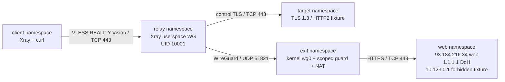

## Результат и границы

По согласию пользователя выполнен **шаг 3 для Fornex: локальные конфиги, новые
ключи и изолированные Linux-тесты**. Это не установка и не подтверждение работы
профиля в реальной сети. В рамках шага не было SSH-подключений к VPS, добавления
peers, изменения firewall, запуска Xray на TimeWeb или переключения клиентов.
Существующие WireGuard, Amnezia, Cenuta и BTH не затронуты.

Два завершенных чистых прогона: **20/20 записей проверок** в каждом, включая
снимок памяти; дополнительно **10 offline contract tests** и **6 проверок config**
самим Xray: три файла на ARM64 и AMD64. Неудачные подготовительные прогоны также
сохранены; они не подменены успешным итогом.

Связанные документы: [TimeWeb_VLESS_REALITY_Architecture_and_Plan](<../architecture/TimeWeb_VLESS_REALITY_Architecture_and_Plan.md>),
[TimeWeb_REALITY_Backup_and_Rollback](<../operations/TimeWeb_REALITY_Backup_and_Rollback.md>), [TimeWeb_REALITY_Step2_Backup_2026-09-12](<TimeWeb_REALITY_Step2_Backup_2026-09-12.md>).

## Master и подготовленные файлы

[Локальный master](<../../services/transport/timeweb-reality/README.md>)
находится в `Dropbox/services/transport/timeweb-reality/`.

| Файл/каталог | Назначение и состояние |
| --- | --- |
| `prepare_stage3.py` | Локальная подготовка pinned Xray и конфигов; не соединяется с VPS |
| `vendor/artifacts.json` | Официальные URLs, проверенные SHA-256 архивов и извлеченных бинарников |
| `vendor/amd64/xray`, `vendor/arm64/xray` | Xray v26.3.27, commit d2758a0; только локальные исполнения |
| `staging/fornex/secrets.json` | Новые REALITY/WG keys, PSK и независимые UUID MacBook/iPhone; не публиковать |
| `staging/fornex/server.loopback.json` | Staging listener 127.0.0.1:443; не установлен и не запущен |
| `staging/fornex/client-macbook.json`, `client-iphone.json` | Заготовки Xray JSON, не проверенный импорт Amnezia; не выданы в `.local/clients` |
| `staging/fornex/new-peer.fragment.conf` | Новый peer 10.20.0.3/32 для Fornex; **не применен** |
| `lab/input/` | Отдельные лабораторные идентичности, не реальные staging keys |
| `lab/run_lab.py`, `lab/test_contract.py` | Изолированный стенд и offline-проверки |
| `run_stage3_tests.py` | Ограниченный запуск Docker, отчеты, проверка неизменности inputs и cleanup |
| `stage3_artifact_inventory.json` | Перечень файлов, размеры, права и контрольные суммы; не deployment authorization |

Реальные ключи никогда не использовались для соединения стенда. Проверка Xray
`run -test` для staging JSON проводилась в контейнере `--network none`, без запуска
службы. Ключи, UUID и PSK в этот документ не включены. Каталоги закрыты правами 700,
секреты и конфиги 600; исполняемые vendor binaries находятся внутри закрытого master.

Python на Mac: `python3 -B`; дополнительные пакеты в эту
среду не устанавливались. В локальном test image создана своя `/opt/lab/.venv`
с dnspython 2.8.0 и h2 4.3.0. **На VPS Python, Xray и зависимости не устанавливались.**

## Устройство стенда

Весь стенд находится внутри одного временного Docker-контейнера на Mac. Внешняя
сеть отключена, host networking, опубликованных портов и Docker socket нет.
Пять Linux network namespaces; адреса ниже существуют только внутри стенда.

Только harness имеет NET_ADMIN/SYS_ADMIN внутри тестового контейнера, чтобы
создать namespaces. Процесс Xray работает с UID 10001 и только
`CAP_NET_BIND_SERVICE` (`CapEff=0x400`), без NET_ADMIN. Он не создавал kernel TUN,
WG-интерфейсы, маршруты или policy rules в relay namespace; снимки до/после совпали.
Kernel wg0 существует только на имитируемом exit и создается harness, не Xray.

OUTPUT guard нового UID разрешает лишь ответы клиенту, фиксированный WG endpoint
и отдельный REALITY target. Прямой маршрут к тестовому сайту **реально существует**:
это проверено контрольным запросом другого UID. Таким образом, отрицательный тест
не получает ложный успех лишь из-за отсутствия маршрута. Для UID Xray этот выход
заблокирован. Guard на exit проверяет фактический IP после DNS resolution.

Тестовый CA доверен только процессам внутри одноразового контейнера. Проверка
сертификатов не отключалась; доверие macOS/VPS не изменялось.

## Проверки

| Проверка | Итог |
| --- | --- |
| HTTPS по IP через REALITY + userspace WG | Сайт видит NAT exit 93.184.216.1, не relay |
| HTTPS по имени и DoH | DNS-запрос приходит на fixture от того же exit |
| Два отдельных UUID | Оба принимаются Xray; это не тест приложений Amnezia |
| Download 256 KiB / upload 64 KiB | Объем download и SHA-256 upload совпали |
| Неизвестный UUID | Не получает пользовательский доступ |
| Private IP и IPv6 literal | Отказ, без прямого выхода |
| Домен разрешается в 10.123.0.1 | Отказ; срабатывание source guard на exit подтверждено счетчиком |
| Прямой curl под UID Xray | Отказ; растет счетчик OUTPUT DROP |
| Отключение лабораторного wg0 | Пользовательский запрос не достигает сайта, direct fallback отсутствует |
| Возврат wg0 без перезапуска Xray | Доступ восстанавливается; в двух итоговых прогонах через 3.03 и 6.04 секунды |
| Отказ DoH, новое имя без cache | Отказ; счетчик блокировки DNS растет, прямой resolver не появляется |
| Остановка relay Xray | Клиентский запрос прекращает работать |
| Capture r-e: TCP и UDP/53 | 0 пакетов прямого TCP/открытого DNS за ограниченное тестовое окно |
| Снимки kernel network relay | Совпадают до/после Xray |

Фильтр capture не является универсальной проверкой всех протоколов и всех
сценариев. Проверены перечисленные запросы, конфигурация и два барьера; полный
клиентский IPv6/DNS leak test еще предстоит на реальных устройствах.

## Отчеты

- Первый успешный прогон (source reference not migrated): 28.89 секунды, 20/20.
- Повторный успешный прогон (source reference not migrated): 28.94 секунды, 20/20.
- Неизменность inputs (source reference not migrated): `unchanged=true`.
- Проверка конфигов (source reference not migrated): 6/6.
- Offline contract tests (source reference not migrated): 10/10.

Рядом сохранены `input-sha256.json`, `image.json`, точная команда запуска,
логи, scoped rules и счетчики. Это данные локальной лаборатории, а не production capture.

После проверки тестовые контейнеры удалены, список Docker containers пуст;
Docker Desktop остановлен, как и до начала шага. Grafana/Prometheus не запускались.
Контроль 175 файлов master не обнаружил drift; 12 относительных файловых ссылок
проверены, секреты staging в выбранных документах не обнаружены.

Короткий ARM64-снимок повторного прогона: RSS 43904 KiB (около 42.9 MiB),
HWM 48532 KiB (около 47.4 MiB). Master на диске занимает примерно 69 MiB, включая
два бинарника и логи; Docker test image хранится отдельно локально. Эти величины
**не принимают ресурсный бюджет TimeWeb**: нет AMD64-нагрузки, длительного теста,
двух зарубежных outbounds и BTH worker. Общий лимит 384/512 MiB остается проектным.

## Что выяснилось при отладке

1. Linux VM создает неактивные fallback tunnel interfaces даже при `network none`.
   Проверка изоляции учитывает их конкретный список; неизвестные/up interfaces и
   исходные маршруты запрещены. Отсутствие только `eth0` не используется как доказательство.
2. Для надежной привязки TCP/443 под непривилегированным UID понадобилось
   `CAP_NET_BIND_SERVICE`; NET_ADMIN процессу не выдавался.
3. Однопоточный `openssl s_server` не подошел для параллельных служебных TLS-проб.
   Его заменили многопоточным TLS/HTTP2 fixture. Первые неуспехи не относятся к VPS.
4. У выбранной REALITY dependency есть сбор post-handshake records с окном 5 секунд.
   Listener может уже принимать TCP, но еще не готов обслужить первую сессию.
   В лаборатории использован warmup 6 секунд и затем полноценный HTTPS-запрос.
   В production необходима ограниченная end-to-end readiness-проверка, не просто
   `ss` или `systemctl active`. [Pinned REALITY source](https://github.com/XTLS/REALITY/blob/9234c772ba8f/record_detect.go).
5. Для DoH fixture нужен HTTP/2; HTTP/1-ответ приводил к `http2: frame too large`.
   Отдельно исправлены readiness тестового HTTP-сервера без внешнего reverse DNS
   и явные SAN `good.lab`, `private.lab`, `uncached.lab`; `allowInsecure` не добавлялся.

## Следующий согласуемый шаг

**Шаг 4: только подготовка Fornex к новому peer.** Перед записью повторить
read-only аудит wg-exit, конфигурации, /32 и доступности SSH. При drift обновить
backup; подготовить точный diff, отдельный manifest runtime/persistent изменений
и проверенный идемпотентный apply/rollback. Лабораторный ruleset не копировать целиком.

После отдельного согласования добавить peer 10.20.0.3/32 и изоляцию только его
источника, без перезапуска wg-exit, смены UDP/51821 и изменения старого peer/Amnezia.
Сверить diff, старые peers, listeners, NAT и службы до/после. При отсутствии нового
TimeWeb Xray отсутствие handshake нового peer ожидаемо. Установка TimeWeb и
публичный TCP/443 остаются следующими отдельными этапами.

Не приняты: реальный маршрут Турция -> TimeWeb -> Fornex; импорт и full tunnel
Amnezia MacBook 5.0.1.5 / iPhone 5.0.2.1; реальные DNS/IPv6 leak tests;
client regression, длительная нагрузка, production guard lifecycle/rollback;
Cenuta и BTH. Подготовленный Fornex-пакет не доказывает работоспособность этих веток.

## Источники

- [Xray v26.3.27](https://github.com/XTLS/Xray-core/releases/tag/v26.3.27).
- [WireGuard schema выбранного tag](https://github.com/XTLS/Xray-core/blob/v26.3.27/infra/conf/wireguard.go).
- [Xray DNS](https://xtls.github.io/en/config/dns.html).
- [Amnezia: форматы конфигураций](https://docs.amnezia.org/documentation/supported-configuration-formats/).
- [h2 4.3.0, библиотека для изолированного fixture](https://pypi.org/project/h2/4.3.0/).
