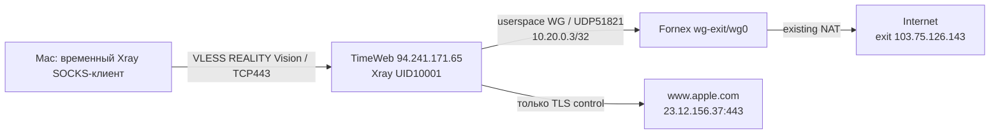

## Итог

Пользователь согласовал шаги 4, 5, 6 и проверку работы. Шаг 4 перепроверен:
`ALREADY_APPLIED`. Шаг 5 выполнен. В шаге 6 публичный сервер запущен и проверен
внешним CLI-клиентом с Mac Mini. **Импорт и полный TUN-маршрут в Amnezia на
MacBook/iPhone пока не проверены**, поэтому клиентская приемка шага 6 не закрыта.

## Изменения

- TimeWeb: `/opt/timeweb-reality/` с pinned Xray 26.3.27, config.json,
  guard.sh, guard.nft, guard.expected. Новых Docker-контейнеров и Python-пакетов нет.
- Новый пользователь/группа `reality-fornex`, UID/GID 10001, login запрещен.
- Новый `xray-timeweb-reality.service`, enabled, bind строго `94.241.171.65:443`.
  `0.0.0.0` заменен после обнаружения dual-stack поведения Go listener.
- Новый nft table `inet reality_fornex`, только OUTPUT UID10001: разрешены
  Fornex UDP51821, закрепленный TLS-target TCP443 и established replies с source443.
  Остальное DROP, включая IPv6-выход. Другие UID и FORWARD не изменены.
- Guard проверяется/создается до каждого старта сервиса. При несовпадении
  существующей таблицы запуск отказывает. Нет постоянного watcher на чужой flush firewall.
- MemoryMax 256M, CPUQuota 50%, TasksMax64; CAP_NET_BIND_SERVICE без NET_ADMIN,
  NoNewPrivileges, readonly system/home, private devices/tmp. Наблюдалось около 19 MiB
  MemoryCurrent после коротких тестов; это не нагрузочная приемка.
- INPUT уже ACCEPT; host/provider firewall не расширялись. Внешний успешный
  REALITY-сеанс подтвердил доступность TCP443 с текущего Mac Mini, не из всех сетей.
- Старые WireGuard, Amnezia, мониторинг, Cenuta, BTH/MikroTik не менялись.

## Backup

`.local/backups/timeweb/2026-09-12T1736Z_pre-reality/backup.tar.gz`,
604013 байт, SHA-256
`e1f12dbec4053c52e6893686b898ee1d7e945a4271646340950c2fdcc949c274`.
Проверены 151 bundle file, 274 host files, capture errors0. Не образ диска.
SHA-256 установленного бинарника совпал с локальным:
`8255dd939c34cf966cc91517b6324dd3c8d0bcf49ffac8beca049a38c46845ed`.

## Найденные проблемы

Первый loopback REALITY тест с www.microsoft.com не прошел, хотя openssl подтвердил
TLS1.3 и сертификат. Ключи, UUID, shortId и SNI сравнивались и совпали. Лог:
`handshake did not complete successfully`; новых WG-пакетов тогда не было.
Есть соответствующий [upstream issue для 26.3.27 и Microsoft](https://github.com/XTLS/Xray-core/issues/6356).
Точный размер проблемного TLS record в нашем запуске не измерялся, поэтому этот
внутренний механизм остается вероятной причиной, а не доказанным packet-level выводом.

Проверен и выбран www.apple.com: TLS1.3, X25519MLKEM768, цепочка 3231 байт.
При замене target/SNI с сохранением ключей запрос сразу вернул IP Fornex.
Менялись только новые конфиги и собственная nft-таблица при остановленном новом
сервисе. Временный debug отключен; итоговый loglevel warning, вывод в journal с rate limit.
Исторические staging-файлы шага 3 с Microsoft не являются актуальными импортными профилями.

Python urllib на Mac встретил локальную ошибку trust store; скачивание тестового
Mac-бинарника выполнено системным curl с обычной проверкой TLS, без `-k`.
SHA-256 macOS ARM64 архива сверена с GitHub release API:
`2e93a67e8aa1936ecefb307e120830fcbd4c643ab9b1c46a2d0838d5f8409eaf`.

## Проверки

| Проверка | Результат |
| --- | --- |
| Loopback VLESS -> WG -> Fornex | IP103.75.126.143 |
| Внешний VLESS через TimeWeb443 с Mac Mini | IP103.75.126.143 |
| HTTPS example.com | Успех, 559 байт |
| HTTPS download 1MiB | Успех, 1048576 байт; последний прогон 1.688s |
| Частный destination 10.20.0.2 | Отказ, curl52 |
| Прямой HTTPS из UID10001 к 1.1.1.1 | Timeout, curl28; контроль root к тому же URL успешен |
| Старый host/relay state | 10/10 сравнений без изменений, после loopback и public |
| IPv6 listener | Отсутствует после явного IPv4 bind |
| Неизвестный UUID при корректных REALITY-параметрах | Отказ, curl35, получено0 байт |
| Runtime privileges | UID10001, CapEff0x400, NoNewPrivs1 |

Новый peer Fornex показал свежий handshake, endpoint TimeWeb:51808 и примерно
1.11 MiB TX после первого внешнего теста. Старый peer сохранил endpoint :55839,
его handshake был 34 секунды. Все семь контейнеров Fornex сохранили uptime.
Временный серверный loopback-клиент остановлен; локальные CLI-клиенты завершаются
через finally. На Mac не менялись маршруты, системный proxy или активный VPN.

## Master, профили, откат

Master: `Dropbox/services/transport/timeweb-reality/`.
`stage56.py`, `check_stage56.py`, `test_stage56_external.py`, `test_stage56_auth.py`,
`issue_stage56_clients.py`; `stage56-timeweb/` содержит конфиги, manifest и evidence.
`stage56_target_update.py` — одноразовая миграция Microsoft -> Apple, **не runbook
повторного запуска**, поскольку возвращает listener на localhost.

Профили 600 в `.local/clients`:

- `TimeWeb-REALITY-Fornex-MacBook-Sergey.json`;
- `TimeWeb-REALITY-Fornex-iPhone.json`.

Идентичности раздельные. JSON содержит только proxy outbound без direct fallback.
Согласно [Amnezia Docs](https://docs.amnezia.org/documentation/supported-configuration-formats/)
поддерживается Xray Reality JSON; фактический импорт этих файлов ожидает проверки.
Существующие WG-файлы не изменены.

Аварийная остановка: локальный `stage56.py rollback` либо серверный
`/var/backups/timeweb-reality/stage56/rollback.sh`. Останавливает/disable только
новую службу, проверяет отсутствие ее процессов и удаляет только собственную
nft-таблицу. Файлы и зарезервированный UID сохраняет для аудита. Это остановка,
не полный uninstall. На этом шаге live rollback не упражнялся; шаг4 rollback
проверялся отдельно. Не снимать UID-защиту при работающем Xray.

## Что еще не принято

Импорт Amnezia и полный маршрут MacBook/iPhone, DNS/IPv6 leak test на физическом
интерфейсе клиента, 120-секундный синхронный capture с MacBook, отказ нового WG с
доказательством отсутствия fallback, длительная нагрузка, reboot/recreate.
Автозапуск настроен, но reboot не выполнялся. BTH/Cenuta в этом профиле отсутствуют.

## Обновление 2026-09-13: функциональная проверка MacBook и read-only audit

Эта запись уточняет исторический список непроверенного выше. Пользователь
подтвердил работу профиля в Amnezia на MacBook Sergey. Выход 103.75.126.143.
Cisco: HTTP 200, 138489 байт за 1.840007 s; Cloudflare: HTTP 200,
5000000 байт за 3.189373 s. Speedtest KPN B.V., Amstelveen:
первый результат DL 29.39 / UL 0.00, следующий DL 29.31 / UL 6.72 Мбит/с,
ping 189 ms, задержка под нагрузкой DL 197 / UL 205 ms.
Result ID успешного теста: 19666533128. Источник: выводы и скриншоты пользователя.
Статьи CNN открываются быстро; продолжающийся спиннер не локализован,
предположение о рекламе не подтверждено. Отмененные рекламные запросы в Network
не доказывают неисправность транспорта.

Между двумя тестами Speedtest агент не менял настройки VPN. Причина предыдущих
таймаутов и нулевого UL не установлена; самовосстановление не считается исправлением.
Функциональный маршрут принят, длительная стабильность не принята.

Свежий read-only audit 2026-09-13 04:52 UTC:

- TimeWeb: xray-timeweb-reality active/running, NRestarts=0, MemoryCurrent=62730240.
- SHA-256 /opt/timeweb-reality/config.json совпал с локальным master
  services/transport/timeweb-reality/stage56-timeweb/public.json:
  34cf6121a487bbb69e2082eb3e7be9f1d704f8f2fcabfe64d6a03e74fd3b5534.
- Inbound слушает только 94.241.171.65:443 IPv4. Outbounds: blackhole и
  userspace WG 10.20.0.3/32 -> 103.75.126.143:51821; Freedom/direct отсутствует.
- Встроенный DNS: DoH https://1.1.1.1/dns-query, UseIPv4, disableFallback=true;
  dns-fornex направлен в wg-fornex. Обе клиентские идентичности идут в wg-fornex.
  IPv6 ::/0 и частные/служебные назначения блокируются перед клиентским правилом.
- nft UID10001: разрешены WG endpoint, TLS target 23.12.156.37:443 и ответы
  установленных входящих TCP443; остальное drop. TLS target является явным
  служебным исключением, не универсальным прямым выходом для клиентского трафика.
- Fornex: REALITY_F3 для source 10.20.0.3 установлен перед общим FORWARD accept;
  private/bogon/VPS destinations закрыты, INPUT от этого source закрыт.
  Все семь существующих контейнеров Up 2 weeks.
- Последние ограниченные captures завершены автоматически, kernel drops=0.
  TimeWeb: /var/tmp/reality-upload.lcGorH/capture.pcap (247152 packets captured).
  Fornex: /var/tmp/reality-upload.dR8rky/capture.pcap (122795 packets captured).
  Это служебные чувствительные данные на VPS, не мастер-копии конфигурации.
  Полная корреляция потоков успешного/неуспешного UL не выполнена.

Итог безопасности: серверная конфигурация соответствует выбранному маршруту.
Это НЕ доказательство отсутствия утечек DNS/IPv6 на физическом интерфейсе MacBook:
агент работает с другого компьютера, клиентский bypass проверяется отдельно.
Ранее один DNS exchange id 29061 был сопоставлен с Fornex, но это не leak test.
На этом шаге не менялись серверные конфиги, правила, маршруты или сервисы.

Следующее действие: read-only проверка DNS и IPv6 маршрутов на MacBook при
включенном профиле, затем ограниченный capture физического интерфейса с
контролируемыми запросами. iPhone, отказ WG/fallback, restart/reboot и BTH/Cenuta
остаются отдельными согласуемыми этапами. Историю таймаутов не закрывать как resolved.

## Клиентские проверки и подготовка отказа, 2026-09-13

По выводам пользователя на MacBook Sergey при включенном профиле:
оба DNS 1.1.1.1 и 1.0.0.1 маршрутизируются через utun22 / 10.33.0.2.
Контрольные UDP DNS запросы example.com вернули NOERROR за 476 и 581 ms;
пользователь не наблюдал новых строк в tcpdump en0 с фильтром port 53 or port 853.
Для этих запросов утечки через проверенные порты не обнаружены; DoH и другие
интерфейсы этим тестом не покрыты. route get IPv6 2606:4700:4700::1111:
not in table. Отсутствие этого маршрута не гарантирует результат после смены сети.
Пользователь установил отдельный профиль iPhone и подтвердил, что туннель работает.
DNS/IPv6 leak tests на iPhone не выполнялись.

Пользователь согласовал кратковременную проверку отказа нового канала.
Подготовлен локальный кандидат test_failclosed_20260913.py в
services/transport/timeweb-reality, запуск через python3 -B.
Проектируемая инъекция: отдельная runtime nft table с DROP только UID10001 ->
103.75.126.143 UDP51821, независимый systemd timer удаления через 120 s,
удаление в finally. Серверная инъекция и ее таймер пока НЕ упражнялись.

Два прогона остановились на baseline ДО каких-либо серверных изменений:

| Прогон (локальное имя артефакта) | api.ipify.org | example.com | 1.1.1.1 HTTPS |
| --- | --- | --- | --- |
| failclosed-20260913T110545 | 103.75.126.143, exit0 | exit28, SSL timeout 5.022s | exit0 |
| failclosed-20260913T110608 | 103.75.126.143, exit0 | exit56, requested URL returned error 503 | exit0 |

report.json и client.log лежат в этих каталогах под services/transport/timeweb-reality.
Это CLI-пробы с машины агента, не повтор MacBook/iPhone TUN-теста. Источник 503
не локализован; ошибку нельзя приписывать сайту, Xray или оператору без диагностики.
В 08:06:30 UTC сервер подтвердил отсутствие reality_failclosed_20260913,
Xray active, NRestarts=0, SHA конфигурации прежний. Временные CLI-процессы завершены.
Fail-closed остается НЕ ПРОВЕРЕН: перед инъекцией необходим достоверный baseline
и проверка самого измерительного пути. Рабочие туннели не отключались.

## Успешный ограниченный fail-closed тест, 2026-09-13

Пользователь запросил выполнение с недорогим субагентом. gpt-5.6-luna выполнил
read-only review скрипта; главный агент исправил приемку: проверка DROP counter,
двойной baseline/restore, отсутствие временной таблицы/активного timer после
теста, сравнение host routes/rules и времени старта wg-relay. Субагент не менял VPS.
HTTP 503 допускается как доставленный HTTP-ответ, но не как здоровье сайта;
в успешном прогоне example.com вернул обычное тело 559 байт.

Артефакт: services/transport/timeweb-reality/failclosed-20260913T112315/report.json.
Имя использует часы локального процесса; диагностические HTTP ответы перед тестом
имели время около 08:21 UTC. Серверная конфигурация не менялась постоянно.

- До инъекции: два прогона по три HTTPS-запроса успешны; api.ipify.org -> 103.75.126.143.
- Отдельная runtime nft table reality_failclosed_20260913, output priority -10:
  DROP только meta skuid 10001, destination 103.75.126.143, UDP51821.
  Существующая таблица reality_fornex не изменялась. До инъекции запущен
  независимый systemd cleanup timer на 120 секунд.
- Во время инъекции: api.ipify.org, example.com и IP-only HTTPS 1.1.1.1/cdn-cgi/trace
  завершились curl28, получено 0 байт. DROP counter: 282 пакета.
  Измеренная фаза от подтверждения fault до чтения counter: 17.28 секунды;
  это не точная длительность существования правила, учитывая SSH-вызовы.
- Правило удалено явно, таймер остановлен; отсутствие таблицы и неактивность
  timer проверены. Аварийное удаление самим таймером не испытывалось.
- После: два прогона по три запроса успешны; внешний IP снова Fornex.
  Локальный временный Xray завершен. Итог passed=true.
- Хеш server config, nft -s reality_fornex, IPv4 host routes/rules и состояние/
  StartedAt wg-relay совпали до/после. Старые WG-подключения не перезапускались;
  это не прикладной regression всех старых клиентов и не snapshot их namespace.

Принят ограниченный серверный сценарий отказа нового WG endpoint: тестовые
соединения не получили ответа через прямой fallback, после удаления DROP
восстановились без перезапуска. Это не исчерпывающая проверка всех destinations,
не reboot/recreate, не проверка обхода на физическом интерфейсе Amnezia-клиента
при отказе, не испытание watchdog по фактическому истечению таймера.
Первопричина прежних перемежающихся TLS timeout и HTTP503 не установлена.

## Проверка рестарта нового Xray, 2026-09-13 08:26 UTC

По отдельному согласованию пользователя выполнен только systemctl restart
xray-timeweb-reality. TimeWeb и старые WG-сервисы не перезапускались.
MainPID сменился с 1244535 на 1258264; старт нового процесса 08:26:53 UTC.
ExecStartPre guard.sh завершился status0; служба active/running.
NRestarts=0 означает отсутствие автоматических рестартов, а не отсутствие
выполненного вручную рестарта. При немедленном чтении ss listener еще не появился;
повторная проверка подтвердила LISTEN 94.241.171.65:443.

До/после совпали nft -s reality_fornex, SHA256 config.json, IPv4 host rules/routes,
состояние и StartedAt wg-relay (2026-07-10T00:10:37.662464526Z).
Снимки: TimeWeb /var/tmp/reality-restart.PTTAa0/.
Внешние CLI проверки после рестарта: api.ipify.org, example.com и
1.1.1.1/cdn-cgi/trace вернули HTTP200/curl0, внешний IP 103.75.126.143.
Локальный отчет: services/transport/timeweb-reality/cli-diagnostic-20260913T112659/report.json.
Временный CLI-клиент завершен.

Серверное восстановление подтверждено. Автовосстановление уже включенной Amnezia
на MacBook/iPhone пока ожидает подтверждения пользователя; новый CLI-процесс
не доказывает восстановление существующего клиентского сеанса.
Reboot/recreate и долгосрочная стабильность этим тестом не проверены.

Пользователь после проверки подтвердил: запрос на уже включенной Amnezia
MacBook сработал без сообщенного ручного переподключения. Клиентское восстановление
после рестарта принято в рамках этой проверки; iPhone отдельно после рестарта
не проверялся. Следующий read-only аудит: [TimeWeb_REALITY_Cenuta_Audit_2026-09-13](<TimeWeb_REALITY_Cenuta_Audit_2026-09-13.md>).
