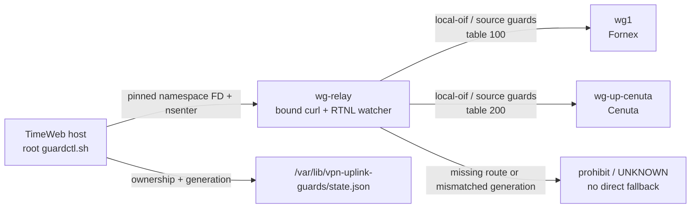

# TimeWeb: подготовка и внедрение uplink guards

План: [TimeWeb_Uplink_Monitoring_Architecture_and_Plan](<../architecture/TimeWeb_Uplink_Monitoring_Architecture_and_Plan.md>).
Предшествующий стенд: [TimeWeb_Uplink_Monitoring_Isolation_Lab_2026-09-11](<TimeWeb_Uplink_Monitoring_Isolation_Lab_2026-09-11.md>).
Код и evidence: `services/monitoring/timeweb-uplinks/`.

## Текущее состояние

На 2026-09-11 09:54 UTC включены **22 собственных IPv4 RPDB rules**
в network namespace действующего `wg-relay`. Helper установлен, проверены
apply, повторный apply и точный rollback. Постоянные collector, Prometheus
и серверная `.venv` **не установлены**. Это законченный ограниченный этап
защиты разовых проб, не приемка круглосуточного мониторинга.

Клиентские правила, маршруты таблиц 100/200/300, WG peers, relay firewall,
host routes/rules и работающий VPN Mac не менялись. Полная прикладная
проверка с реального клиента TimeWeb -> Fornex остается открытой. Трафик
через Cenuta имеет существовавший до изменения отказ внешнего TCP.

Команды эксплуатации: [TimeWeb_Uplink_Guards_Quick_Guide](<../operations/TimeWeb_Uplink_Guards_Quick_Guide.md>).

## Границы

Согласованы проверка и внедрение только собственных IPv4 RPDB guards.
Клиентские правила, таблицы 100/200, WG-конфигурации и Docker restart не
менять. Установка серверной `.venv`, collector и Prometheus остается
отдельным согласованием. Python запускается только на Mac через
`python3`, подтверждена версия 3.13.12.

## Аудит и backup

Baseline 09:10:40 UTC: `wg-relay` PID 1181, namespace `net:[4026532282]`.
Внутри работает CoreDNS, слушает TCP/UDP 53 и health TCP 8080 на всех
адресах. Его ответы должны сохранять маршруты в клиентские и служебные
сети. Host-level SSH/Zabbix находятся вне namespace изменения.

Первоначальный кандидат: 20 правил, priorities 31000-31019, protocol 242,
только `iif lo`. После стендовой проверки расширен до 22 (см. ниже).
Клиентские protection 180/181, RU mark 190 и остальные existing rules
не меняются. Local-oif lookup/prohibit направляет bound sockets в 100/200.
Local-source lookup/prohibit удерживает ответы ядра с 10.20.0.1/10.40.40.2.
Перед source guards предусмотрены узкие исключения к connected-сетям
10.20.0.0/24, 10.30.30.0/24 и 172.19.0.0/16: lookup main с подавлением
default и точечным prohibit при исчезновении connected route.

Backup 09:10:52 UTC:
`.local/backups/timeweb/20260911T091052Z/timeweb-pre-uplink-guards.tar.gz`.
SHA256 `85543146d8a1ab94470063b0c4528c712df4d16daf3d547ce2680b73dba60e94`.
Проверено 232 файла: исходные hashes до/после архивации и hashes после
распаковки в отдельный каталог на TimeWeb. Проверен SHA256 скачанной копии.
Архив содержит приватные VPN-конфиги и runtime showconf, хранится только
в закрытом каталоге System и root-каталоге сервера. Полной VM/image копией
не является. Исторические backups и изменяющиеся logs исключены.

## 09:19 UTC: первый тест нового helper

Production не изменен. Применение, идемпотентность и матрица local/forwarded
маршрутов прошли в отдельном namespace; measurement-тест остановлен из-за
`monitor_not_ready`. Запуск netlink watcher через shell-функцию в background
дал PID оболочки, а не `ip monitor`. Проверка socket owner искала неверный
PID. Cleanup остановил оболочку, но оставил дочерний watcher, удерживавший
унаследованный flock FD. Следующие helper-вызовы не получили lock.

Предотвращающее правило: watcher запускать прямым `nsenter ... ip monitor &`,
без background shell-функции/конвейера; передавать в readiness/cleanup PID
реального exec-процесса, закрывать у него FD блокировки. Приемка обязательно
проверяет отсутствие оставшихся watcher-процессов и namespaces. Не считать
провал readiness сетевым DOWN и не разрешать production-переход.

Сохранен результат `evidence/20260911-guards/guard-lab-v1.json`, включая
неуспешные assertions. Оставшийся процесс PID 1137350 адресно остановлен
после проверки namespace теста `net:[4026532351]`, без воздействия на
рабочий `wg-relay`. В последующих прогонах cleanup исправлен.

## Доработки стенда

Третий прогон: HTTPS через оба fixture WG успешен, прямых TCP нет;
RTNL watcher отверг HTTP 200 после удаления маршрута. При этом сама
попытка восстановления `default via 10.20.0.2 dev wg1 table 100` получила
`Nexthop has invalid gateway`: local-oif lookup/prohibit перехватывает
проверку достижимости gateway при добавлении route. Такой кандидат нельзя
переносить в production, где маршрут должен восстанавливаться штатно.

Предотвращающее правило: до local-oif guards предусмотреть узкое исключение
`iif lo oif wg1 to 10.20.0.2/32 lookup main suppress_prefixlength 0` с
prohibit fallback. Оно использует существующий connected route, не WAN
default. Перепроверить не только удаление/восстановление самой пары guards,
но и штатное добавление gateway route при работающих guards, затем ABA.
Кандидат расширяется до 22 правил, 31000-31021; все остальные границы прежние.

Дополнительная диагностика readiness после второго прогона: `ss -p -f
netlink` на этом хосте не заполняет Process, хотя сокет существует и
подписан на группы. Поэтому искать `pid=...` в этом выводе нельзя.
Readiness и здоровье watcher проверяются по inode его socket FD и записи
`/proc/<pid>/net/netlink`: протокол NETLINK_ROUTE, mask групп link/IPv4
address/route/rule, Drops=0; перед приемкой результата также Rmem=0.
Закрытие FD flock и прямой exec сохраняются. Неуспешный v2 сохранен;
production по-прежнему не изменен.

### 09:45 UTC: повтор с поздними RST

v5 подтвердил для финальных 22 правил: 8 поздних RST через WG, 0 TCP
на direct-интерфейсе. Но ABA assertion не прошел: HTTP 200 принят как
VALID_OBSERVATION. Этот прогон не считать успешно принятым целиком.

В тестовом триггере найден дефект изоляции: capture принимал любой TCP,
включая поздние ответы предыдущего сценария, и не проверял свою готовность
до запроса. Точного времени удаления/возврата route в v5 нет; по нему
нельзя доказать, что изменение произошло внутри окна измерения.
Предотвращающее правило: fault injection привязывать к новому исходящему
SYN, ждать listening capture до запуска helper, сохранять временные отметки
SYN/delete/restore и результат. Повторить ABA с этой синхронизацией.
Рабочий helper и production rules на этом шаге не изменять.

## Источники семантики

- [ip-rule: local iif/oif, suppress_prefixlength](https://man7.org/linux/man-pages/man8/ip-rule.8.html).
- [ip-monitor: RTNETLINK events](https://man7.org/linux/man-pages/man8/ip-monitor.8.html).

## Финальный manifest

| Приоритеты | Селектор и действие |
| --- | --- |
| 31000-31001 | `iif lo oif wg1 to 10.20.0.2/32`: main без default, затем prohibit; сохраняет проверку gateway при восстановлении route table 100 |
| 31002-31003 | `iif lo oif wg1`: lookup 100, затем prohibit |
| 31004-31005 | `iif lo oif wg-up-cenuta`: lookup 200, затем prohibit |
| 31006-31017 | Для каждого source `10.20.0.1/32`, `10.40.40.2/32` и каждой сети `10.20.0.0/24`, `10.30.30.0/24`, `172.19.0.0/16`: main с `suppress_prefixlength 0`, затем prohibit; все с `iif lo` |
| 31018-31019 | `iif lo from 10.20.0.1/32`: lookup 100, затем prohibit |
| 31020-31021 | `iif lo from 10.40.40.2/32`: lookup 200, затем prohibit |

Все новые правила имеют protocol `242`. Существующие destination rules
180/181 к клиентским сетям, mark rule 190 и source/iif rules 219-300
предшествуют guards. Приоритеты до применения были свободны.
Точные argv и нормализованные JSON rules находятся в manifest, таблица
выше не является заменой машинного manifest для apply/delete.

## Внедрение и проверки

| Время UTC 2026-09-11 | Результат |
| --- | --- |
| 09:10:40-09:10:52 | Baseline и восстанавливаемая конфигурационная копия; 232 файла проверены |
| 09:29:00-09:29:24 | Стенд v4: 23 PASS, 0 failures; apply/noop, оба WG, ABA, rollback, чужой priority, stale namespace |
| 09:31:03 | Повторный production baseline совпал с исходным, backup остается актуален |
| 09:32:21-09:32:30 | Canary: apply 22, NOOP, check, служебные проверки и пробы; затем точный rollback |
| 09:33:18 | После rollback правила и конфигурационные снимки полностью совпали с baseline |
| 09:34:35 | Повторное применение, state generation 5; аварийный rollback timer на 10 минут |
| 09:34:53-09:35:11 | Ограниченные captures и 6 HTTPS-проб; прямых TCP-пакетов проб на eth0 нет |
| 09:36:01 | Изменение конфигурации состоит только из 22 собственных правил |
| 09:40:39 | Guard layer оставлен включенным; rollback timer остановлен после проверок |
| 09:45:26-09:45:40 | v5: late RST защищены; ABA assertion не прошел, обнаружен недостаточно точный тестовый триггер |
| 09:47:27-09:47:40 | v6: 26 PASS, 0 failures, синхронизированный ABA и поздние RST на финальных 22 правилах |
| 09:49:44-09:49:59 | v7: независимый повтор, 26 PASS, 0 failures, late RST и ABA подтверждены повторно |
| 09:54:04-09:54:28 | Check generation 5; checkpoint со сверкой 7 файлов, итоговый audit без дополнительного drift; тестовых процессов и timers нет |

В v6: начало helper `09:47:34.296`, SYN `09:47:34.630`, delete
`09:47:34.641`, restore `09:47:34.702`; raw HTTP 200 отвергнут как
`UNKNOWN reason=generation_or_manifest_changed`. Это подтвержденное
изменение внутри измерения, в отличие от неполного evidence v5.

### Regression и фактическая связность

- **130 route lookups** до/после идентичны: 120 комбинаций клиентских
  source/mark/destination и 10 локальных ответов в клиентские/служебные сети.
- CoreDNS на 53/UDP и 53/TCP отвечает NOERROR, health на 8080 дает HTTP 200.
  Повторная проверка выполнена из host network и с Fornex через WG к
  `10.20.0.1`. Это важная проверка local-source guards, не только curl.
- До guards Cenuta -> TimeWeb `10.40.40.2` ping: 0/2. После: 2/2,
  среднее около 98 ms; health TimeWeb через WG HTTP 200. Раньше на TimeWeb
  отсутствовал connected route к `10.40.40.1`; source guards обеспечили
  возврат локального ответа через table 200.
- Fornex: gstatic HTTP 204 (0.230 s), Cloudflare HTTP 200 (0.212 s),
  ipify HTTP 200 (0.299 s). Cenuta: все три TCP connect timeout около 3 s.
  Это валидные измерения существующего отказа, не ошибка collector.
- Capture проб: 94 пакета, 0 kernel drops; исходящие TCP на `wg1`: 47,
  на `wg-up-cenuta`: 9, на `eth0`: **0**. Поздних RST в этом production
  capture не было; отдельный стенд v6 дал 8 late RST через WG и 0 напрямую.
- Capture клиентов: 31 пакет, все входящие от selector `10.50.50.24`,
  обратных пакетов и трафика legacy clients нет. Это не доказывает
  работоспособность клиентского приложения. Источник соответствует
  MikroTik Cenuta-only; SYN без ответов согласуются с отказом Cenuta.
- Клиентский VPN не переключался. Пользователю предложена проверка сайтов
  с уже подключенного TimeWeb -> Fornex устройства. Подтверждения пока нет.

Ресурсы перед внедрением: 1 vCPU, MemAvailable около 1494 из 1967 MiB,
около 18 GiB свободно. Постоянной новой нагрузки сейчас нет: watcher
существует только на время разовой пробы. Этот снимок не заменяет
нагрузочный бюджет будущих collector/Prometheus.

## Код, состояние и evidence

TimeWeb:

- `/opt/vpn-monitoring/guards/guardctl.sh` (root, 700).
- `/opt/vpn-monitoring/guards/guard-manifest.json` (root, 600).
- `/opt/vpn-monitoring/guards/probe-targets.json` (root, 600; DNS snapshot с TTL 1 час).
- `/var/lib/vpn-uplink-guards/state.json`: manifest hash, generation 5,
  status `applied`; root-only каталог.

| Файл | SHA256 |
| --- | --- |
| guardctl.sh | `2f883e3ea356b1d88719a148acb89a5b50ccc629b6b51fd619fe2f67ab88cde1` |
| guard-manifest.json | `cc1f61eb8aaec7ed86835b17402c399d2695fd15cd4b75e20c845a38df9122fd` |
| probe-targets.json | `5b9122253c95c6f77d60c99f7802de263a26c5a57c6dd67d2c56874fbb96ccd0` |

Manifest привязан к boot `113c32a1-44c6-477b-b48c-de22034fcad3`,
container `de135c801f3060209d9ef41453502b844c072e14a0ef0096e683059c35fde297`,
StartedAt `2026-07-10T00:10:37.662464526Z`, PID 1181, start tick 1584,
namespace `net:[4026532282]`, ifindex/адресам, routes/rules/peer AllowedIPs
и статической конфигурации firewall.

Локальная директория evidence:
`services/monitoring/timeweb-uplinks/evidence/20260911-guards/`.
Основные файлы: `baseline.json`, `backup.json`, `guard-lab-v1.json` ...
`guard-lab-v7.json`, `pre-production.json`, `production-canary.json`,
`after-canary-rollback.json`, `production-apply.json`, `regression-before.json`,
`regression-after.json`, `production-captures.json`, `production-after.json`,
`guard-layer-retained.json`, `acceptance-summary.json`, `probes.capture`,
`clients.capture`. Неуспешные прогоны сохранены, а не заменены успешными.

Итоговая машинная сверка: `acceptance-summary-final.json` (26 PASS в каждом
из v6/v7, 130 lookups, проверка неизменности конфигурации до `final-audit.json`
09:54:28). Предыдущая сводка не перезаписана.

После внедрения отдельно сохранен
`evidence/20260911-guards/checkpoint-20260911T095404Z.tar.gz`, SHA256
`f51f04b377f43fc1ffd166c0d70dfe2f8a009b5c2c7a260e065f8bdbf59a4850`.
Внутри helper/manifest/targets/state/rules/routes/time и SHA256SUMS;
проверены все 7 файлов и точное совпадение локального кода с установленным.
Это дополнение к полному pre-change VPN backup, не его замена.

В 09:54 MemAvailable 1471 MiB, свободно 18 GiB; оба upstream имеют
свежий handshake: Fornex 09:52:39 UTC, Cenuta 09:52:36 UTC (около 85-90 s
перед снимком). Это не опровергает TCP egress failure Cenuta.
Временных lab directories, RTNL watcher-процессов и rollback timers нет.

## Ограничения и следующий этап

- Guards сейчас runtime-only в текущем namespace. **Нет auto-reapply после
  перезагрузки или пересоздания контейнера.** Старый manifest будет отвергнут;
  перед новым применением нужен свежий audit и новый проверенный manifest.
- `probe` использует bound sockets, pinned DNS/TLS, pre/post manifest и
  RTNL watcher link/address/route/rule. Проверяются фактический PID/socket
  inode watcher, подписки, Drops и пустая очередь перед приемкой.
- RTNL ABA проверен. Обнаружение временного out-of-band изменения и возврата
  WG peers через generic netlink или firewall не доказано: их persistent
  drift ловит pre/post snapshot, но это не универсальный generation monitor.
- DNS targets имеют expires_unix. Истекший snapshot дает REFUSED, а не DOWN.
  Автоматический безопасный refresh и постоянное поколение состояния
  должны войти в collector. Не отключать срок годности ради зеленой панели.
- Helper выполняет одну пробу, не имеет истории и не классифицирует HTTP
  response в итоговое UP/DOWN. Exit 0 с `curl_exit=28` означает достоверный
  timeout. Это необходимо учитывать будущему collector.
- Положительный production HTTPS egress Cenuta через этот helper подтвержден
  11:41:55-11:41:57 UTC: gstatic 204 / 0.471 s, Cloudflare 200 / 0.490 s,
  VALID generation 5 до/после, отдельный свежий TTL snapshot. Полные
  T01-T35, прикладной клиентский regression и длительный baseline еще не приняты.
- Локальное ядро collector/state/history, target cache, scheduler primitives
  и exporter реализованы: 43 теста PASS. Это не production daemon.
  Следующий технический шаг: batch helper (общий flock сейчас сериализует
  разовые пробы), автоматический DNS refresh и связка scheduler/adapter.
  Установки TimeWeb `.venv`, collector и Prometheus согласовываются отдельно.
  Детали: [TimeWeb_Uplink_Collector_Local_Implementation_2026-09-11](<TimeWeb_Uplink_Collector_Local_Implementation_2026-09-11.md>).
