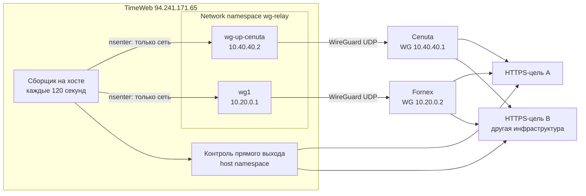
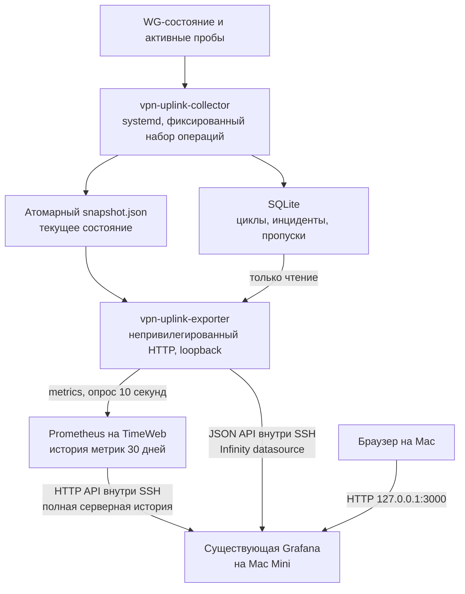
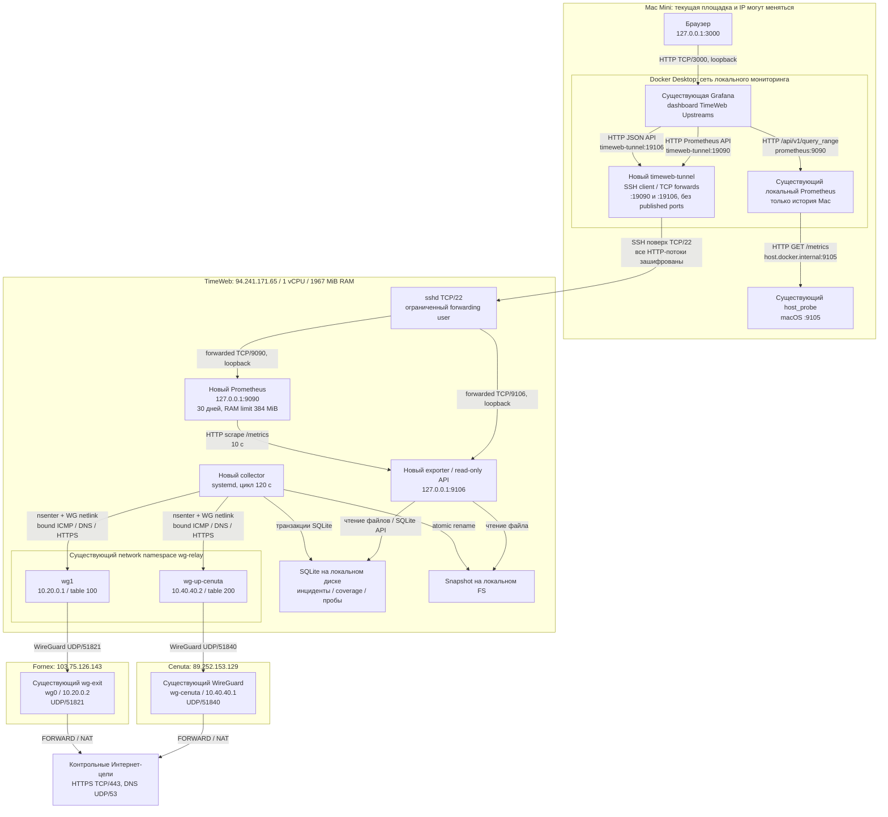
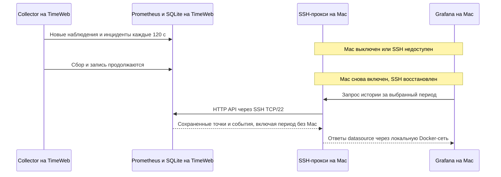
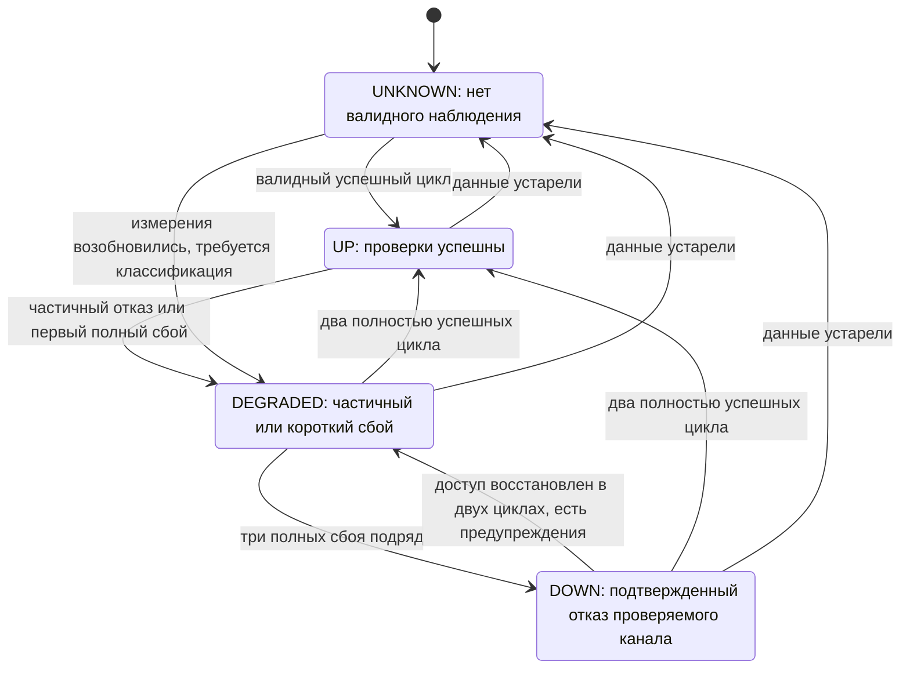

> [!WARNING] Историческая версия, не текущий runbook
> Полный текст документа до документационного ревью 2026-09-13 сохранен ниже без изменения. Старые статусы, планы, команды, интервалы и пути не подтверждают состояние runtime и не разрешают повторное внедрение.
> Актуальная версия: [TimeWeb_Uplink_Monitoring_Architecture_and_Plan](<../architecture/TimeWeb_Uplink_Monitoring_Architecture_and_Plan.md>). Текущий статус TimeWeb: [Pilot Quick Guide](<../operations/TimeWeb_Uplink_Pilot_Quick_Guide.md>).
> Относительные ссылки внутри оригинала относятся к прежнему расположению в `MIKROTIK/docs/`.

<!-- ORIGINAL DOCUMENT START -->
---
type: architecture
topic: timeweb-uplink-monitoring
status: pilot-running
created: 2026-09-11
updated: 2026-09-11
resource_check_utc: "2026-09-11T06:31:42Z"
tags:
  - timeweb
  - wireguard
  - monitoring
  - prometheus
  - grafana
---

## Назначение и статус

**Актуальное решение 2026-09-11:** серверная SQLite хранит 7 дней
(`retention_days=7`), вместо 30. Для следующего этапа выбран локальный кэш
с инкрементальной подкачкой: [TimeWeb_Uplink_History_Sync_Plan](<../reference/TimeWeb_Uplink_History_Sync_Plan.md>). Разделы ниже
с серверным Prometheus и 30-дневным хранением описывают предыдущий проектный
вариант, не текущую установленную схему. Текущая схема:
[TimeWeb_Uplink_Pilot_Quick_Guide](<../operations/TimeWeb_Uplink_Pilot_Quick_Guide.md>).

Проект круглосуточного мониторинга двух направлений: **TimeWeb -> Cenuta** и **TimeWeb -> Fornex**. Сбор, хранение истории и определение инцидентов работают на TimeWeb независимо от местонахождения и состояния Mac Mini. **Визуализация остается в существующей Grafana на Mac Mini; вторую Grafana на TimeWeb не устанавливаем.**

**Статус: 2026-09-11 запущен ограниченный пилот на TimeWeb.** Установлены
серверная `.venv`, collector и loopback exporter, SQLite хранит реальные
результаты раз в 120 секунд. На Mac добавлены SSH LaunchAgent, job существующего
Prometheus и отдельный дашборд. Серверный Prometheus не установлен.
Рабочий helper не заменен; пилот использует отдельный batch-helper и существующие guards.
[Инструкция пилота](<../operations/TimeWeb_Uplink_Pilot_Quick_Guide.md>) и
[протокол внедрения](<TimeWeb_Uplink_Pilot_Deployment_2026-09-11.md>).
Локальный Prometheus не заполняет историю за время отсутствия Mac: серверная
SQLite/API сохраняет эти данные, но историческая интеграция Grafana еще впереди.
Подробности и незакрытые условия полной приемки:
[agents/history/TimeWeb_Uplink_Collector_Local_Implementation_2026-09-11](<TimeWeb_Uplink_Collector_Local_Implementation_2026-09-11.md>).
Новый этап и результаты:
[agents/history/TimeWeb_Uplink_Batch_Daemon_2026-09-11](<TimeWeb_Uplink_Batch_Daemon_2026-09-11.md>).
Production gate остается закрытым: стенд воспроизводит необнаруженный
WG/firewall ABA. Отдельный явно согласованный pilot config и `--pilot` разрешают
наблюдения ограниченной достоверности; конфигурация кандидата по умолчанию запрещает запуск.
В 11:41 UTC защищенные HTTPS-пробы обоих upstream успешны; это короткая
проверка, не непрерывная история и не прикладной regression клиентов.

**Текущий режим по решению пользователя: один цикл проверок раз в 120 s.**
Deadline цикла 45 s, сетевой HTTPS timeout до 5 s, stale snapshot 180 s.
Три неуспеха подтверждают DOWN примерно через 4-6 минут плюс время проб;
два успеха подтверждают восстановление через 2-4 минуты плюс время проб.
Короткие обрывы между пробами могут полностью остаться незамеченными.
Это относится к новому TimeWeb uplink monitoring, не меняет существующий
локальный мониторинг Mac. Исторические 10-секундные evidence не переписываются.

Основной результат: ответить, **когда перестал работать конкретный upstream, что именно наблюдалось, когда работа восстановилась и сколько времени мониторинг вообще мог наблюдать сеть**.

### Содержание

- [](#Границы решения и исходные данные)
- [](<#архитектура>)
- [](#Размещение модулей по хостам и протоколы)
- [](#Как гарантировать проверку нужного туннеля)
- [](#Программа измерений)
- [](#Состояния и регистрация инцидентов)
- [](#Контракт данных и метрик)
- [](#Отображение в Grafana)
- [](#Размещение и безопасность)
- [](#Ресурсы и хранение)
- [](#План реализации)
- [](#План тестирования)
- [](#Эксплуатация и откат)
- [](#Критерии приемки)
- [](#Связанные документы и источники)

## Границы решения и исходные данные

### Что мониторим

| Направление | Namespace на TimeWeb | Интерфейс      | Адрес TimeWeb внутри WG | Внутренний адрес соседа | Публичный endpoint соседа  | Таблица маршрутизации |
| ----------- | -------------------- | -------------- | ----------------------- | ----------------------- | -------------------------- | --------------------- |
| Cenuta      | контейнер `wg-relay` | `wg-up-cenuta` | `10.40.40.2/32`         | `10.40.40.1`            | `89.252.153.129:51840/udp` | `200`                 |
| Fornex      | контейнер `wg-relay` | `wg1`          | `10.20.0.1/24`          | `10.20.0.2`             | `103.75.126.143:51821/udp` | `100`                 |

TimeWeb: `94.241.171.65`; существующий VPN Compose: `/opt/wg/docker-compose.yml`. Публичный выход ожидается через `89.252.153.129` для Cenuta и `103.75.126.143` для Fornex. Это исходные значения для сверки, а не неизменяемые константы.

Основания: [TimeWeb_Parameters](<../hosts/timeweb/TimeWeb_Parameters.md>), [agents/host-state/TimeWeb_Configuration](<../hosts/timeweb/TimeWeb_Configuration.md>), [agents/host-state/Cenuta_Configuration](<../hosts/cenuta/Cenuta_Configuration.md>), [agents/host-state/Fornex_Configuration](<../hosts/fornex/Fornex_Configuration.md>). В записи аудита TimeWeb от 2026-09-11 указаны свежие handshakes обоих upstream. Это снимок WG-состояния, не история доступности и не доказательство работоспособности всех клиентских маршрутов.

### Что не следует смешивать

1. **Upstream:** TimeWeb способен обмениваться данными с peer и выходить через него в Интернет.
2. **Клиентский маршрут:** пакеты Apple TV или другого клиента действительно выбирают этот upstream и проходят FORWARD/NAT.
3. **Локальное устройство:** Wi-Fi, DNS, приложение VPN, kill switch и состояние самой Apple TV.

Первый этап проверяет пункт 1. Успех синтетического запроса с TimeWeb не проверяет целиком пункт 2: локально созданный пакет не проходит те же входные правила, что клиентский. Неисправность Flow VPN на Apple TV этим мониторингом не определяется.

Данные Mac Mini остаются отдельным источником наблюдений. Их нельзя использовать как непрерывную историю домашней сети, когда Mac выключен, перемещен или использует другой VPN. Отсутствующую историю за предыдущие две недели восстановить задним числом этим внедрением невозможно.

**Не входит в первый этап:** автоматическое переключение провайдера, перезапуск WG, изменение клиентов, установка агентов на Cenuta/Fornex, полный мониторинг Amnezia, доказательство конкретного виновника блокировки.

## Архитектура

### Выбранное распределение

**Рекомендуется: TimeWeb = ограниченный сбор и хранение; Mac Mini = существующая Grafana, SSH-прокси и интерактивный просмотр.** На TimeWeb остается небольшой Prometheus для стандартных временных рядов и SQLite для точного журнала инцидентов. Локальный Prometheus Mac продолжает обслуживать локальный `host_probe`, но не является источником непрерывной истории серверов.

| Вариант                                                         | Нагрузка на TimeWeb                                             | Что происходит без Mac                           | Решение                                                                      |
| --------------------------------------------------------------- | --------------------------------------------------------------- | ------------------------------------------------ | ---------------------------------------------------------------------------- |
| Prometheus и Grafana на TimeWeb                                 | Сбор, две БД, визуализация и плагины на 1 vCPU                  | Работает все                                     | Не выбран: дублируется уже установленная Grafana                             |
| Collector, SQLite и малый Prometheus на TimeWeb; Grafana на Mac | Сбор и ограниченное хранение/запросы, без Grafana               | История и инциденты продолжают записываться      | Рекомендуется при проверенном ресурсе и лимите RAM 512 MiB на новые процессы |
| Только collector и SQLite на TimeWeb; Grafana на Mac            | Минимальная память, но нужен собственный API исторических рядов | История в SQLite сохраняется                     | Резерв при нехватке RAM; больше собственного кода агрегации и тестов         |
| На TimeWeb только exporter; Prometheus и Grafana на Mac         | Минимальная нагрузка                                            | История не собирается, пока Mac выключен/нет SSH | Не подходит для поставленной задачи                                          |

Вариант с малым Prometheus выбран не потому, что ресурсы неограниченны: live-проверка показала около 1.43 GiB доступной памяти. Это позволяет оставить стандартное хранилище метрик в ограниченном бюджете без разработки собственного time-series API. Точный расход нового стека пока не измерен, его лимиты и критерии пересмотра приведены ниже.

Длительные произвольные PromQL/SQL-запросы, полный мониторинг Docker, Loki, tracing, cAdvisor и обработка pcaps не добавляются на TimeWeb. В Grafana на Mac выполняются построение панелей и преобразования небольших ответов. Сам запрос к данным исполняется на TimeWeb: его стоимость тоже ограничивается, а не считается автоматически перенесенной на Mac.

### Схема проверок



Контроль прямого выхода нужен для сравнения: если одновременно отказали обе внешние цели через все три пути, это не позволяет однозначно обвинить один VPN. Прямой контроль не подставляется вместо результата конкретного туннеля.

### Схема компонентов и данных



Выбранный состав:

- **Сборщик:** небольшой Python-сервис под systemd; использует системные `wg`, `ip`, `nsenter`, `curl`, `ping` и библиотеку DNS. Версии зависимостей фиксируются при реализации.
- **Exporter:** отдельный непривилегированный процесс. Читает готовый snapshot, а не запускает сетевые проверки по HTTP-запросу.
- **SQLite:** журнал наблюдений и инцидентов для воспроизводимой статистики. Не заменяет Prometheus.
- **Prometheus на TimeWeb:** отдельный небольшой Compose-проект только с Prometheus, не часть проекта `wg`; единственный прикладной scrape target - exporter. Хранение 30 дней с size limit и ограничением запросов.
- **Grafana на Mac:** использовать существующую установку из `services/monitoring/vpn-connectivity/`; добавить dashboard и два datasource, не заменяя текущий локальный Prometheus datasource.
- **SSH-прокси на Mac:** отдельный небольшой контейнер в Docker-сети существующей Grafana. Устанавливает исходящее SSH-соединение к TimeWeb; forwards доступны только контейнерам мониторинга, без публикации портов на Mac/LAN.
- **Grafana Infinity на Mac:** фиксированная совместимая версия для таблицы инцидентов из JSON API; backend parser и разрешенный адрес только SSH-прокси. Возможности и требования совместимости проверяются по [документации Infinity](https://grafana.com/docs/plugins/yesoreyeram-infinity-datasource/latest/). Установка плагина на сервере не нужна.

Зачем не только стандартный blackbox exporter: нужны выбор конкретного network namespace и upstream, WG-метаданные и журнал переходов состояния. Универсальный сетевой опрос без этого может измерять другой маршрут. Готовые Prometheus/Grafana используются для хранения и визуализации; собственная часть ограничена сбором и классификацией.

### Работа одного цикла

1. По точному имени найти `wg-relay`, проверить его состояние, получить PID и идентификатор network namespace. Не сохранять PID навсегда.
2. Прочитать разрешенные WG-поля и проверить наличие ожидаемых интерфейсов, peer, адресов и тестовых маршрутов.
3. Запустить независимые проверки двух upstream и прямого контроля с ограничением параллелизма и общим deadline.
4. Проверить, что контейнер/namespace не сменился во время измерения. При смене поколений результаты не смешивать.
5. Транзакционно записать результаты и переходы состояния в SQLite. Опубликовать согласованный snapshot с номером цикла.
6. Дождаться следующего 120-секундного слота по монотонным часам. Просроченный цикл завершить, дочерние процессы остановить, пропуск отметить; не накапливать очередь.

`nsenter` применяется только к network namespace: инструменты и CA-сертификаты используются с хоста. Не входить в mount namespace контейнера и не устанавливать пакеты внутрь работающего WG-образа. Механизм описан в [руководстве nsenter](https://man7.org/linux/man-pages/man1/nsenter.1.html).

## Размещение модулей по хостам и протоколы

Схема показывает **целевое размещение**, а не уже развернутый новый стек. WG и локальные файлы Grafana/Prometheus существуют; collector, серверный Prometheus, API и SSH-прокси предстоит реализовать/развернуть.



Стрелки чтения/API обозначают инициатора запроса; ответы возвращаются по тому же соединению. `nsenter`, netlink, файлы и SQLite не требуют сетевых listening ports. Внешний UDP WireGuard несет внутренние ICMP/HTTPS/DNS-пробы. Management SSH Mac -> TimeWeb не использует в качестве обязательного транспорта тестируемый канал TimeWeb -> Cenuta/Fornex.

| Соединение                     | Протокол и порт                          | Назначение                          | Требует работающего Mac |
| ------------------------------ | ---------------------------------------- | ----------------------------------- | ----------------------- |
| Collector -> WG namespace      | local nsenter, netlink                   | Метаданные WG и запуск bound-проб   | Нет                     |
| TimeWeb -> Cenuta              | WireGuard, UDP/51840                     | Проверяемый туннель                 | Нет                     |
| TimeWeb -> Fornex              | WireGuard, UDP/51821                     | Проверяемый туннель                 | Нет                     |
| Внутри каждого WG -> peer      | ICMP, без TCP/UDP-порта                  | Внутритуннельный round-trip         | Нет                     |
| Через upstream -> внешние цели | TLS/HTTPS TCP/443; DNS UDP/53            | Проверки egress и resolver          | Нет                     |
| Prometheus TimeWeb -> exporter | HTTP TCP/9106, loopback                  | Сбор текущих метрик каждые 10 с     | Нет                     |
| Mac SSH-прокси -> TimeWeb sshd | SSH TCP/22                               | Два зашифрованных TCP-forward       | Да                      |
| Grafana -> SSH-прокси          | HTTP TCP/19090 и TCP/19106 внутри Docker | Метрики истории и журнал инцидентов | Да                      |
| Браузер -> Grafana Mac         | HTTP TCP/3000, loopback                  | Просмотр dashboard                  | Да                      |

При смене площадки/адреса Mac SSH-прокси переподключается к публичному TimeWeb. Никакого callback в домашнюю сеть, фиксированного IP Mac или port forwarding на MikroTik не требуется. Mac может использовать другой VPN, лишь бы по его текущему пути был доступен TCP/22 TimeWeb.

### Поведение при отсутствии Mac или SSH



Это чтение уже сохраненной серверной истории, не ее «догрузка» в локальный Prometheus. Обычный scrape текущего `/metrics` не воспроизводит все пропущенные точки. Локальный job для удаленных метрик не добавляем как основной источник: Grafana обращается непосредственно к серверному datasource через SSH. После восстановления соединения графики за период без Mac доступны в пределах retention TimeWeb.

Если SSH недоступен, dashboard сообщает «нет доступа к источнику TimeWeb». Это не означает, что оба upstream DOWN: TimeWeb может продолжать сбор. Если выключен сам TimeWeb, не работают и сбор, и хранение; такой gap после восстановления сохраняется как неизвестное состояние.

## Как гарантировать проверку нужного туннеля

Это обязательный этап до доверия зеленому индикатору. На TimeWeb policy routing живет внутри `wg-relay`; обычный `curl` с хоста проверяет не его.

### Привязка и защита от обходного маршрута

1. Снимать `ip rule` и таблицы `100`, `200`, `main` внутри namespace. Проверять фактические адреса, WG AllowedIPs, маршруты обратного направления и NAT на выходной стороне.
2. Сокет каждой пробы привязывать к **интерфейсу**, не только к исходному IP. Для HTTPS использовать проверенную локальной версией curl форму `--interface if!wg-up-cenuta` либо `--interface if!wg1`. Отключать использование proxy environment и `.curlrc`.
3. Проверять route lookup с теми же `oif`, source и назначением, которые использует запрос. Не считать корректным обычный `ip route get` без этих селекторов.
4. Если действующих правил недостаточно для локального probe-трафика, добавить отдельные правила только для локальных сокетов: `iif lo` + `oif <WG>` -> таблица соответствующего upstream; следом такой же selector с действием `prohibit`. Приоритеты выбирать из свободного диапазона после live-сверки, после `local`, но до конкурирующих общих правил.
5. Дополнить route guards обязательной проверкой ожидаемого явного маршрута, интерфейса и поколения конфигурации до и после пробы. При отсутствии/изменении маршрута не запускать новую пробу либо отвергнуть результат уже начатой как `UNKNOWN`. Не считать, что `prohibit` обязательно остановит сокет с привязанным `oif`: Linux способен построить для него маршрут on-link после ошибки FIB lookup. Для непривязанных ответов ядра с WG source отдельный local-source lookup/prohibit предотвращает уход в `main`. При ошибке привязки сокета не выполнять запрос без привязки.
6. Не менять клиентские source-rules, RU/BTH-маркировку, default route хоста, AllowedIPs или общий NAT ради прохождения тестов. Если тестовый источник не обслуживается существующей схемой, остановиться на этапе проверки и отдельно согласовать узкую доработку.

Правила с `iif lo` выделяют локальный трафик, а `oif` применим к локальным сокетам, привязанным к устройству; это основание ограничения. Приоритеты выбирать после аудита; конкретный развернутый inventory фиксируется в отдельном manifest, а не в универсальной команде. См. [ip-rule](https://man7.org/linux/man-pages/man8/ip-rule.8.html).

Уточнение по live-проверке 2026-09-11: `curl --interface if!<WG>` успешно
направляет основной обмен через нужный WG без добавления правил. Однако
после закрытия сокета Fornex несколько TCP RST с source `10.20.0.1` были
видны на `eth0` в ответ на поздние пакеты с WG. Поэтому одних selectors
`iif lo + oif` недостаточно считать доказанной изоляцией всех kernel replies.
Стенд 2026-09-11 подтвердил кандидат с local-oif и local-source guards плюс
проверкой manifest до/после запроса: 16 сценариев, 41 assertion PASS.
[Отчет стенда](<TimeWeb_Uplink_Monitoring_Isolation_Lab_2026-09-11.md>).
Production-уточнение 09:54 UTC: helper применен, выбраны 22 rules
31000-31021/protocol 242 после existing client/service rules. Аудит CoreDNS
и проверки local DNS/health-ответов выполнены, connected-network exceptions
сохраняют служебную связность. Перед local-oif guards необходимо узкое
исключение gateway `10.20.0.2/32` через main без default: иначе нарушается
штатное восстановление table 100 route через этот gateway. Forwarded
клиентские правила не изменены; 130 route lookups до/после идентичны.
Полный точный inventory и ограничения:
[agents/history/TimeWeb_Uplink_Guards_Deployment_2026-09-11](<TimeWeb_Uplink_Guards_Deployment_2026-09-11.md>).
История и evidence:
[agents/history/TimeWeb_Uplink_Monitoring_Implementation_Log_2026-09-11](<TimeWeb_Uplink_Monitoring_Implementation_Log_2026-09-11.md>).

В стенде 2026-09-11 воспроизведено: при пустой таблице 100 bound curl все
еще получает HTTP 200 через WG, несмотря на lookup/prohibit; это не прямой
fallback, но и не подтверждение валидности маршрутного manifest. Поведение
согласуется с обработкой ошибки `fib_lookup` при заданном `flowi4_oif` в
[Linux 6.8 route.c](https://github.com/torvalds/linux/blob/v6.8/net/ipv4/route.c#L2582-L2612).
Тесты должны отдельно проверять отсутствие пакетов на прямом интерфейсе,
запрет запуска при невалидном manifest и отбрасывание результата, если
маршрут изменился во время запроса. Не исправлять такой тест простой заменой
ожидаемого отказа на успех.

Для опроса только одного внутреннего адреса соседа также требуется проверка маршрута: наличие адреса `/32` на `wg-up-cenuta` само по себе не создает маршрут ко всей подсети.

### Как доказать корректность

- Убедиться, что HTTPS-запрос дает ожидаемый внешний IPv4. Значение сохранять с временем последней проверки; старое значение не показывать как текущее.
- При приемке выполнить короткий адресный capture на выбранном WG-интерфейсе и внешнем интерфейсе TimeWeb. На WAN должен идти внешний UDP к нужному peer, а не открытое TCP-соединение к HTTPS-цели.
- Продолжать capture после завершения curl: поздние FIN/ACK и ответные RST тоже входят в проверку изоляции. Фактический source port сверять с capture/`local_port`, не полагаться только на запрошенный `--local-port`.
- Отрицательный тест в изолированном namespace: удалить только тестовый маршрут и убедиться, что запрос завершается ошибкой, а не через прямой Интернет.
- Если поменялись PID, интерфейс, правила или таблица, проверку валидности пути выполнить заново. До ее завершения статус `UNKNOWN`, причина `probe_path_unverified`.

Подготовка правил выполняется отдельным идемпотентным helper, а не HTTP-handler. Он владеет только явно зарегистрированными правилами мониторинга. После пересоздания контейнера helper может восстановить их в новом namespace; при конфликте приоритетов останавливается и сообщает ошибку. Не перезапускает WG.

### DNS, HTTPS и идентификация выхода

- Основные HTTPS-пробы используют предварительно проверенный набор IPv4 через `--resolve`, сохраняя имя URL, SNI и проверку сертификата. Не использовать `-k`.
- Адреса целей обновляются отдельно с учетом DNS TTL. Просроченный/отсутствующий набор адресов означает невалидную пробу, а не автоматически отказ upstream. Возраст набора экспортируется.
- Отдельная DNS-проба обращается к заданному внешнему resolver через сокет, привязанный к тому же WG-интерфейсу. Использовать DNS-библиотеку для формирования/проверки ответа; не писать собственный DNS-парсер.
- Системный DNS хоста не выдавать за DNS через туннель. DNS-over-UDP и DNS-over-TCP фиксировать раздельно, если включены оба режима.
- Кандидаты целей: `https://www.cloudflare.com/cdn-cgi/trace` и `https://www.gstatic.com/generate_204`; проверка public IP: `https://api.ipify.org`. Окончательный allowlist утверждается после проверки доступности, ожидаемых ответов и допустимой частоты запросов. Публичные цели не имеют гарантии доступности для нашей системы; замены версионируются.
- Ограничивать размер ответа, не следовать редиректам на произвольные адреса. HTTPS считается успешным только после TLS-проверки и проверки ожидаемого HTTP-кода/формата ответа.

Используемые возможности и ограничения параметров сверять с установленной версией и [руководством curl](https://curl.se/docs/manpage.html). Выбор двух независимых целей и правила оценки выше являются нашим проектным решением, а не гарантией сторонних сервисов.

## Программа измерений

| Проверка                                   | Период | Ограничение                         | Что означает                                              |
| ------------------------------------------ | ------ | ----------------------------------- | --------------------------------------------------------- |
| Контейнер, WG-интерфейсы и ожидаемые peers | 120 с | 1 с на операцию | Локальный сервис существует и доступен сборщику |
| Last handshake, RX/TX каждого upstream | 120 с | 1 с на операцию | Состояние WG и изменение счетчиков |
| ICMP внутреннего адреса peer | 120 с | 1 пакет, timeout 1 с | Контроль обмена внутри WG, не главный критерий Интернета |
| HTTPS A и B через каждый upstream | 120 с | connect 3 с, total 5 с | Выход через заданный канал; допустим последовательный adapter |
| Прямые HTTPS A и B с TimeWeb | 120 с | total 5 с | Независимый от WG контроль общих целей и хоста |
| DNS через каждый upstream | 120 с | timeout 2 с | Доступность resolver по проверяемому протоколу |
| Внешний IPv4 каждого upstream | 120 с | timeout 3 с | Сверка ожидаемого выхода |
| TCP/22 публичных IP соседей с TimeWeb | 120 с | timeout 2 с | Дополнительный management reachability |
| RAM, CPU, диск, часы, собственные процессы | 120 с | без тяжелых обходов FS | Ресурсы и надежность мониторинга |

Общий deadline цикла: **45 секунд**, интервал: **120 секунд**. Сетевой timeout
одной HTTPS-пробы не увеличивается до 120 s. Для первого adapter допустимы
последовательные guard-пробы: шесть timeout по 5 s занимают до 30 s без
учета накладных расходов. Остаток бюджета 15 s требуется проверить на стенде;
вспомогательную диагностику распределять по циклам, не превышать 45 s.
Нет перекрывающихся циклов и догоняющих повторов. TTL DNS по-прежнему
обязателен до/после наблюдения; увеличение интервала не продлевает TTL.
Prometheus scrape /metrics каждые 10 s может остаться: он читает готовое
состояние и не инициирует сетевых проб. Это не 10-секундная разрешающая
способность наблюдений сети.

Собирать WG-поля через script-friendly подкоманды `latest-handshakes`, `transfer`, `peers`, `endpoints`, `persistent-keepalive`. Не сохранять `wg show all dump` или `showconf`: они могут содержать private/preshared keys. Keepalive поддерживает NAT-состояние и не означает новый handshake каждые 25 секунд. См. [wg(8)](https://git.zx2c4.com/wireguard-tools/about/src/man/wg.8).

Дополнительная проверка во второй итерации: короткий HTTPS POST с 16 KiB синтетических данных на контролируемый echo-endpoint раз в 120 секунд. Она полезна для симптома «слышу собеседников, меня не слышат», но требует согласованного приемника. Не использовать случайный публичный POST-сервис. Даже успешный GET проверяет обмен в обе стороны только для небольшого запроса; он не доказывает качество uplink для ВКС.

## Состояния и регистрация инцидентов

### Уточнение по инциденту Cenuta 11 сентября

Проверяемая доступность называется **HTTPS/TCP egress**, не «весь Интернет».
Во время инцидента UDP/443 клиента проходил, а новые TCP-соединения не
устанавливались. Сохраненные helper-пробы обеих независимых HTTPS-целей
дают валидный `curl_exit=28`, фазу `tcp_connect`, хотя process exit helper
равен 0. Локальное ядро корректно классифицирует этот случай как отказ.

Обязательно разделять:

- свежесть/validity наблюдения и результат самой пробы;
- peer ICMP и WG metadata, отдельно от HTTPS egress;
- TCP connect, TLS negotiation/certificate и ожидаемый HTTP status;
- DNS UDP/TCP через WG, отдельно от management DNS для refresh pinned IP;
- тот же pinned target через другой upstream и direct TimeWeb control;
- необязательный site check Google/Speedtest и базовый кворум целей.

Последние два уровня локализации: прямой HTTPS с peer VPS по событию и
контролируемый двусторонний SYN/SYN-ACK capture. Они не выполняются скрытно
в каждом цикле и требуют отдельного безопасного adapter/доступа. Односторонний
collector не доказывает конкретный узел потери или преднамеренную блокировку.
Точная потеря обратных SYN-ACK в текущем инциденте подтверждена captures
только для отдельного потока Cenuta -> TimeWeb:22, не для всех сайтов.

Для diagnostic signal нужно время измерения того же цикла. Старый ping
или прежний direct control не использовать как свежий факт. Неизвестная
фаза timeout остается `unknown_phase`. Ожидаемые HTTP-коды задаются на
цель: 204 для generate_204, 200 для Cloudflare trace; arbitrary HTTP 200
не проверяет содержимое всего сайта. HTTP 301/403 отдельного сайта не
означает полного отказа Интернета.

**Следующий шаг расписания:** нынешний helper держит общий `flock` на всю
пробу. При интервале 120 s параллельный batch больше не обязателен только
ради быстродействия: первым кандидатом становится ограниченный последовательный
adapter в бюджете 45 s. Требуется проверить весь цикл, свежесть targets,
смену поколения между пробами, cleanup и отказ lock. Отдельная защитная
проверка каждой пробы не доказывает отсутствие ABA между пробами.
Прототип пока не реализует этот Linux adapter, постоянный DNS refresh-loop
или auto-reapply guards. Уменьшение частоты не снимает эти условия приемки.

### Отдельные признаки вместо одного handshake-индикатора

| Наблюдение                                        | Интерпретация                                         | Итог для канала                                         |
| ------------------------------------------------- | ----------------------------------------------------- | ------------------------------------------------------- |
| Две HTTPS-цели успешны, путь проверен             | Тестируемый egress работает                           | `UP`, если нет диагностических предупреждений           |
| Одна HTTPS-цель успешна, вторая нет               | Интернет доступен, частичный отказ цели/пути          | `DEGRADED`, не полный обрыв                             |
| HTTPS работает, ICMP или DNS не отвечает          | Доступен HTTPS; отдельный протокол/сервис проблемен   | `DEGRADED` с конкретной причиной                        |
| Обе валидные HTTPS-пробы неуспешны                | Наблюдается отказ проверяемого egress                 | Сначала `DEGRADED`, после 3 циклов `DOWN`               |
| WG peer отвечает внутри туннеля, HTTPS нет        | WG проходит, проблема дальше или специфична для HTTPS | Причина `egress_failed`, а не доказанная UDP-блокировка |
| Handshake старый, peer и HTTPS не отвечают        | Признаки отказа WG-направления                        | Причина `tunnel_unreachable`, виновник не установлен    |
| Контейнер/интерфейс подтвержденно отсутствует     | Локальный VPN-сервис недоступен                       | `DOWN` после 3 наблюдений, причина `local_service_down` |
| Сборщик не может прочитать Docker/WG из-за ошибки | Не удалось измерить                                   | `UNKNOWN`, не отказ удаленного сервера                  |
| Невалидный маршрут, неправильный внешний IP       | Проверяется не ожидаемый путь                         | `UNKNOWN` и отдельный configuration alert               |
| Snapshot старше 180 с или exporter недоступен | Мониторинг потерял данные | `UNKNOWN`, без сохранения прежнего зеленого статуса |

Возраст handshake больше **180 секунд** создает диагностический признак `handshake_stale`, но сам по себе не объявляет `DOWN`. Отсутствие трафика также не равно разрыву. Начальный порог проверяется на baseline; он относится к постоянно проверяемым инфраструктурным peers, не ко всем телефонам и ноутбукам.

При работающем HTTPS и старом handshake фиксировать расхождение метаданных и `DEGRADED`; проверить правильность сопоставления peer. Состояние Linux-интерфейса `UNKNOWN` не путать с нашим `UNKNOWN`: для WireGuard отсутствие Ethernet carrier нормально, ориентироваться на наличие интерфейса, флаг UP и пробы.

Если хотя бы одна проверенная HTTPS-цель доступна, отказ других протоколов не должен превращать индикатор в «Интернета нет». Если обе HTTPS-пробы невалидны из-за ошибки тестовой конфигурации, это `UNKNOWN`, не сетевой отказ.

Порядок классификации: сначала свежесть и достоверность измерения, затем подтвержденное отсутствие локального сервиса, затем проверка маршрута и результаты HTTPS. При одной невалидной пробе и одной неуспешной полной картины нет: `UNKNOWN`; при одной успешной и одной невалидной подтверждена частичная доступность: `DEGRADED`. Сетевой timeout выполненной корректной пробы является валидным неуспехом; отмена из-за перегрузки scheduler является пропуском наблюдения. Подтвержденная остановка контейнера дает известный отказ локального сервиса даже без запуска HTTPS; не создавать фиктивные результаты неисполненных проб.

### Автомат состояния



Сырые результаты каждого цикла хранятся без сглаживания. Полный отказ из одного-двух циклов регистрируется как `transient`, а не выбрасывается: иначе можно потерять жалобы на 20-секундные перерывы. После третьего неуспеха тот же эпизод становится подтвержденным `outage`, без второго события.

Первый обнаруженный отказ дает DEGRADED в ближайшем 120-секундном цикле.
Подтверждение после трех неуспехов ожидается через 4-6 минут после начала
отказа плюс время завершения проб (до 45 s). Два success подтверждают
восстановление через 2-4 минуты плюс время проб. Это оценки при штатном
расписании, не SLA. Handshake-порог 180 s остается диагностическим.

Для эпизода сохранять:

- последний успешный цикл до отказа;
- первый неуспешный цикл и время подтверждения;
- первый восстановившийся цикл и время подтверждения восстановления вторым успешным циклом;
- причину, состояние peer/HTTPS/DNS, версию конфигурации проверок;
- известные интервалы отказа и интервалы отсутствия наблюдений;
- открытый/закрытый/прерванный наблюдением статус.

Два последовательных цикла с хотя бы одной успешной HTTPS-целью закрывают полный outage. Если вторая цель или диагностика еще неисправна, канал остается `DEGRADED`. Повторный отказ между двумя успешными циклами не создает отдельного outage; сырая краткая успешная проба остается в истории.

### Пропуски, перезапуски и статистика

Все timestamps хранить в UTC; длительности процесса считать монотонными часами. В интерфейсе показывать timezone браузера и UTC в деталях. При изменении системного времени фиксировать событие `clock_discontinuity`, не считать отрицательную длительность.

Для новых отчетов используются 120-секундные слоты наблюдения. Слот без
завершенной валидной пробы обозначается UNKNOWN; соседние успешные точки
не заполняют его автоматически. Оценка длительности имеет дискретность
120 s и не доказывает непрерывного состояния между пробами. Обрыв на
20-30 s может пройти между измерениями полностью незаметно.
Интервал и freshness policy сохраняются в SQLite metadata. Старые
10-секундные evidence читаются с исходной дискретностью, без пересчета
на 120 s; запись в БД с другим timing запрещена. Для нового режима
предусмотрена отдельная БД, production-история пока не создавалась.

Если сборщик пропал во время outage, разрыв наблюдения не засчитывается целиком как простой. После запуска фиксируется `observation_gap`; старый эпизод получает неопределенную границу, новое наблюдение начинает новый сегмент с возможной связью с предыдущим. Это не доказанное восстановление между сегментами. Не выдавать число сегментов за точное число физических разрывов.

Отчет за сутки, 7, 14 или 30 дней содержит по каждому upstream:

| Показатель                 | Правило расчета                                                                            |
| -------------------------- | ------------------------------------------------------------------------------------------ |
| Coverage                   | Валидные слоты / все ожидаемые слоты выбранного периода                                    |
| Наблюдаемая доступность    | Слоты хотя бы с одним успешным HTTPS / валидные слоты                                      |
| Полные неуспешные проверки | Сумма длительностей слотов с полным отказом, включая короткие эпизоды                      |
| Подтвержденные outage      | Число начавшихся в периоде подтвержденных эпизодов; пересекающие начало периода отдельно   |
| Короткие эпизоды           | Число `transient`, не достигших трех полных отказов подряд                                 |
| Длительность инцидента     | Первое восстановление минус первый отказ; отдельно известный простой и неизвестные участки |
| Наибольший перерыв         | Самый длинный известный непрерывный участок отказа, с оговоркой дискретности               |
| UNKNOWN                    | Длительность и причины отсутствия достоверных наблюдений                                   |

Обрезать интервалы по границам отчета; открытые инциденты считать до последнего наблюдения, не до бесконечности. При нулевом coverage показывать «нет данных», не 100% доступности. Не считать отчет простым `avg_over_time` без учета отсутствующих серий. Статистика формируется из SQLite; Prometheus `increase` используется для оперативных графиков, не как точный бухгалтерский счетчик инцидентов.

## Контракт данных и метрик

### Журнал и API

SQLite содержит `cycles`, `probe_results`, `incidents`, `incident_segments`, `observation_gaps`, `config_revisions`. Ключ результата: поколение запуска + slot + upstream + check + target; повторная запись не создает дубликат. Обновление результатов и автомата состояния выполняется одной транзакцией.

Накопительные счетчики хранить отдельно в постоянной таблице `counters`: очистка 30-дневной истории не уменьшает `outages_total`. Отчетная валидность слота учитывает как выполненные классифицируемые пробы, так и достоверно установленный `local_service_down`; ошибки самого сборщика валидными сетевыми наблюдениями не являются.

В результате пробы хранить время, длительность, outcome, валидность, ограниченный error code, HTTP status, namespace generation и используемый target IP. Сырые HTTP-body, payload пользователей и секреты не хранить. Текст ошибки ограничивать по длине и очищать; подробности не превращать в labels метрик.

Планируемые read-only маршруты exporter:

- `/metrics`: текущий snapshot и его возраст; обработчик не делает I/O в Интернет.
- `/healthz`: работоспособность самого HTTP-процесса, не состояние VPN.
- `/api/incidents?from=<unix_ms>&to=<unix_ms>&upstream=<id>`: события, границы которых пересекают период.
- `/api/summary?from=<unix_ms>&to=<unix_ms>`: агрегаты с coverage.

Параметры валидируются, диапазон ограничивается 30 днями, число строк и время SQL-запроса ограничены: исходный бюджет 1000 событий на страницу, 1 MiB JSON, timeout 2 с, один отчетный запрос одновременно. Предусмотреть pagination, короткий кэш одинаковых запросов и индексы по upstream/time. Summary вычислять по заранее сохраняемым итогам слотов/дней и инцидентам, не сканированием миллионов подробных probe-строк при каждом refresh. Только подготовленные запросы; нельзя передать произвольный SQL, URL, команду или интерфейс. Ошибку/усечение ответа отдавать явно. JSON API читает SQLite в read-only режиме; migration/write выполняет только сборщик.

### Prometheus

| Метрика                                                     | Тип     | Смысл                                                  |
| ----------------------------------------------------------- | ------- | ------------------------------------------------------ |
| `vpn_uplink_expected{upstream}`                             | gauge   | Ожидаемое направление из реестра                       |
| `vpn_uplink_service_present{upstream}`                      | gauge   | Подтвержденное наличие интерфейса и peer               |
| `vpn_uplink_last_handshake_timestamp_seconds{upstream}`     | gauge   | Время последнего handshake; 0 означает «никогда»       |
| `vpn_uplink_rx_bytes_total{upstream}`                       | counter | Полученные WG-байты; возможен reset при пересоздании   |
| `vpn_uplink_tx_bytes_total{upstream}`                       | counter | Отправленные WG-байты; возможен reset при пересоздании |
| `vpn_uplink_probe_success{upstream,check,target}`           | gauge   | Результат последней выполненной пробы, 0/1             |
| `vpn_uplink_probe_valid{upstream,check,target}`             | gauge   | Можно ли использовать этот результат                   |
| `vpn_uplink_probe_duration_seconds{upstream,check,target}`  | gauge   | Время пробы, включая timeout; timeout не RTT           |
| `vpn_uplink_probe_timestamp_seconds{upstream,check,target}` | gauge   | Свежесть конкретной пробы                              |
| `vpn_uplink_path_verified{upstream}`                        | gauge   | Проверены привязка и маршруты текущего поколения       |
| `vpn_uplink_egress_match{upstream}`                         | gauge   | Последняя успешная сверка IP соответствует ожиданию    |
| `vpn_uplink_state{upstream}`                                | gauge   | 0 UNKNOWN, 1 UP, 2 DEGRADED, 3 DOWN                    |
| `vpn_uplink_outages_total{upstream}`                        | counter | Число подтверждений outage, счетчик восстановим из БД  |
| `vpn_monitor_last_cycle_timestamp_seconds`                  | gauge   | Время последнего завершенного цикла                    |
| `vpn_monitor_cycle_duration_seconds`                        | gauge   | Время работы цикла                                     |
| `vpn_monitor_missed_cycles_total`                           | counter | Пропущенные слоты                                      |
| `vpn_monitor_storage_ok`                                    | gauge   | Успешно ли сохраняются данные и инциденты              |

Для прямого контроля использовать `upstream="direct"`; не включать его в число WG-peers. Метрики ресурсов держать под отдельным префиксом `vpn_monitor_host_*`. Возраст egress-проверки и DNS-кэша публиковать отдельно; после 180 секунд без успешной сверки egress показывать «IP не подтвержден», а не старый IP как свежий.

Labels ограничены небольшим реестром `upstream`, `check`, `target`; не добавлять timestamp, случайные IDs, динамические endpoints или сообщения ошибок. Конфигурационная metadata может содержать короткие стабильные display names. Для handshake age проверять timestamp > 0; не отображать 1970 год как последний контакт.

Exporter при stale snapshot отдает `UNKNOWN` и сохраняет реальный старый timestamp. Если упал сам exporter, Grafana/recording rules вычисляют UNKNOWN из `up=0`, `absent` и свежести. Ожидаемые две строки провайдеров задаются статически в provisioning, чтобы отсутствие метрики не удаляло строку. Не использовать «последнее непустое значение за 30 минут» для текущего статуса.

## Отображение в Grafana

Отдельный dashboard **TimeWeb Upstreams** в **существующей Grafana Mac Mini**. Dashboard **VPN Connectivity**, его локальный datasource `Prometheus` (`http://prometheus:9090`) и данные не заменяются.

Добавить два явно именованных datasource: `TimeWeb Prometheus` -> `http://timeweb-tunnel:19090` и `TimeWeb Incidents` (Infinity backend) -> `http://timeweb-tunnel:19106`. Все панели нового dashboard закрепить за нужным UID, не полагаться на default datasource. Grafana должна читать серверную историю, а не локальный scrape со случайными пропусками.

```text
TimeWeb Upstreams                          Период: 24h / 7d / 14d / 30d
TimeWeb / время последнего цикла / coverage / состояние хранения

Провайдер   Канал      Peer    Handshake age   HTTPS A/B   DNS   Выходной IP
Cenuta      ...       ...     ...            ...        ...   ...
Fornex      ...       ...     ...            ...        ...   ...

История состояний: Cenuta
История состояний: Fornex
История наблюдений: сборщик / пробелы

Задержки по провайдерам                RX/TX по провайдерам

Инциденты: начало / восстановление / длительность / причина / coverage
```

Цвета: зеленый `UP`, желтый `DEGRADED`, красный `DOWN`, серый `UNKNOWN`. Статус сопровождается текстом. Пробелы не соединять линией и не закрашивать предыдущим значением. Панель истории строить как [Grafana State timeline](https://grafana.com/docs/grafana/latest/visualizations/panels-visualizations/visualizations/state-timeline/) с фиксированным mapping; при больших периодах сохранять минимальную длительность сбоя через отдельную агрегацию, а не усреднять коды состояний.

Текущую сводку получать instant-запросом с проверкой свежести. RTT показывать только для успешного ICMP; timeout отдельно в success/state. Аналогично HTTP duration не называть сетевым RTT. RX/TX в bit/s рассчитывать из `rate` с учетом counter reset.

Таблица инцидентов и точная сводка периода используют JSON API через Infinity backend; браузер не обращается напрямую к TimeWeb exporter. При ошибке API показывать ошибку/нет данных, не пустую таблицу с нулем аварий. Доступен также CLI-экспорт тех же данных в CSV/JSON для обращения к провайдеру. Для передачи границ периода использовать backend macros `${__timeFrom}` и `${__timeTo}` в Unix milliseconds, согласно [Infinity macros](https://grafana.com/docs/plugins/yesoreyeram-infinity-datasource/latest/query/macros/).

Refresh панели может оставаться 10 s для отображения stale/ошибки datasource,
но новые сетевые измерения появляются раз в 120 s. Для истории 7-30 дней
refresh 120 s либо вручную; step 120-900 s, ограниченный max data points.
Наблюдавшиеся инциденты сохранять в таблице/аннотациях. Для обзорных бакетов
выдавать наличие DOWN и UNKNOWN отдельно, не среднее числового enum.
Частый scrape не добавляет информации о ненаблюдавшихся коротких сбоях.

В первом этапе правила `UplinkDown`, `MonitorStale`, `ProbePathInvalid`, `MonitorStorageFailure`, `DiskLow` вычисляются Prometheus на TimeWeb и отображаются в Grafana при доступном SSH. Причины уже классифицирует сборщик; не добавлять к `UplinkDown` повторно 30-секундную задержку. Grafana на выключенном Mac не может присылать уведомления: круглосуточную доставку при необходимости организовать отдельно со стороны TimeWeb после выбора канала. Полагаться на Mac-based alerts как на 24/7 механизм нельзя.

## Размещение и безопасность

### Порты и процессы

На Linux TimeWeb отдельный monitoring Compose содержит только Prometheus с host networking и явным loopback bind. На Mac используется существующая Docker-сеть Grafana и новый SSH-прокси:

| Хост              | Компонент               | Адрес                                | Права и доступ                                       |
| ----------------- | ----------------------- | ------------------------------------ | ---------------------------------------------------- |
| TimeWeb           | Collector               | Не слушает TCP                       | systemd root, фиксированные операции                 |
| TimeWeb           | Exporter/API            | `127.0.0.1:9106`                     | Отдельный пользователь, read-only snapshot/БД        |
| TimeWeb           | Prometheus              | `127.0.0.1:9090`                     | Непривилегированный контейнер, отдельный data volume |
| Mac Mini          | Существующая Grafana    | Published `127.0.0.1:3000`           | Локальный просмотр, две новые datasource             |
| Mac Mini          | Существующий Prometheus | Published `127.0.0.1:9090`           | История самого Mac, без замены настроек              |
| Mac Mini / Docker | `timeweb-tunnel`        | `:19090`, `:19106` внутри контейнера | Нет published ports; только сеть мониторинга         |

На TimeWeb не публиковать monitoring на `0.0.0.0` или `::`. На Mac bind `0.0.0.0` внутри отдельного proxy-контейнера необходим для соседнего контейнера Grafana, но наружу порты не публикуются. Это разные сетевые границы. Проверить listeners/Compose ports и недоступность из WAN/LAN. Не добавлять публичные firewall exceptions.

Collector имеет существенные права из-за доступа к Docker и `nsenter`; считать его доверенным административным компонентом, а не «безопасным read-only пользователем». Минимизировать код, не принимать удаленные команды, запускать subprocess через аргументы без shell, ограничивать timeout и число процессов. Скрипты и конфигурация недоступны для записи непривилегированным пользователям. systemd-hardening не должен блокировать необходимый доступ к namespace; проверить его функциональными тестами.

Grafana, Prometheus и exporter не получают Docker socket, SSH-ключи или WG private keys. SSH-прокси получает только специально созданный ключ forwarding-пользователя и проверенный `known_hosts`, read-only mounts; не монтировать весь `~/.ssh`, root audit key или Docker socket. Private key остается на Mac, на TimeWeb регистрируется только public key. На Cenuta/Fornex для первого этапа не нужен новый агент. Не собирать целиком логи `wg-relay`: в существующей документации отмечен `LOG_CONFS=true`, возможны секреты.

### Просмотр с Mac

Постоянный путь: браузер -> существующая Grafana `http://127.0.0.1:3000` -> `timeweb-tunnel` по Docker DNS -> SSH TCP/22 -> loopback TimeWeb. Имена сервисов доступны внутри общей Compose-сети, как описано в [Docker Compose networking](https://docs.docker.com/compose/how-tos/networking/).

`127.0.0.1` в контейнере Grafana указывает на сам контейнер. Поэтому нельзя прописать datasource как `http://127.0.0.1:19090`, если SSH запущен на macOS или в соседнем контейнере. `host.docker.internal` для loopback-forward macOS не считать заранее проверенным решением. Выбран proxy-контейнер в общей Docker-сети, без публичных портов.

Forwarding-пользователь TimeWeb получает только local forwarding к `127.0.0.1:9090` и `127.0.0.1:9106`: `AllowTcpForwarding local`, соответствующий `PermitOpen`, запрет PTY, agent/X11 forwarding и shell/exec sessions. `PermitOpen` ограничивает назначения, а не HTTP-методы; Prometheus admin/lifecycle/remote-write receiver API не включать. Настройки пользователя применяются после отдельной проверки существующей SSH-конфигурации, с сохранением root-доступа. Proxy перезапускается при обрыве с backoff и strict host-key checking.

Для первоначальной ручной проверки **API с macOS**, а не настройки datasource внутри Docker, допустима одна команда по текущему [Host_Access_Guide](<../operations/access.md>):

```bash
ssh -i .local/ssh/codex_timeweb_audit_20260628 -o IdentitiesOnly=yes -o StrictHostKeyChecking=yes -o ExitOnForwardFailure=yes -o ConnectTimeout=10 -o ServerAliveInterval=15 -o ServerAliveCountMax=3 -N -L 127.0.0.1:19090:127.0.0.1:9090 -L 127.0.0.1:19106:127.0.0.1:9106 root@94.241.171.65
```

После внедрения с macOS проверить `http://127.0.0.1:19090/-/ready` и `http://127.0.0.1:19106/healthz`, команды проверки давать отдельно. Это ручной диагностический forward, не основной runtime. Не выключать проверку SSH host keys при ошибках; постоянный proxy не должен использовать root audit key.

Потеря SSH-соединения закрывает просмотр, но не сбор на TimeWeb. Недоступность SSH Cenuta не должна останавливать измерения WG с TimeWeb.

## Ресурсы и хранение

### Фактическая проверка 2026-09-11

Read-only SSH выполнен 2026-09-11 в **06:31:42-06:34:00 UTC** (09:31-09:34 Europe/Istanbul). Использованы `uptime`, `nproc`, `free -m`, `df`, `vmstat 1 3`, `docker stats --no-stream`, `ps`, `ss`, `/proc/pressure/*`, список работающих systemd services и чтение адресов/routes внутри `wg-relay`.

| Параметр                | Измерено                                                | Вывод                                                                        |
| ----------------------- | ------------------------------------------------------- | ---------------------------------------------------------------------------- |
| CPU                     | 1 vCPU; load `0.01 / 0.04 / 0.05`                       | Главный риск - конкуренция за одно ядро, а не текущая постоянная нагрузка    |
| RAM total               | 1967 MiB, около 1.92 GiB                                | Малый VPS, обязательны лимиты новых процессов                                |
| MemAvailable            | 1469 MiB, около 1.43 GiB                                | На момент проверки достаточно для ограниченного сбора/хранения               |
| Free RAM                | 90 MiB; остальное в том числе reclaimable cache         | Free не равняется реально доступной памяти; не считать это OOM               |
| Swap                    | 0                                                       | Нельзя рассчитывать на swap при всплеске памяти                              |
| Диск `/`                | 29 GiB, занято 11 GiB, свободно 18 GiB, 39% used        | История малого числа метрик помещается с запасом, рост нужно измерить        |
| Inodes                  | 4% использовано                                         | Текущего дефицита нет                                                        |
| Uptime                  | 63 дня, около 6 часов                                   | Не требуется reboot для проектирования мониторинга                           |
| `wg-relay`              | Up 2 months, CPU 0.13%, memory 33.43 MiB, 18 PIDs       | Снимок контейнера; не включает всю kernel/network memory WG                  |
| Давление памяти         | PSI memory avg10/60/300 = 0                             | В коротком окне признаков memory pressure нет                                |
| Давление CPU            | PSI some avg10 2.53%, avg60 2.41%, avg300 1.68%         | Ненулевое ожидание CPU; не занимать ядро длинными запросами                  |
| Существующий мониторинг | `zabbix-agent.service` active, TCP/10050                | Не дублировать/изменять агент; его сервер и доступные метрики не обследованы |
| Новые порты             | TCP/9090, 9106 и 3000 не обнаружены в listeners TimeWeb | Конфликтов в этом снимке нет; перед deployment проверить еще раз             |

В короткой выборке `vmstat` был отдельный интервал 59% user CPU, следующий около 99% idle. Это не нагрузочный тест и не основание обещать запас во время пиков VPN. Маршруты подтверждены: `wg1` -> table 100 default via `10.20.0.2`; `wg-up-cenuta` -> table 200 default через этот интерфейс. Их наличие не заменяет активные egress-пробы.

На Mac проверены `services/monitoring/vpn-connectivity/compose.yaml`, `prometheus/prometheus.yml` и Grafana datasource provisioning. Local probe scrape настроен на 10 секунд, retention на 30 дней. На проверке 2026-09-11 запущен существующий Docker Desktop 4.87.0, Engine 29.7.2; Grafana 13.1.3 и локальный Prometheus работают. После исправления запуска probe через штатную `.venv` target `vpn-host-probe` имеет статус UP. Infinity отсутствует и пока не устанавливался. Подробности проверки и backup локальных файлов запуска находятся в журнале внедрения; существующий стек и его данные не переустанавливались.

### Штатная Python-среда и порядок действий агента

На Mac использовать существующую `/Users/sergey/.venv`, проверенную 2026-09-11:
`python3`, Python 3.13.12; `.zshrc` активирует ее
автоматически. В scripts, launchd, tests и командах `-m pip` использовать
абсолютный путь интерпретатора, не полагаться на активацию интерактивного shell.
Системный Python и новая локальная `.venv` для этой задачи не используются.

Проверочные команды агент выполняет самостоятельно, без повторных запросов
разрешения. Перед установкой/обновлением пакетов, плагинов или новых сервисов
требуется отдельное согласование пользователя; после согласования установку
выполняет агент. Запуск уже установленных сервисов не равняется установке.

В общей `.venv` есть 11 несогласованных требований по результату `pip check`;
автоматически обновлять/downgrade зависимости других приложений нельзя.
PyYAML/requests/pytest импортируются. `prometheus_client` и `dns` отсутствуют;
текущему Mac probe они не нужны, для нового сборщика список зависимостей
фиксируется перед согласованием установки. Все проверки Python в этом шаге
выполнены через штатную `.venv`, пакеты не устанавливались.

Для TimeWeb Mac-окружение не копируется: macOS virtualenv не является Linux
runtime. При ограниченном поиске `pyvenv.cfg` в `/opt` и `/root` до глубины 4
существующая серверная `.venv` не найдена. Перед запуском нового Python-кода
на VPS согласовать и создать серверную `.venv` (предлагаемый путь
`/opt/vpn-monitoring/.venv`) и использовать только ее Python/pip. На сервере
в этом шаге Python-код не запускался, окружения и пакеты не создавались.

Проверки и изменения локального автозапуска описаны в
[журнале внедрения](<TimeWeb_Uplink_Monitoring_Implementation_Log_2026-09-11.md>).

### Лимиты ресурсов

Начальный инженерный бюджет, уточняемый по baseline:

- не более 300 прикладных series мониторинга, отдельно учитывать self-metrics Prometheus; два upstream и один direct control, без всех клиентских peers в первой версии;
- Prometheus: memory limit 384 MiB; collector с дочерними процессами: 96 MiB; exporter/API: 32 MiB. Итого стартовый бюджет новых компонентов **512 MiB** без учета существующего Docker daemon/kernel; это лимиты для испытания, не измеренный расход;
- Grafana, ее плагины и SSH-прокси работают на Mac; памяти TimeWeb не потребляют. Существующий local Prometheus Mac остается на месте;
- перед запуском желательно не менее 1 GiB `MemAvailable`, после запуска под обычной нагрузкой не менее 512 MiB; иначе пересмотреть состав или ресурс VPS;
- CPU дополнительной нагрузки в среднем менее 5% одного ядра. Начальные верхние quotas: Prometheus 0.15 CPU, collector 0.10 CPU, API 0.05 CPU, с проверкой deadline на baseline. Если quotas вызывают пропуски, сначала сократить вспомогательные пробы и queries, а не отнимать ресурс у WG;
- зарезервировать 5 GiB под историю, WAL и служебные данные с отдельным запасом для ОС/VPN; retention Prometheus `30d`, предварительный size limit `2GB`, плановый бюджет SQLite 1 GiB плюс запас/логи. Не считать size limit жесткой файловой квотой;
- сохранить действующие сервисы: не останавливать WG/Amnezia и не обновлять ОС для освобождения ресурсов в рамках этой задачи.

При двух HTTPS-целях на двух туннелях и прямом контроле это 6 запросов за
120 секунд, около 4 320 в сутки суммарно, в 12 раз меньше прежнего плана.
DNS/ICMP и проверки IP учитываются отдельно. Фактические байты и ресурсы
нужно измерить; малый payload не устраняет TLS/network overhead.

Prometheus хранит данные на локальном диске VPS. Одновременные ограничения времени и размера применяются по первому достигнутому пределу; нужен запас для WAL/compaction. Следовательно, 30 дней подтверждаются измерением роста, а не только настройкой `30d`. См. [Prometheus storage](https://prometheus.io/docs/prometheus/latest/storage/). Формат задания retention выбрать по закрепленной версии: в актуальной документации CLI-флаги retention отмечены deprecated в пользу полей конфигурации.

Ограничить запросы Prometheus: `--query.max-concurrency=2`, `--query.timeout=5s`, `--query.max-samples=500000`. Это исходные значения, проверяемые на всех панелях за 30 дней; запрос с превышением должен дать явную ошибку. Флаги описаны в [Prometheus command line](https://prometheus.io/docs/prometheus/latest/command-line/prometheus/). Для частых графиков использовать узкие selectors и небольшие recording rules; не добавлять запросы по всем series. При превышении лимита сначала оптимизировать запрос/шаг, не повышать лимиты автоматически.

Если baseline показывает OOM, sustained CPU pressure, менее 512 MiB MemAvailable или влияние на VPN, полная приемка останавливается. Резерв: убрать Prometheus из TimeWeb и разработать ограниченный исторический API поверх SQLite для Grafana Mac. Этот резерв требует отдельного изменения контракта и тестов; простое перенесение scrape на Mac без серверной истории не считается эквивалентной заменой.

SQLite: сырые результаты и завершенные инциденты хранить 30 дней; не удалять открытые эпизоды и данные, нужные для расчета пересекающего границу отчета. Ограничить journald-логи сервиса. При нехватке места отдавать `storage_ok=0`, сохранять возможность текущих проб при доступном кэше, явно сообщать, что история не записывается.

### Файлы

| Место                                        | Содержимое                                                                                 |
| -------------------------------------------- | ------------------------------------------------------------------------------------------ |
| TimeWeb `/opt/vpn-monitoring/`               | Collector/API, Prometheus-only Compose и rules, tests, manifest версий                     |
| TimeWeb `/etc/vpn-monitoring/`               | Реестр upstream/целей, пороги, root-owned runtime settings                                 |
| TimeWeb `/run/vpn-monitoring/`               | Атомарный текущий snapshot, права чтения exporter                                          |
| TimeWeb `/var/lib/vpn-monitoring/`           | SQLite и Prometheus TSDB; Grafana data здесь отсутствует                                   |
| Dropbox `services/monitoring/timeweb-uplinks/` | Актуальные копии кода, конфигураций, dashboard и deployment manifest                       |
| Mac `services/monitoring/vpn-connectivity/`    | Существующий Compose, Grafana provisioning и новые datasource/dashboard/SSH-proxy settings |
| Dropbox `.local/backups/timeweb/`   | Датированные резервные копии и результаты приемочных проверок                              |
| Obsidian `MIKROTIK/docs/`                    | Этот документ и будущий Quick Guide для пользователя                                       |
| Obsidian `MIKROTIK/docs/history/`     | Датированный журнал внедрения и troubleshooting, без секретов                              |

Пути в Dropbox указаны относительно `/Users/sergey/Library/CloudStorage/Dropbox/`. Каталоги создаются при появлении содержимого, не заранее. Существующий `services/monitoring/vpn-connectivity/` относится к Mac и не переименовывается. `.local/clients` не используется для мониторинга. Полные конфиги и backups не помещаются в Obsidian.

Живую TSDB/SQLite не синхронизировать файловым клиентом Dropbox. Для переноса использовать согласованные backup/snapshot: SQLite online backup, Prometheus snapshot либо остановку только monitoring-компонента в согласованное окно; Grafana data копировать согласованно с ее БД на Mac. В текущем Mac Compose data directories находятся под Dropbox: перед внедрением проверить/запланировать перенос живых БД в локальный несинхронизируемый runtime или Docker volumes с отдельными snapshots в System. Сейчас пути данных не менялись; перенос требует проверенного backup и сохранения прежней истории. Проверять восстановление, checksum и manifest. Бэкап monitoring не заменяет бэкап VPN.

## План реализации

В этапе 0 выполнены обследование ресурсов/маршрутов TimeWeb, проверка NTP,
PID и keepalive; на Mac проверены штатная `.venv`, запущен существующий Docker,
подтверждена работа Grafana/Prometheus и исправлен запуск probe через `.venv`.
Активные пробы подтвердили HTTPS-выход через Fornex и прохождение тестовых
пакетов через WG/NAT Cenuta. На Cenuta наблюдался отказ новых TCP-соединений,
включая пробы с самого VPS, при работающих SSH-входе/ICMP/handshake.
2026-09-11 завершен ограниченный этап защиты разовых проб: после проверенного
configuration backup и аудита CoreDNS применены 22 local-oif/local-source
rules 31000-31021/protocol 242 в текущем namespace `wg-relay`. Routes и
клиентские rules не менялись. Helper с pre/post manifest, pinned namespace
и RTNL generation validation установлен; apply/NOOP/точный rollback
проверены. 130 route lookups до/после идентичны; DNS/health и bounded
captures проверены. Late RST и route ABA проверены на финальном стенде.
Прикладная приемка реального клиента и положительный production egress
Cenuta остаются открытыми. Autoreapply после смены namespace отсутствует;
постоянные collector, серверная `.venv` и Prometheus пока не установлены.
Эксплуатация: [TimeWeb_Uplink_Guards_Quick_Guide](<../operations/TimeWeb_Uplink_Guards_Quick_Guide.md>).
Точный manifest, evidence, ограничения generation и развертывания:
[agents/history/TimeWeb_Uplink_Guards_Deployment_2026-09-11](<TimeWeb_Uplink_Guards_Deployment_2026-09-11.md>).
Результаты и оставшиеся пункты:
[журнал внедрения](<TimeWeb_Uplink_Monitoring_Implementation_Log_2026-09-11.md>).
Проверочные команды выполнять самостоятельно, с короткими комментариями;
для установок запрашивать согласование и затем выполнять их самостоятельно.
Пользователь не должен копировать проверочные команды вручную. Каждый этап
фиксировать в датированном журнале, не превращать архитектуру в длинный лог.

### Этап 0. Проверка исходной конфигурации

**Действия:** дополнить read-only обследование TimeWeb: версии Docker/curl/iproute2/wg/Python, NTP synchronization, PID/network namespace `wg-relay`, полные `ip rule`, ожидаемые peers и keepalive. Освежить ресурсный снимок перед deployment. Проверить назначение существующего Zabbix без изменения его настроек. На Mac запустить существующий Docker Desktop, проверить Grafana/Prometheus, runtime-версии, Docker-сеть и текущий dashboard; сохранить данные и provisioning перед добавлениями. Чувствительные поля не экспортировать.

**Результат:** sanitized inventory, manifest текущих маршрутов и ресурсов, список расхождений с таблицей документа. Проверить доступ к соседям для подтверждения NAT/AllowedIPs; если SSH соседа недоступен, ограничиться доказуемым round-trip и явно отметить непроверенные конфиги.

**Gate:** оба назначения однозначно сопоставлены с peer, известен корректный способ доступа к namespace, ресурсов хватает на ограниченный серверный состав. Доступ к существующей Grafana Mac подтвержден. При нехватке ресурсов сначала согласовать резерв с SQLite-only либо изменение VPS, а не устанавливать Grafana на TimeWeb.

### Этап 1. Подготовка и безопасная проверка путей

**Действия:** подтвердить наличие актуального восстанавливаемого backup перед изменениями; сохранить исходные правила отдельно. Выбрать независимые HTTPS-цели и resolver. Выполнить разовые bound-пробы, route lookup, сверку egress IP и адресные captures. Только при необходимости подготовить/применить собственные local-oif rules с prohibit fallback.

**Результат:** доказательство отдельно для Cenuta и Fornex, что проба следует ожидаемому upstream; manifest собственных правил и точный rollback.

**Gate:** нет прямого fallback, клиентские rules/default route не изменены. Если один канал сейчас неисправен, это не повод менять VPN: обозначить его как непроверенный для положительного теста; поддержку логики отработать на другом канале и fixtures. Полная приемка требует положительной проверки обоих.

### Этап 2. Сборщик, журнал и exporter

**Действия:** реализовать typed-config с allowlist; bounded subprocess runner; планировщик; привязку сокетов; разбор WG; state machine; SQLite migrations; snapshot; read-only HTTP API; проверку свежести; CLI-отчет. Все изменения сначала подготовить локально в System, применить тесты с fake clock/fixtures.

**Результат:** версия исходников, конфигурация двух upstream, unit tests, воспроизводимый offline demo с известными инцидентами.

**Gate:** цикл укладывается в 45 секунд даже при сетевых timeout и стартует
раз в 120 s; exporter отвечает быстро независимо от проб; ошибки сбора не
превращаются в remote DOWN; duplicate cycles не дублируют инциденты.

### Этап 3. Развертывание измерений на TimeWeb

**Действия:** установить только необходимые зависимости вне WG-контейнера, отдельные systemd units collector/exporter, владельцев и permissions. Настроить restart/backoff только monitoring-сервисов. Запустить и проверить каждый upstream и `/metrics`; выполнить 30-минутный baseline.

**Результат:** непрерывный локальный журнал, метрики и измеренный ресурсный профиль. Работа не зависит от открытого SSH-сеанса или Mac.

**Gate:** нет изменений пользовательских маршрутов, нет пропусков по вине scheduler при штатной нагрузке, snapshot/API свежие, на WAN не появились публичные listeners мониторинга.

### Этап 4. Серверное хранение и существующая Grafana Mac

**Действия:** на TimeWeb создать отдельный Prometheus-only Compose project, зафиксировать версию/image digest без `latest`, read-only config, локальный volume, memory/CPU/query limits. Scrape `10s`, timeout `2s`, evaluation `10s`, time/size retention. Не менять WG Compose и не ставить Grafana на VPS.

На TimeWeb создать ограниченного forwarding-пользователя после проверки SSH-конфигурации. На Mac подготовить отдельный ключ/known_hosts для proxy и добавить `timeweb-tunnel` в существующую сеть мониторинга без published ports. Не монтировать административный ключ. Дополнить Grafana provisioning двумя datasource и новым dashboard, закрепить совместимую версию Infinity. Не менять default local datasource и не пересоздавать data volumes. Проверить доступ к API именно из контейнера Grafana, не только с macOS.

**Результат:** dashboard TimeWeb Upstreams виден в существующей Grafana `127.0.0.1:3000`. Новый datasource читает историю TimeWeb по `timeweb-tunnel:19090`, инциденты по `:19106`. Исходный dashboard Mac работает без регрессии.

**Gate:** исчезновение exporter дает UNKNOWN, а не прошлый UP; обрыв SSH показывает недоступность datasource, не DOWN обоих peers; таблица инцидентов совпадает с CLI/SQLite. После периода без Mac серверная история доступна полностью. Ограничения scrape timeout сверить с [конфигурацией Prometheus](https://prometheus.io/docs/prometheus/latest/configuration/configuration/).

### Этап 5. Проверка отказов и отчетности

**Действия:** выполнить матрицу тестов ниже сначала на fixtures/изолированном стенде; безопасные lifecycle-тесты только monitoring-сервисов выполнить на TimeWeb. Физическое отключение production WG не требуется для проверки алгоритма. Любой тест реального разрыва, reboot VPS или recreating `wg-relay` требует отдельного окна и подтверждения.

**Результат:** тест-отчет с ожидаемыми/фактическими статусами, временами, скриншотами, routes diff и местом evidence. Приложить CSV за известный синтетический период.

**Gate:** все обязательные тесты прошли; destructive/invasive тесты явно отмечены как не выполненные, если окна не было. Нет формулировки «проверено на реальном отключении» по одному mock-тесту.

### Этап 6. Наблюдение и приемка

**Действия:** 24 часа baseline, затем 48 часов наблюдения обычной эксплуатации. Не устраивать непрерывный tcpdump. Проверить coverage, динамику диска/памяти, частоту probe failures и корректность классификации. Сопоставить возможные новые жалобы пользователей с UTC-временем и реальным клиентским маршрутом.

**Результат:** отчет uptime/coverage по каждому upstream, расчет retention по росту данных, список ограничения достоверности. Если реальных отказов не было, так и указать; это не дефект теста.

**Gate:** coverage не ниже 99.5% вне согласованных работ, запас памяти не ниже принятого, нет OOM/restart loops, локальные пробы не ухудшают VPN. По результатам корректировать пороги отдельной версионированной правкой, не переписывая старые события.

### Этап 7. Документация и передача

**Действия:** создать Quick Guide: запуск/остановка, просмотр через SSH, значения статусов, отчет 14 дней, диагностика UNKNOWN, backup/restore. Обновить [TimeWeb_Parameters](<../hosts/timeweb/TimeWeb_Parameters.md>) и agent host-state только по фактическому deployment; добавить ссылки в README. Синхронизировать текущие файлы в System и сохранить датированный deployment log.

**Результат:** один канонический runtime manifest, инструкция для человека и агента, tested rollback и backup. Только после приемки изменить статус этого документа на `implemented`, указав версию и дату; незавершенные расширения оставить отдельным backlog.

## План тестирования

### Матрица обязательных тестов

| ID  | Сценарий и способ                                                | Ожидаемый результат                                                                              |
| --- | ---------------------------------------------------------------- | ------------------------------------------------------------------------------------------------ |
| T01 | Fixtures: оба upstream полностью исправны                        | Две независимые строки UP; WG metadata сопоставлены правильно                                    |
| T02 | Изолированный netns: выбрать Cenuta/Fornex по очереди            | Разные ожидаемые пути, нет прямого TCP к HTTPS-цели на WAN                                       |
| T03 | Изолированный netns: убрать route/ошибиться в interface          | Запрос не уходит напрямую; path invalid, UNKNOWN/config alert                                    |
| T04 | Fixture: свежий handshake, HTTPS A/B fail, peer ping success     | После 3 циклов DOWN/egress_failed, не «WG исправен значит Интернет есть»                         |
| T05 | Fixture: stale handshake, peer/HTTPS не отвечают                 | DOWN/tunnel_unreachable; нет утверждения об установленном виновнике                              |
| T06 | Fixture: HTTPS успешен, ICMP не поддерживается                   | DEGRADED/icmp_failed, доступ не объявлен полностью отсутствующим                                 |
| T07 | Fixture: одна HTTPS-цель недоступна                              | DEGRADED, число полных outage не растет                                                          |
| T08 | Fixture: DNS fail, pinned HTTPS success                          | DNS-проблема отдельно; канал не DOWN                                                             |
| T09 | Fixture: отсутствует/просрочен IP-кэш HTTPS-целей                | Невалидные пробы, UNKNOWN, не фиктивный сетевой outage                                           |
| T10 | Fake clock: 1, 2 и 3 неуспешных цикла                            | Два transient и один подтвержденный outage в раздельных сценариях                                |
| T11 | Fake clock: один success, fail, два success после outage         | Нет ложного закрытия после первого success; корректное восстановление                            |
| T12 | Остановить collector, оставить exporter/Prometheus | После 180 с от последнего snapshot UNKNOWN, отдельный MonitorStale |
| T13 | Остановить exporter при работающем collector                     | Prometheus up=0, dashboard UNKNOWN; SQLite продолжает историю                                    |
| T14 | Перезапустить collector во время fixture-outage                  | Нет двойного счетчика; observation_gap не засчитан как доказанный простой                        |
| T15 | Стенд: PID/namespace wg-relay сменился в середине цикла          | Результат старого поколения отвергнут; путь проверен заново                                      |
| T16 | Fixture: контейнер stopped против permission denied Docker       | Первый случай local_service_down, второй UNKNOWN/read_error                                      |
| T17 | Fixture: wrong public IP, измененный rule, proxy env             | Не появляется ложный UP другого выхода; proxy не используется                                    |
| T18 | Fixture: timeout subprocess и исключение DNS/parser              | Цикл ограничен deadline; нет зависшего HTTP или бесконечных subprocess                           |
| T19 | Стенд: reset WG RX/TX counters                                   | Нет отрицательной скорости; количество инцидентов не меняется от reset                           |
| T20 | Fake clock: пропуск часов, DST и скачок wall clock               | UTC хранится корректно, нет отрицательных длительностей, gap видим                               |
| T21 | Fixture: outage пересекает начало/конец отчета, открыт сейчас    | Пересечение и открытая граница учтены; нет двойного счета                                        |
| T22 | Стенд: диск read-only/full, SQLite locked/corrupt snapshot       | Явная storage/read error; нет пустого отчета «аварий не было»                                    |
| T23 | Перезапуск Prometheus на TimeWeb и отдельно Grafana на Mac       | Данные каждого хранилища сохраняются, остановка просмотра не мешает collector                    |
| T24 | Restore monitoring backup в изолированный каталог/порты          | БД, конфиг и dashboard восстанавливаются; production VPN не затронут                             |
| T25 | Проверка WAN TimeWeb 9090/9106 и Mac LAN 3000/19090/19106        | Нет публичного/LAN доступа к monitoring; Grafana и proxy внутри своей сети доступны              |
| T26 | Fixture: data gap между двумя DOWN-сегментами                    | Неизвестный период исключен из известного downtime; связь сегментов явно отмечена                |
| T27 | Grafana: период 30 дней с единичным неуспешным 120-секундным слотом | Наблюдавшийся сбой виден в инцидентах; сбой целиком между пробами не выдумывается |
| T28 | Baseline 24 ч и наблюдение 48 ч                                  | Выполнены ресурсные/coverage gates, нет влияния на VPN                                           |
| T29 | Выключить Docker/Mac на час, на стенде сформировать инцидент     | TimeWeb продолжает сбор; после включения видны весь час и инцидент, не только новые точки        |
| T30 | Оборвать только SSH при здоровом TimeWeb                         | Datasource unavailable; оба upstream не объявлены DOWN, в серверной истории нет ложного gap      |
| T31 | Сменить внешнюю сеть/IP Mac и перезапустить proxy                | Нет зависимости от старого IP/LAN, SSH восстановлен, оба datasource работают                     |
| T32 | Запросить API из контейнера Grafana через service DNS            | Работают 19090/19106; host-loopback не используется как адрес соседнего контейнера               |
| T33 | Параллельный просмотр 30-дневных панелей при обычном VPN-трафике | Query/CPU/RAM limits соблюдены; пробы не пропускают deadline, VPN не деградирует                 |
| T34 | Проверить старый локальный dashboard и ограниченный SSH key      | Local datasource не заменен; ключ не дает shell, remote forwarding и доступ к посторонним портам |
| T35 | Стенд: успешный bound HTTPS, закрытие сокета, поздние FIN/ACK и исчезновение тестового маршрута | RST и остальные служебные TCP-пакеты не уходят напрямую; нет HTTP fallback; production WG не меняется |

Unit tests включают parser fixtures из обезличенных выводов, таблицу истинности состояний, SQLite migrations/idempotency, API bounds, fake-clock переходы. Routing tests требуют изолированного Linux-стенда с реальными bound sockets; один mock curl не доказывает отсутствие fallback.

Для проверки forwarded route в стенде использовать source, который не
принадлежит самому маршрутизатору (например, `198.51.100.20`), и реальный
тестовый ingress. Сначала получить baseline lookup, затем сравнить его после
добавления local-only rules. Source собственного WG-адреса при `iif` другого
интерфейса моделирует поступление пакета с локальным source, а не обычный
клиентский transit: при `accept_local=0` ядро отклоняет такой lookup с
`EINVAL`. Это ошибка тестовой модели, не отказ проверяемого правила.
См. [Linux accept_local](https://docs.kernel.org/networking/ip-sysctl.html#proc-sys-net-ipv4-variables).

Prometheus конфигурацию и alerts проверить `promtool check config`, `promtool check rules` и `promtool test rules`; fixtures должны содержать stale/missing series и counter reset. Возможность проверки правил описана в [Prometheus unit testing](https://prometheus.io/docs/prometheus/latest/configuration/unit_testing_rules/). Dashboard проверить визуально и через запросы: две фиксированные строки, корректные единицы, нет склейки UNKNOWN, одинаковые интервалы в API и CSV.

### Ограниченная диагностика реального сбоя

При новом инциденте сначала сохранить timestamps, результаты проб, handshake age и counters. При необходимости запустить адресный capture одновременно на TimeWeb и соседе в согласованное окно не менее двух минут для пользовательского теста. Ограничить объем/время, записать exit code и stderr; мгновенно завершившийся capture не считать проведенным наблюдением.

Отправка ответа на Cenuta доказывает только отправку с Cenuta, не получение на TimeWeb. Для вывода об односторонних потерях сопоставлять пакеты на обеих сторонах. Одновременный отказ двух провайдеров совместим с внешней фильтрацией, но также с неисправностью TimeWeb/его uplink/общих целей. В журнале разделять факт, гипотезу и недоступное наблюдение.

## Эксплуатация и откат

Сборщик автоматически перезапускается systemd только при собственном сбое. Он **не меняет VPN**, не вызывает `commands.sh refresh-clients`, не делает `wg-quick down/up`, `docker restart wg-relay` или failover. Даже клиентские helpers с soft reload могут иметь fallback на полное пересоздание; мониторинг их не использует.

Последовательность отката при влиянии на рабочий трафик:

1. Остановить collector и helper восстановления его правил; сохранить snapshot и журнал ошибки.
2. Удалить только правила мониторинга из manifest, проверяя точный selector и priority. Не выполнять `ip rule flush`, не восстанавливать весь старый routing поверх текущего.
3. На TimeWeb остановить exporter и только отдельный Prometheus Compose; не удалять volumes и SQLite. На Mac при необходимости остановить только `timeweb-tunnel` и убрать добавленные datasource/dashboard из сохраненного manifest; не выполнять `compose down -v` для существующего локального стека.
4. Сверить клиентские routes, свежесть WG и тестовый клиентский трафик с исходным состоянием.
5. Сохранить файлы в датированный backup, зафиксировать причину отката в agent history.

Недоступность самого TimeWeb остается слепой зоной его собственного мониторинга: после восстановления будет виден gap, но не его причина. Следующее расширение: независимый наблюдатель на Fornex или другой площадке для heartbeat/TCP к TimeWeb. Это отдельный этап, а не обещание мониторинга TimeWeb самим собой при его выключении.

## Критерии приемки

- TimeWeb собирает оба upstream каждые 120 секунд без Mac, SSH и доступа к домашней сети.
- Для обоих направлений доказаны правильная привязка пути и отсутствие прямого fallback.
- Активные HTTPS-пробы определяют проверяемую доступность; ICMP/DNS/handshake объясняют, но не подменяют ее.
- Отдельно видны частичный отказ, короткий эпизод, подтвержденный outage и UNKNOWN.
- Сырые события и отчет за период согласованы; coverage и границы неопределенности включены в отчет.
- Остановка мониторинга не ломает VPN; остановка exporter не превращается в ложное «Cenuta умер».
- Dashboard работает в существующей Grafana Mac; исторические данные читаются из TimeWeb через SSH даже за период отсутствия Mac.
- Данные не исчезают из-за смены IP Mac; локальный dashboard и его datasource сохраняют работу.
- Новые серверные компоненты проходят бюджет RAM 512 MiB и ограничения CPU/query без влияния на VPN; Grafana на TimeWeb отсутствует.
- Публичные порты закрыты, proxy имеет ограниченный forwarding key, секретов нет в метриках/логах/Obsidian.
- Проверены backup/restore, rollback, лимиты ресурсов и предполагаемый срок истории.
- Сводка по этим двум каналам не выдается за доказательство доступности Apple TV или всех сервисов Amnezia.

## Связанные документы и источники

Канонические документы инфраструктуры:

- Индекс MikroTik Docs (source reference not migrated)
- [SSH-доступ, ключи и правила для агентов](<../operations/access.md>)
- [Операционная карточка TimeWeb](<../hosts/timeweb/TimeWeb_Parameters.md>)
- [Реестр клиентских VPN](<../registry/tunnels.md>)
- [Техническая конфигурация TimeWeb](<../hosts/timeweb/TimeWeb_Configuration.md>)
- [Техническая конфигурация Cenuta](<../hosts/cenuta/Cenuta_Configuration.md>)
- [Техническая конфигурация Fornex](<../hosts/fornex/Fornex_Configuration.md>)
- Правила агента и внешнее хранилище System (source reference not migrated)
- [Журнал восстановления доступа и диагностики](<../reference/Восстановление_доступа.md>)

Предыдущие предложения и отдельный локальный мониторинг:

- [Общий backlog мониторинга VPS и сервисов](<../reference/VPN_Connectivity_Monitoring_Improvements.md>)
- [Архитектура мониторинга на Mac](<../architecture/VPN_Connectivity_Monitoring_Architecture.md>)
- [План локального мониторинга](<../reference/VPN_Connectivity_Monitoring_Implementation_Plan.md>)
- [Quick Guide локального мониторинга](<../operations/VPN_Connectivity_Monitoring_Quick_Guide.md>)

Этот документ уточняет приоритет и заменяет Mac-based SSH polling как основной способ **круглосуточного наблюдения upstream**. Он не отменяет локальные проверки Mac или более широкий backlog сервисного мониторинга. Официальные технические источники приведены непосредственно в соответствующих разделах; конкретные версии пакетов фиксируются при реализации после проверки совместимости.
