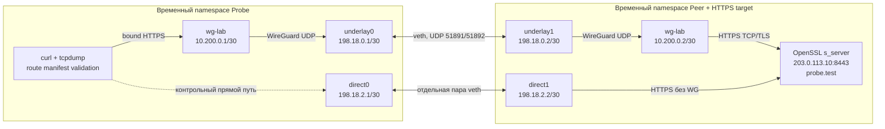

## Итог

На TimeWeb выполнен изолированный Linux/WireGuard-стенд без установки
пакетов и без изменения production VPN. Финальный прогон 08:39:07-08:39:24
UTC: **16 сценариев, 41 успешная проверка, 0 ошибок**, exit code 0.

Подтверждена работоспособность комбинации: bound sockets + local-source
routing guards + проверка явного маршрутного manifest до и после запроса.
Это результат стенда, не развертывание collector и не полная приемка
мониторинга TimeWeb. Изменения в рабочий `wg-relay` не переносились.

План: [TimeWeb_Uplink_Monitoring_Architecture_and_Plan](<../architecture/TimeWeb_Uplink_Monitoring_Architecture_and_Plan.md>).
Журнал: [TimeWeb_Uplink_Monitoring_Implementation_Log_2026-09-11](<TimeWeb_Uplink_Monitoring_Implementation_Log_2026-09-11.md>).

## Артефакты

- [Рабочий сценарий стенда в System](<../../services/monitoring/vpn-connectivity/tests/uplink_namespace_lab.sh>).
- Результаты всех трех прогонов и проверки до/после (source reference not migrated).
- [Снимок сценария успешного прогона](<../../services/monitoring/vpn-connectivity/tests/uplink_namespace_lab.sh>).

SHA256 снимка сценария:

```text
e72511a71a52f2d3323e5aebd0639dcbc201be8114cd0e6e1c8ecf0c4482ef4b
```

В evidence сохранены stdout/stderr и выбранные заголовки пакетов. Полные
pcap не создавались. Private keys тестового WG и TLS генерировались заново
в закрытом временном каталоге на сервере и удалены при cleanup; в evidence
и Obsidian их нет.

## Устройство стенда



Все veth, адреса, WG-интерфейсы, маршруты и qdisc находились только в двух
новых namespaces. Связей с production интерфейсами/bridge или Интернетом
у стенда не было. Сервер HTTPS имитирует внешнюю цель, а не настоящий
Fornex/Cenuta; NAT/MTU/потери реальных провайдеров этим стендом не проверялись.

Использованы уже установленные bash, unshare/nsenter, ip, wg, curl 8.5.0,
openssl, nc, tcpdump и tc/netem. Python не запускался на VPS. Генерация
краткоживущего self-signed TLS-сертификата нужна только для fixture;
curl проверял его через явный `--cacert` и имя `probe.test`, без `-k`.

Скрипт отказывается работать вне свежего namespace с единственным `lo`.
Внешний timeout ограничен 90 секундами; cleanup останавливает дочерние
процессы и удаляет собственный временный каталог. При выходе процессов
их сетевые namespaces и интерфейсы автоматически исчезают.

## Проверяемая защита

Только внутри стенда применялись четыре правила:

```text
100: iif lo oif wg-lab lookup 100
101: iif lo oif wg-lab prohibit
102: iif lo from 10.200.0.1/32 lookup 100
103: iif lo from 10.200.0.1/32 prohibit
```

Первая пара относится к привязанным локальным сокетам. Вторая нужна для
ответов ядра после исчезновения сокета, когда прежнего oif уже нет.
`iif lo` отделяет локальные пакеты от forwarded-трафика; семантика описана
в [ip-rule](https://man7.org/linux/man-pages/man8/ip-rule.8.html).
Номера и адреса выше относятся только к стенду и не являются командами
для копирования в production.

Route validator сравнивал явный default route таблицы 100 с baseline
до запроса и после его завершения. При отсутствии/изменении возвращал
внутренний результат 90 и `UNKNOWN`, не сетевой DOWN. Это прототип
поведения в тесте, не установленный серверный сборщик.

## Результаты

| Сценарий | Наблюдение |
| --- | --- |
| Direct control | HTTP 200 через direct0: обходной маршрут действительно работоспособен |
| Bound HTTPS без guards | HTTP 200 через WG |
| Запрос к закрытому TCP-порту без guards | 1 RST ушел напрямую |
| Задержанный HTTPS, timeout 250 мс, без guards | 7 поздних RST напрямую, 1 через WG |
| Bound HTTPS с guards | HTTP 200, 0 прямых пакетов |
| Закрытый порт с guards | 1 RST через WG, 0 напрямую |
| Задержанный HTTPS с guards | 8 RST через WG, 0 напрямую |
| Удален явный default route, сырой bound curl | HTTP 200 через WG: обнаруженная особенность Linux, не успешная проверка manifest |
| Удален маршрут, validator включен | `UNKNOWN/probe_path_unverified`, запрос не запускался |
| Удален маршрут, ответ ядра на закрытый порт | RST не ушел ни напрямую, ни через WG |
| Direct control при удаленном маршруте WG | HTTP 200: запрет не объясняется недоступностью альтернативы |
| Маршрут восстановлен | Проверка manifest и HTTPS успешны; 0 прямых пакетов |
| Маршрут удален во время HTTPS | Raw HTTP 200 получен через WG, но результат отвергнут: `UNKNOWN/probe_path_changed` |
| WG-интерфейс выключен | curl 7, 0 прямых пакетов |
| WG-интерфейс включен обратно | HTTP 200, 0 прямых пакетов |
| WG-интерфейс удален | curl 45, 0 прямых пакетов |

Дополнительная проверка вне этих 16 сценариев: lookup forwarded-трафика
с нелокальным source `198.51.100.20`, ingress underlay0, до и после guards
полностью совпал. Это проверка route lookup, не end-to-end клиентский тест.

Задержка ответов формировалась `tc netem delay 100ms` исключительно на
тестовом WG в peer namespace. После curl timeout capture продолжался
0.8 секунды. Вывод относится к этому ограниченному окну, а не ко всем
возможным TCP retransmission timers и нагрузкам.

## Что выявили промежуточные прогоны

1. Прогон 08:32:15 UTC остановился на forwarded lookup с собственным WG
   source и другим ingress (`EINVAL`). В отдельном минимальном namespace
   подтверждено: при `accept_local=0` локальный source отклоняется,
   нелокальный проходит. Исправлена fixture, правило проверки добавлено
   в архитектуру до изменения сценария.
2. Прогон 08:35:16 UTC завершился с одной ошибкой ожидания: удаление route
   не заставило bound curl отказать. TCP продолжил идти через WG, не напрямую.
   Это поведение подтверждено исходным кодом
   [Linux 6.8 IPv4 routing](https://github.com/torvalds/linux/blob/v6.8/net/ipv4/route.c#L2582-L2612):
   при заданном oif после ошибки FIB lookup возможен on-link route.
3. Добавлены самостоятельные проверки manifest до/после запроса и отдельные
   сценарии отсутствия route и его изменения в процессе. Непрошедший тест
   не скрыт: исходные результаты всех прогонов сохранены. Финальный прогон
   не утверждает, что сам `prohibit` останавливает любой bound socket.

Проверка до/после не ловит мгновенное изменение с возвратом к точно прежнему
состоянию между проверками (ABA). Production collector должен также следить
за изменением generation/PID/ifindex/правил и отвергать такие наблюдения;
это еще не реализовано и не протестировано данным shell-прототипом.

## Контроль production после стенда

Замеры 08:31:51 и 08:39:54 UTC совпали:

| Объект | До / после |
| --- | --- |
| PID wg-relay | 1181 / 1181 |
| SHA256 host IPv4 rules/routes и адресов | `37d644d4aeff9feb6001ac261bbbfa4ea10224b72f0239c94fa28b059c75aafd` |
| SHA256 relay IPv4 rules/routes/адресов и iptables filter/nat/mangle | `b0b91850cb2dbbaab26532d34a85fa46984ab53859b99ca30408d005a8f49411` |
| TCP listener 8443 в host namespace | 0 / 0 |
| Временные каталоги uplink-netns-lab | 0 / 0 |

VPN-контейнер не перезапускался. Production systemd/SSH/WG и клиентские
конфиги не менялись; пакеты не устанавливались. Стенд не является
нагрузочным тестом, проверкой Cenuta egress или доказательством доступности
Apple TV.

## Следующий этап

Для рабочей реализации выбран кандидат: bound sockets, local-oif и
local-source guards, валидация manifest до/после, контроль смены поколения.
Отдельный постоянный namespace пока не требуется выбранному кандидату.

Перед production-применением нужны:

- свежий восстанавливаемый backup и отдельный manifest точных изменяемых правил;
- аудит локальных сервисов и их ответов с WG source: source guards способны
  затронуть и другие локальные ответы, не только мониторинг;
- сохранение приоритета существующих маршрутов к клиентским/служебным сетям,
  выбор свободных rule priorities, проверка обоих WG и таблиц 100/200;
- идемпотентный helper и точный rollback, без общего route/rule flush;
- regression клиентского трафика и bounded captures после включения guards;
- согласование установки серверной `.venv`, collector и Prometheus отдельно.

Эти действия в рамках стенда не выполнялись. Полные T01-T35 и 24/48-часовые
испытания общего плана не объявляются пройденными.
