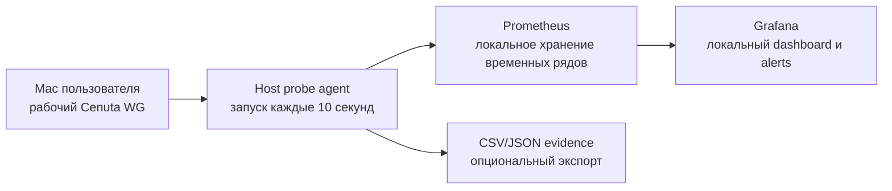

> [!WARNING] Историческая версия, не текущий runbook
> Полный текст документа до документационного ревью 2026-09-13 сохранен ниже без изменения. Старые статусы, планы, команды, интервалы и пути не подтверждают состояние runtime и не разрешают повторное внедрение.
> Актуальная версия: [VPN_Connectivity_Monitoring_Architecture](<../architecture/VPN_Connectivity_Monitoring_Architecture.md>). Текущий статус TimeWeb: [Pilot Quick Guide](<../operations/TimeWeb_Uplink_Pilot_Quick_Guide.md>).
> Относительные ссылки внутри оригинала относятся к прежнему расположению в `MIKROTIK/docs/`.

<!-- ORIGINAL DOCUMENT START -->
---
type: architecture
status: planned
topic: vpn-connectivity-monitoring
created: 2026-08-17
updated: 2026-08-17
tags:
  - monitoring
  - grafana
  - prometheus
  - wireguard
  - vpn
source:
  - "[Восстановление_доступа](<../reference/Восстановление_доступа.md>)"
  - "[VPN_HLD](<../architecture/overview.md>)"
---

# Архитектура мониторинга связности VPN

## Назначение

Документ описывает локальную систему наблюдения за качеством интернет-доступа
при работе через выбранный VPN-маршрут. Текущий первый профиль реализации —
AmneziaVPN/AmneziaWG через Fornex, внешний IPv4 `103.75.126.143`. Система
должна фиксировать короткие сбои,
в том числе ситуацию, когда входящий трафик сохраняется, а исходящий канал
временно перестает работать.

Мониторинг запускается на Mac пользователя. Это важно: проверки должны идти по
тому же маршруту, что и рабочий трафик, а не из отдельного VPS или из
изолированной Docker-сети.

## Исходное наблюдение

- При работе через Cenuta WG связь прерывается примерно раз в 5–7 минут.
- Перерыв длится около 20–30 секунд.
- Во время видеоконференции пользователь слышит собеседников, но они не слышат
  пользователя.
- Это рабочая гипотеза о потере исходящего направления, а не доказанное
  одностороннее повреждение канала.
- История наблюдения и результаты предыдущей диагностики находятся в
  [Восстановление_доступа](<../reference/Восстановление_доступа.md>).

## Текущий профиль реализации

- Egress provider: `Fornex`.
- Transport/client: `AmneziaVPN` / `AmneziaWG`.
- Active macOS tunnel interface: `utun4`.
- Tunnel address observed: `10.8.1.3`.
- Full-tunnel routes observed: `0/1` и `128.0/1` через `utun4`.
- External IPv4 observed: `103.75.126.143`.
- Cenuta остается историческим диагностическим профилем и может быть добавлен
  отдельным сравнительным профилем позже.

## Профили площадок

Mac перемещается между площадками. Его LAN IP может измениться, а адрес
шлюза `192.168.88.1` совпадает на разных площадках, поэтому площадка должна
быть отдельным явно выбранным профилем мониторинга.

| Профиль | Площадка | Провайдер | Шлюз | Последний известный IP Mac | Интерфейс | Статус данных |
| --- | --- | --- | --- | --- | --- | --- |
| `orekhovo_asarta` | Орехово, Детская 11 | Asarta (`asarta.ru`) | `192.168.88.1` | `192.168.88.20` | Wi-Fi | Последнее зафиксированное значение |
| `nakhimova_domru` | Нахимова 11 | Дом.ру / ER-Telecom | `192.168.88.1` | `192.168.88.28` | Ethernet | Последнее зафиксированное значение |

IP Mac не должен быть жестко зашит в probes. При каждом запуске и в каждом
измерении exporter должен получать текущий адрес интерфейса средствами macOS
и публиковать его как безопасную информационную метрику. Для корректной
идентификации места оператор выбирает `site_profile`; одинаковый шлюз не
позволяет надежно определить площадку автоматически.

## Цели

1. Получать измерение каждые 10 секунд.
2. Хранить историю минимум 30 дней.
3. Разделять LAN, ICMP, DNS, HTTPS и WireGuard.
4. Видеть короткие сбои на временной шкале.
5. Не менять рабочую маршрутизацию и не переносить конфиги VPN в систему
   мониторинга.
6. Иметь возможность позже добавить уведомление о сбое длительностью 20–30
   секунд.

## Не входит в задачу

- автоматическое переключение между Cenuta, Fornex и AmneziaWG;
- изменение конфигурации MikroTik, TimeWeb, Cenuta или Fornex;
- хранение private key, preshared key, QR-кодов и полных WireGuard-конфигов;
- доказательство блокировки конкретным оператором только по одному типу теста.

## Логическая схема



## Компоненты

### 1. Host probe agent

Небольшой локальный процесс на macOS. Он выполняет проверки с ограниченными
таймаутами и публикует последние результаты в Prometheus-формате на
`127.0.0.1:9105/metrics`.

Процесс должен выполняться на хосте Mac, а не только в Docker-контейнере.
Docker Desktop может использовать другой сетевой namespace и другой путь до
VPN, поэтому контейнерная проверка не заменяет проверку с Mac.

### 2. Prometheus

Prometheus опрашивает host probe agent каждые 10 секунд и хранит результаты.
Он используется как локальная база временных рядов. Grafana имеет встроенную
поддержку Prometheus: [официальная документация](https://grafana.com/docs/grafana/latest/datasources/prometheus/).

Параметры первой версии:

- endpoint: `host.docker.internal:9105` из Prometheus-контейнера;
- scrape interval: `10s`;
- retention: `30d`;
- storage: постоянный Docker volume в Dropbox System или отдельном локальном
  каталоге, не в Obsidian.

### 3. Grafana

Grafana отвечает только за визуализацию, Explore и alerts. Источник данных -
Prometheus. Доступ к Grafana ограничивается `127.0.0.1`, если не появится
отдельная потребность в удаленном доступе.

Планируемые локальные адреса:

- Grafana: `http://127.0.0.1:3000`;
- Prometheus: `http://127.0.0.1:9090`;
- host probe agent: `http://127.0.0.1:9105/metrics`.

### 4. Evidence export

Для расследования можно дополнительно сохранять CSV или JSON с теми же
измерениями. Это позволит приложить короткий фрагмент истории к тикету
провайдера и не зависеть от сохранности Grafana dashboard.

## Набор проверок

Каждое измерение получает общий timestamp и отдельные значения `up`, latency,
error и duration.

| Проверка | Пример цели | Что отделяет |
| --- | --- | --- |
| LAN gateway | `192.168.88.1` | сбой Wi-Fi/Ethernet или локального роутера |
| ICMP | `1.1.1.1`, второй независимый адрес | потерю IP-доступа или фильтрацию ICMP |
| DNS | запрос к `1.1.1.1` и/или системному DNS | отказ DNS при сохранении IP-связи |
| HTTPS | `https://api.ipify.org`, `https://example.com` | рабочий TCP/TLS и прикладной доступ |
| WireGuard | handshake age и TX/RX counters, если доступны на Mac | состояние туннеля и наличие реального обмена |

Тесты должны иметь разные метрики. Нельзя объявлять интернет недоступным
только по одному `ping`: ICMP может фильтроваться независимо от TCP/HTTPS.

## Модель метрик

Минимальный набор:

```text
vpn_probe_up{site_profile="...",probe="gateway|icmp|dns|https"} 0|1
vpn_probe_latency_seconds{site_profile="...",probe="..."} <value>
vpn_probe_duration_seconds{site_profile="...",probe="..."} <value>
vpn_probe_errors_total{site_profile="...",probe="..."} <counter>
vpn_host_info{site_profile="...",lan_ip="...",interface="..."} 1
vpn_wireguard_handshake_age_seconds{peer="..."} <value>
vpn_wireguard_tx_bytes_total{peer="..."} <counter>
vpn_wireguard_rx_bytes_total{peer="..."} <counter>
```

Секреты, полные endpoint-конфиги и private keys в метрики не попадают.
Имена peer должны быть обезличенными или соответствовать внутреннему
стабильному идентификатору.

## Dashboard Grafana

Первая версия должна содержать четыре панели:

1. **Connectivity state** - State timeline по gateway, ICMP, DNS и HTTPS.
2. **Latency** - задержка по независимым проверкам.
3. **Failure matrix** - какие проверки одновременно перешли в `down`.
4. **WireGuard** - возраст handshake и скорости прироста TX/RX.

Временные интервалы: последние 15 минут, 1 час, 6 часов, 24 часа и
произвольный диапазон.

## Интерпретация результатов

| Наблюдение | Предварительная интерпретация |
| --- | --- |
| Gateway down | локальная сеть, Wi-Fi/Ethernet или MikroTik |
| Gateway up, ICMP/DNS/HTTPS down | проблема выше LAN или полный отказ VPN-маршрута |
| ICMP down, HTTPS up | ICMP фильтруется или деградирует отдельно; вывод о потере интернета делать нельзя |
| DNS down, HTTPS по IP up | проблема DNS |
| HTTPS down, WireGuard handshake свежий | туннель жив, но есть проблема маршрутизации/NAT/egress |
| Handshake stale, все внешние проверки down | вероятен сбой WireGuard/UDP-пути |
| Внешние проверки up, ВКС не передает голос | отдельная проблема UDP-медиатрафика, приложения или NAT; нужны counters и packet capture |

Эта таблица задает направление расследования, но не заменяет корреляцию с
серверными counters и packet capture.

## Безопасность и хранение

- Grafana, Prometheus и exporter по умолчанию слушают только localhost.
- В dashboard не отображаются ключи, пароли и содержимое конфигов.
- История метрик считается техническим артефактом и хранится в Dropbox System
  или локальном каталоге мониторинга, не в Obsidian.
- В Obsidian хранятся архитектура, план, инструкции и sanitized summaries.
- При передаче evidence третьей стороне экспортировать только нужный диапазон
  времени и удалить локальные адреса, если они не нужны для анализа.

## Выбор технологии

Для первой реализации выбран стек **host probe agent + Prometheus + Grafana**.
Он дает точный 10-секундный интервал, локальное хранение и возможность
добавить специфические метрики WireGuard. InfluxDB также поддерживается Grafana
и подходит для временных рядов, но отдельный стек `Telegraf + InfluxDB`
потребует больше решений на первом этапе: [официальная документация Grafana по InfluxDB](https://grafana.com/docs/grafana/latest/datasources/influxdb/).

Grafana Cloud на этом этапе не используется: для текущей диагностики нет
необходимости отправлять сетевые метрики за пределы Mac.

## Критерии готовности архитектуры

- измерения появляются каждые 10 секунд;
- история доступна минимум за 30 дней;
- сбой длительностью 20–30 секунд виден на State timeline;
- LAN, ICMP, DNS и HTTPS различаются отдельными метриками;
- проверка выполняется с Mac через активный Cenuta WG;
- система не меняет VPN-маршрутизацию и не содержит секретов.
