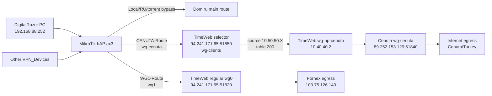

## Назначение

План описывает безопасное внедрение отдельного Cenuta-маршрута для одного домашнего устройства:

- `DigitalRazor PC` с LAN IP `192.168.88.252` должен выходить в нероссийский интернет через Cenuta.
- Остальные устройства из текущего `VPN_Devices` должны продолжить выходить через Fornex.
- Локальные сети, российские подсети `RU_Networks`, torrent bypass `63450-63459` и BTH-контур должны остаться без изменения поведения.

Target outcome: после внедрения переключение домашнего устройства между Fornex и Cenuta выполняется переносом его IP между address-list `VPN_Devices` и `CENUTA_Devices`, без изменения общих списков `Local_Networks`, `RU_Networks` и torrent bypass.

## Текущее точное состояние

Факты из актуального сохраненного export `2026-05-25 09:26:52`:

- RouterOS: `7.22.1`.
- LAN: `192.168.88.0/24`, router `192.168.88.1`.
- WAN: `10.12.20.168/22`, gateway `10.12.20.1`.
- `DigitalRazor PC`: DHCP lease `192.168.88.252`, `dhcp-option=VPN-DNS`.
- `DigitalRazor PC` сейчас входит в `VPN_Devices`.
- Текущий Fornex-туннель на MikroTik:
  - interface `wg1`;
  - local tunnel IP `10.10.10.24/24`;
  - endpoint `94.241.171.65:51820`;
  - route table `WG1-Route`;
  - route `0.0.0.0/0 gateway=wg1 routing-table=WG1-Route`;
  - NAT `masquerade out-interface=wg1`.
- BTH-туннель `wg-home` активен отдельно и не является частью этой миграции.

Текущий порядок `mangle` для `VPN_Devices`:

1. local bypass: `dst-address-list=Local_Networks`.
2. forced VPN: `dst-address=195.133.216.210` / `dw-qwen.appliedai.tech` -> `WG1-Route`.
3. Russian bypass: `dst-address-list=RU_Networks`.
4. BitTorrent bypass: TCP/UDP `63450-63459`, `src` и `dst`.
5. all other: `VPN_Devices` -> `WG1-Route`.

Факты из SYSTEM-документов:

- TimeWeb `94.241.171.65` является центральным WireGuard relay/router.
- Fornex egress: TimeWeb `wg1` -> Fornex `103.75.126.143:51821`, table `100`.
- Cenuta egress: TimeWeb `wg-up-cenuta` -> Cenuta `89.252.153.129:51840`, table `200`.
- TimeWeb selector endpoint уже существует: `wg-clients`, `94.241.171.65:51850`, subnet `10.50.50.0/24`.
- Selector clients маршрутизируются по source IP:
  - route `fornex` -> table `100`;
  - route `cenuta` -> table `200`.

## Решение

На MikroTik добавляется второй исходящий WireGuard-клиент, условно `wg-cenuta`, подключенный не к обычному TimeWeb endpoint `51820`, а к selector endpoint `94.241.171.65:51850`.

Почему нельзя решить только новой route table поверх текущего `wg1`:

- текущий `wg1` входит на TimeWeb в контур `wg0` / `10.10.10.0/24`;
- TimeWeb для этого контура маршрутизирует source `10.10.10.0/24` в table `100`, то есть Fornex;
- если MikroTik отправит DigitalRazor через тот же `wg1`, TimeWeb все равно увидит MikroTik peer `10.10.10.24` и отправит трафик в Fornex.

Новая целевая модель:



## Scope

Включено:

- создать на TimeWeb один новый selector-client route `cenuta` для MikroTik;
- добавить на MikroTik `CENUTA_Devices`;
- добавить на MikroTik `wg-cenuta`;
- добавить на MikroTik `CENUTA-Route`;
- добавить NAT и FastTrack bypass для `wg-cenuta`;
- добавить параллельные `mangle`-правила для `CENUTA_Devices`;
- перенести `192.168.88.252` из `VPN_Devices` в `CENUTA_Devices`;
- проверить каждый этап до следующего шага.

Не делаем:

- не меняем `RU_Networks`;
- не меняем `Local_Networks`;
- не меняем текущий `wg1` / `WG1-Route`;
- не меняем `wg-home` / BTH;
- не меняем Fornex;
- не меняем Cenuta, если live-проверка покажет, что `wg-cenuta` и NAT уже работают;
- не включаем IPv6 egress через Cenuta;
- не сохраняем private keys, preshared keys, QR-коды и полные client configs в Obsidian.

## Доступы

TimeWeb:

- доступ у Codex уже есть;
- рабочий entrypoint: `/opt/wg-router/commands.sh`;
- `wg-client-config` является только удобной оберткой для просмотра/вывода config/QR.

MikroTik:

- доступ потребуется перед шагом `3. MikroTik read-only baseline`;
- до этого шага live-доступ к MikroTik не нужен;
- когда план дойдет до этого места, Codex должен запросить у пользователя один из вариантов:
  - временный SSH-доступ к MikroTik `192.168.88.1`;
  - запуск команд пользователем в WinBox Terminal с передачей вывода;
  - BTH/VPN-доступ до домашней сети, если Codex-среда сможет достучаться до `192.168.88.1`.

---
Доступ к MikroTik. Прямой доступ до `192.168.88.1` есть, SSH открыт, но ключевой доступ пока не настроен.

В WinBox -> Terminal выполни:

```
/user add name=codex group=full comment="temporary Codex access 2026-07-04" disabled=no
/file add name=codex_mikrotik_20260704.pub contents="ssh-rsa AAAAB3NzaC1yc2EAAAADAQABAAABAQDNmUVwWDDX9d/4AYUNVhyQOER0MSqv4l9M/8a9vRpVugypNc6wHikZdisrWD0eXWoujY/L4G2U2sMp31H7zwGbyiXGVNBcsN8F5EsxQ77yaUTvJ6Knt/PeqBUcwERmnoW5ReUE5LpV0K2LDyNbu3B9Px/EJVfIo/rdcHino3NNYkg8LwgO9BKkzxIOAXaSVhFOGKKKvoqfPMhYno4ePPaa62yisHai8x/XODTkvHI0s3ey+enWc/BRhMxdJtOY5Nh2tbs9Lf4TQEjVDbJ2Xdx4rxAJrvd/+183SKLzI48y9CSvQ5OdJdmb03TJf9SlM7LLaMQW5h82OQXGsWlculvl codex-mikrotik-20260704"
/user ssh-keys import public-key-file=codex_mikrotik_20260704.pub user=codex
/user print where name=codex
/user ssh-keys print detail where user=codex
```

Если команда `/file add ... contents=...` не пройдет, загрузи файл `.local/ssh/codex_mikrotik_20260704.pub` в WinBox -> Files под именем `codex_mikrotik_20260704.pub`, затем выполни только:

```
/user add name=codex group=full comment="temporary Codex access 2026-07-04" disabled=no
/user ssh-keys import public-key-file=codex_mikrotik_20260704.pub user=codex
/user ssh-keys print detail where user=codex
```
---

Минимальные требования к MikroTik-доступу для выполнения:

- read для снятия текущей конфигурации;
- write для добавления interface, route table, route, NAT, firewall filter, mangle и address-list;
- test для ping/tool-проверок;
- sensitive понадобится только если Codex сам вводит WireGuard private key/preshared key из root-only TimeWeb export.

Стоп-линия: не передавать private key/preshared key в чат. Если ключи нужно ввести вручную, Codex должен дать команды с placeholders, а пользователь вставляет секреты локально в защищенном канале/терминале.

## Execution Plan

### 0. Pre-flight: подтвердить источники и стоп-линии

Task: зафиксировать, что план исполняется по текущему snapshot и свежим live-проверкам.

Почему: экспорт MikroTik от `2026-05-25`, а TimeWeb selector был изменен `2026-06-29`; перед production-изменениями нельзя полагаться только на старый файл.

Scope:

- проверить, что текущий документ соответствует `VPN_HLD`, `TimeWeb_Configuration`, `Fornex_Configuration`, `Cenuta_Configuration`;
- определить rollback-путь до любых live-изменений.

Проверки:

- документ существует и зарегистрирован в `docs/catalog.md`;
- в плане есть rollback;
- в плане есть отдельные approval gates для TimeWeb mutation и MikroTik mutation.

Stop-lines:

- если пользователь хочет строго нулевые изменения на TimeWeb, остановиться и обсудить: без нового selector peer на TimeWeb новый MikroTik-туннель к Cenuta не будет корректно принят.

### 1. TimeWeb read-only baseline

Task: убедиться, что TimeWeb selector, Fornex uplink и Cenuta uplink живы до создания нового клиента.

Будущие команды:

```bash
ssh -i .local/ssh/codex_timeweb_audit_20260628 -o IdentitiesOnly=yes root@94.241.171.65
sudo /opt/wg-router/commands.sh status
sudo /opt/wg-router/commands.sh test fornex
sudo /opt/wg-router/commands.sh test cenuta
docker exec wg-relay wg show
docker exec wg-relay ip rule
docker exec wg-relay ip route show table 100
docker exec wg-relay ip route show table 200
```

Acceptance:

- `wg1` handshake to Fornex fresh or operational.
- `wg-up-cenuta` handshake to Cenuta fresh or operational.
- `wg-clients` exists and listens on `51850`.
- table `100` routes to Fornex.
- table `200` routes to `wg-up-cenuta`.

Stop-lines:

- no `wg-up-cenuta`;
- no `wg-clients`;
- Cenuta test fails;
- route table `200` missing;
- Docker container `wg-relay` not running.

### 2. TimeWeb: создать selector-client для MikroTik/Cenuta

Task: создать отдельный root-only selector client profile для будущего MikroTik `wg-cenuta`.

Будущая команда:

```bash
sudo /opt/wg-router/commands.sh add-client mikrotik-hap-ax3 cenuta
sudo wg-client-config mikrotik-hap-ax3-cenuta.conf
```

Ожидаемый результат:

- root-only export: `/root/wg-client-exports/mikrotik-hap-ax3-cenuta.conf`;
- новый selector IP в `10.50.50.0/24`;
- route profile `cenuta`;
- server-side route check: source `10.50.50.X` -> table `200` -> `wg-up-cenuta`;
- backup created by `/opt/wg-router/commands.sh`.

Проверки после шага:

```bash
sudo /opt/wg-router/commands.sh show-client mikrotik-hap-ax3-cenuta.conf view
sudo /opt/wg-router/commands.sh test-client mikrotik-hap-ax3
docker exec wg-relay wg show wg-clients
docker exec wg-relay ip rule | grep '10.50.50'
docker exec wg-relay ip route show table 200
```

Acceptance:

- новый peer есть в `wg-clients`;
- peer source IP имеет policy rule в table `200`;
- NAT для этого source IP идет только через `wg-up-cenuta`;
- существующие clients `client-1`, `client-2`, `sergey-iphone-12`, `sveta-iphone` не изменены.

Stop-lines:

- `add-client` предлагает перезаписать существующий config;
- command creates route `fornex` instead of `cenuta`;
- backup не создается;
- config/private key выводятся в общий чат.

### 3. MikroTik read-only baseline

Task: получить свежий live snapshot MikroTik перед изменениями.

Этот шаг требует участия пользователя для организации доступа к MikroTik.

Инструкция пользователю на момент выполнения:

1. Если Codex может подключиться к домашней сети/BTH, дай IP/порт и временный логин для MikroTik.
2. Если прямого доступа нет, открой WinBox -> Terminal и выполни команды, которые Codex даст на этом шаге.
3. Не передавай private keys в чат; для read-only baseline они не нужны.

Минимальный read-only набор команд:

```routeros
/export hide-sensitive
/interface wireguard print detail
/interface wireguard peers print detail
/ip address print detail
/routing table print detail
/ip route print detail
/ip firewall address-list print where list=VPN_Devices
/ip firewall address-list print where list=CENUTA_Devices
/ip firewall mangle print detail
/ip firewall filter print detail
/ip firewall nat print detail
```

Acceptance:

- `DigitalRazor PC` все еще `192.168.88.252`;
- `192.168.88.252` найден в `VPN_Devices`;
- `CENUTA_Devices` либо отсутствует, либо пуст/не конфликтует;
- `wg1`, `wg-home`, `WG1-Route`, BTH rules соответствуют сохраненному export или расхождения явно зафиксированы;
- есть текущие rule numbers для точного `place-before`.

Stop-lines:

- live config отличается от export так, что rule order непонятен;
- `192.168.88.252` уже не DigitalRazor;
- `DigitalRazor PC` имеет другой IP или lease не static;
- уже существует `wg-cenuta` или `CENUTA-Route` с неизвестным назначением;
- нет способа снять backup/export.

### 4. MikroTik backup/checkpoint

Task: создать безопасную точку отката до live-изменений.

Будущие действия:

- снять `/export hide-sensitive`;
- если возможно, снять binary backup через WinBox/Files или CLI;
- сохранить backup локально вне публичных заметок;
- не копировать sensitive export в Obsidian.

Проверки:

```routeros
/system backup save name=pre-digitalrazor-cenuta
/export hide-sensitive file=pre-digitalrazor-cenuta
/file print where name~"pre-digitalrazor-cenuta"
```

Acceptance:

- backup/export создан;
- user подтвердил, что backup скачан или доступен на MikroTik;
- план rollback использует эту точку.

Stop-lines:

- backup не создается;
- устройство сообщает ошибки storage/file;
- пользователь не может скачать или подтвердить наличие backup.

### 5. MikroTik: добавить `wg-cenuta` без переключения трафика

Task: добавить новый WireGuard interface и route table так, чтобы существующий трафик еще не изменился.

Будущие действия:

- создать `/routing table name=CENUTA-Route`;
- создать `/interface wireguard name=wg-cenuta`;
- назначить IP из TimeWeb selector config;
- добавить peer на `94.241.171.65:51850`;
- добавить route `0.0.0.0/0 gateway=wg-cenuta routing-table=CENUTA-Route`;
- добавить NAT `masquerade out-interface=wg-cenuta`;
- добавить FastTrack bypass rules для `wg-cenuta` выше `defconf: fasttrack`.

Секреты:

- private key и preshared key вводятся только в RouterOS/WinBox/SSH;
- в Obsidian и чат не сохраняются.
- при переносе WireGuard-полей из client config нельзя парсить строки через
  `awk -F '='`, потому что base64-ключи могут заканчиваться padding-символом
  `=`; значение нужно брать как всю часть строки после первого `=`, сохраняя
  padding.

Проверки после шага:

```routeros
/interface wireguard print detail where name=wg-cenuta
/interface wireguard peers print detail where interface=wg-cenuta
/ip address print detail where interface=wg-cenuta
/routing table print detail where name=CENUTA-Route
/ip route print detail where routing-table=CENUTA-Route
/ip firewall nat print detail where out-interface=wg-cenuta
/ip firewall filter print detail where comment~"Cenuta"
```

TimeWeb-side checks:

```bash
docker exec wg-relay wg show wg-clients
sudo /opt/wg-router/commands.sh test-client mikrotik-hap-ax3
```

Acceptance:

- `wg-cenuta` exists and has expected `10.50.50.X/32`;
- peer endpoint is `94.241.171.65:51850`;
- TimeWeb shows handshake after MikroTik sends keepalive;
- `CENUTA-Route` exists;
- FastTrack bypass rules for `wg-cenuta` are numerically above
  `defconf: fasttrack`; after `place-before` this must be verified with
  `/ip firewall filter print detail`, and corrected with `move` if needed;
- no `mangle` rule yet sends DigitalRazor to `CENUTA-Route`;
- existing `VPN_Devices` behavior remains Fornex.

Stop-lines:

- no handshake;
- route table typo;
- NAT missing;
- FastTrack bypass cannot be placed above `defconf: fasttrack`;
- any existing device loses internet.

### 6. MikroTik: добавить параллельные `mangle` rules для `CENUTA_Devices`

Task: подготовить routing logic для новой egress-группы без немедленного влияния на текущие устройства.

Правила должны переиспользовать существующие сущности:

- `Local_Networks`;
- `RU_Networks`;
- torrent ports `63450-63459`;
- forced host `195.133.216.210`.

Новые правила должны быть логически такими:

```routeros
/ip firewall mangle add action=accept chain=prerouting comment="CENUTA Bypass: Local Network" \
  dst-address-list=Local_Networks src-address-list=CENUTA_Devices

/ip firewall mangle add action=mark-routing chain=prerouting comment="Force CENUTA: dw-qwen.appliedai.tech" \
  dst-address=195.133.216.210 new-routing-mark=CENUTA-Route passthrough=no src-address-list=CENUTA_Devices

/ip firewall mangle add action=accept chain=prerouting comment="CENUTA Bypass: Russian Subnets" \
  dst-address-list=RU_Networks src-address-list=CENUTA_Devices

/ip firewall mangle add action=accept chain=prerouting comment="CENUTA Bypass: BitTorrent TCP dst 63450-63459" \
  dst-port=63450-63459 protocol=tcp src-address-list=CENUTA_Devices

/ip firewall mangle add action=accept chain=prerouting comment="CENUTA Bypass: BitTorrent TCP src 63450-63459" \
  protocol=tcp src-address-list=CENUTA_Devices src-port=63450-63459

/ip firewall mangle add action=accept chain=prerouting comment="CENUTA Bypass: BitTorrent UDP dst 63450-63459" \
  dst-port=63450-63459 protocol=udp src-address-list=CENUTA_Devices

/ip firewall mangle add action=accept chain=prerouting comment="CENUTA Bypass: BitTorrent UDP src 63450-63459" \
  protocol=udp src-address-list=CENUTA_Devices src-port=63450-63459

/ip firewall mangle add action=mark-routing chain=prerouting comment="CENUTA: Route all other for CENUTA_Devices" \
  new-routing-mark=CENUTA-Route passthrough=no src-address-list=CENUTA_Devices
```

Порядок размещения:

1. `CENUTA Bypass: Local Network` рядом с текущим local bypass.
2. `Force CENUTA` до текущего `Force VPN: dw-qwen.appliedai.tech`.
3. `CENUTA Bypass: Russian Subnets` рядом с текущим RU bypass.
4. CENUTA torrent bypass рядом с текущим torrent bypass.
5. `CENUTA: Route all other` до или рядом с текущим `VPN: Route all other for VPN_Devices`.

Почему так:

- forced host должен идти в выбранный egress до RU bypass;
- RU/local/torrent bypass должны остаться bypass для обеих egress-групп;
- если адрес случайно окажется в обеих группах, CENUTA rules должны сработать раньше `VPN_Devices -> WG1-Route`, но validation все равно должна остановить двойное членство.

Проверки после шага:

```routeros
/ip firewall mangle print detail where comment~"CENUTA"
/ip firewall address-list print where list=CENUTA_Devices
/ip firewall mangle reset-counters [find comment~"CENUTA"]
```

Acceptance:

- CENUTA mangle rules существуют в правильном порядке;
- `CENUTA_Devices` пока пуст или не содержит production IP до switch step;
- counters CENUTA rules не растут без устройства в списке;
- existing `VPN_Devices` traffic не изменился.

Stop-lines:

- нельзя гарантировать `place-before`;
- CENUTA all-other rule стоит выше local/RU/torrent bypass;
- CENUTA rules начинают матчить неожиданные адреса.

### 7. Переключить DigitalRazor в `CENUTA_Devices`

Task: выполнить минимальное переключение egress для `192.168.88.252`.

Безопасная последовательность:

```routeros
/ip firewall address-list add list=CENUTA_Devices address=192.168.88.252 comment="DigitalRazor PC"
/ip firewall address-list remove [find list=VPN_Devices address=192.168.88.252]
```

Перед удалением из `VPN_Devices` CENUTA rules уже должны быть активны и стоять выше WG1 all-other. Это дает короткий безопасный overlap: если `192.168.88.252` на секунду будет в обоих списках, CENUTA route должен победить по порядку правил.

После переключения нужно сбросить conntrack только для `192.168.88.252`, чтобы
активные старые соединения DigitalRazor не продолжали использовать прежнее
состояние маршрутизации до естественного timeout.

Операционное правило для RouterOS bulk edits: не использовать map-style
`:foreach addr,comment in={...}` для массового переноса address-list. В RouterOS
это легко приводит к syntax error и некорректным значениям. Для production
переноса использовать явные команды по каждому IP и после операции проверять,
что в целевом списке нет `0.0.0.0`.

Проверки сразу после switch:

```routeros
/ip firewall address-list print where address=192.168.88.252
/ip firewall mangle print stats where comment~"CENUTA"
/ip firewall mangle print stats where comment~"VPN"
/interface wireguard peers print detail where interface=wg-cenuta
```

Acceptance:

- `192.168.88.252` есть в `CENUTA_Devices`;
- `192.168.88.252` отсутствует в `VPN_Devices`;
- handshake `wg-cenuta` остается свежим;
- другие устройства в `VPN_Devices` не изменены.

Stop-lines:

- адрес оказался в обоих egress-list после финальной проверки;
- DigitalRazor потерял доступ в интернет;
- AppleTV/MacMini перестали выходить через Fornex;
- MikroTik CPU/firewall counters ведут себя неожиданно.

### 8. End-to-end tests после переключения

Task: доказать, что изменился только egress DigitalRazor для нероссийского трафика.

Тесты с DigitalRazor:

```powershell
curl.exe -4 https://api.ipify.org
curl.exe -6 https://api64.ipify.org
tracert 1.1.1.1
```

Ожидание:

- IPv4 egress: Cenuta/Turkey, ожидаемо `89.252.153.129` или документированный Cenuta egress;
- IPv6: нет внешнего IPv6 egress;
- route уходит в туннель.

Тесты с другого `VPN_Devices`, например Mac Mini M4 или AppleTV:

```bash
curl -4 https://api.ipify.org
curl -6 https://api64.ipify.org
```

Ожидание:

- IPv4 egress остается Fornex `103.75.126.143`;
- IPv6 не меняется относительно текущего baseline.

Тест RU bypass с DigitalRazor:

- открыть/проверить российский ресурс, IP которого входит в `RU_Networks`;
- на MikroTik проверить рост counter у `CENUTA Bypass: Russian Subnets`, а не у `CENUTA: Route all other`.

RouterOS checks:

```routeros
/ip firewall mangle print stats where comment~"CENUTA"
/ip firewall mangle print stats where comment~"VPN"
/interface wireguard peers print detail where interface=wg-cenuta
/interface wireguard peers print detail where interface=wg1
```

TimeWeb checks:

```bash
docker exec wg-relay wg show wg-clients
docker exec wg-relay ip rule
docker exec wg-relay ip route show table 200
sudo /opt/wg-router/commands.sh test-client mikrotik-hap-ax3
```

Acceptance:

- DigitalRazor external IPv4 is Cenuta.
- Existing Fornex devices external IPv4 remains Fornex.
- Local LAN access from DigitalRazor still works.
- RU bypass still bypasses VPN for DigitalRazor.
- Torrent bypass ports still bypass VPN for DigitalRazor.
- BTH remains unaffected.

Stop-lines:

- DigitalRazor egress remains Fornex;
- any non-DigitalRazor `VPN_Devices` host moves to Cenuta;
- RU bypass sends DigitalRazor through Cenuta;
- IPv6 leaks through an unexpected path;
- BTH route breaks.

### 9. Документирование результатов

Task: зафиксировать только sanitized факты после внедрения.

Обновить:

- `VPN_HLD.md` route matrix;
- `TimeWeb_Configuration.md` selector clients list, если создан новый client;
- `TimeWeb_Parameters.md` current selector clients, если создан новый client;
- этот workplan: статус, дата, фактический selector IP, результаты проверок;
- `docs/catalog.md`, если добавляются новые документы.

Не записывать:

- private keys;
- preshared keys;
- QR-коды;
- полный client config;
- несекретный public key можно фиксировать только при необходимости.

Acceptance:

- documented state matches live state;
- no secrets in Obsidian;
- links remain relative/vault-compatible.

## Rollback Plan

Быстрый rollback egress для DigitalRazor:

```routeros
/ip firewall address-list add list=VPN_Devices address=192.168.88.252 comment="DigitalRazor PC"
/ip firewall address-list remove [find list=CENUTA_Devices address=192.168.88.252]
```

Проверки rollback:

```routeros
/ip firewall address-list print where address=192.168.88.252
/ip firewall mangle print stats where comment~"VPN"
/ip firewall mangle print stats where comment~"CENUTA"
```

Expected:

- DigitalRazor снова в `VPN_Devices`;
- DigitalRazor external IPv4 снова Fornex `103.75.126.143`;
- `wg-cenuta` может остаться как standby до cleanup.

Полный cleanup после успешного rollback, только если нужно:

- disable CENUTA mangle rules;
- disable route `CENUTA-Route`;
- disable `wg-cenuta`;
- оставить TimeWeb selector client без трафика или удалить через `/opt/wg-router/commands.sh delete-client` после отдельного подтверждения.

Stop-line для cleanup: не удалять TimeWeb selector client до подтверждения, что MikroTik больше не использует `wg-cenuta`.

## Definition of Done

- `DigitalRazor PC` `192.168.88.252` находится в `CENUTA_Devices`, не в `VPN_Devices`.
- DigitalRazor нероссийский IPv4 egress идет через Cenuta.
- Остальные текущие `VPN_Devices` продолжают идти через Fornex.
- `Local_Networks` bypass работает для DigitalRazor.
- `RU_Networks` bypass работает для DigitalRazor.
- torrent bypass `63450-63459` работает для DigitalRazor.
- BTH `wg-home` не изменен.
- No secrets stored in Obsidian.
- Rollback tested or at least command-validated.

## Текущий статус

> Operational note 2026-07-09: этот блок фиксирует успешное состояние rollout от `2026-07-04`. Актуальное временное состояние после отказа Cenuta описано ниже в блоке `Follow-up change 2026-07-09`.

- Status: implemented 2026-07-04.
- TimeWeb selector client: `mikrotik-hap-ax3`, route `cenuta`, IP `10.50.50.24/32`.
- MikroTik: добавлены `wg-cenuta`, `CENUTA-Route`, NAT `out-interface=wg-cenuta`, FastTrack bypass и CENUTA mangle rules.
- DigitalRazor `192.168.88.252` перенесен из `VPN_Devices` в `CENUTA_Devices`.
- Нероссийский egress DigitalRazor подтвержден пользователем как Cenuta/Izmir.
- RU bypass подтвержден через `https://yandex.ru/internet/`: DigitalRazor показал Санкт-Петербург `5.18.198.12`.
- Контрольный `VPN_Devices` host Mac Mini M4 остался на Fornex `103.75.126.143`.
- TimeWeb route check: `10.50.50.24 -> table 200 -> wg-up-cenuta`.
- MikroTik final counters: `CENUTA Bypass: Russian Subnets` вырос до `568` packets; `CENUTA: Route all other for CENUTA_Devices` вырос до `32082` packets.
- Backups/checkpoints:
  - TimeWeb root-only backup: `/opt/wg-router/backups/20260704T131652Z`;
  - MikroTik Files: `pre-digitalrazor-cenuta-20260704.backup` and `pre-digitalrazor-cenuta-20260704.rsc`.

Follow-up change 2026-07-04:

- Все оставшиеся устройства перенесены из `VPN_Devices` в `CENUTA_Devices`:
  - `192.168.88.11` - `AppleTV Gostinnaya`;
  - `192.168.88.35` - `Mac Mini M4`;
  - `192.168.88.28` - `AppleTV Spalna`;
  - `192.168.88.252` - `DigitalRazor PC` уже был в `CENUTA_Devices`.
- `VPN_Devices` сейчас пуст.
- Mac Mini M4 после переноса показал внешний IPv4 Cenuta `89.252.153.129`.
- Перед переносом создан MikroTik checkpoint:
  - `pre-all-vpn-devices-to-cenuta-20260704.backup`;
  - `pre-all-vpn-devices-to-cenuta-20260704.rsc`.
- При первой попытке bulk-команды RouterOS была создана ошибочная запись
  `CENUTA_Devices address=0.0.0.0`; запись удалена до финального переноса,
  проверка после переноса показала отсутствие `0.0.0.0` в `CENUTA_Devices`.

Follow-up change 2026-07-09: временный fallback из-за отказа Cenuta.

- Восстановительные работы по возврату домашней сети в рабочее состояние завершены.
- Это временное решение до восстановления Cenuta и последующей проверки uplink через Cenuta.
- Симптом: маршрут через Cenuta перестал работать для всех устройств:
  - для устройств, маршрутизируемых через MikroTik `CENUTA_Devices`;
  - для устройств с локальным VPN-клиентом через Cenuta.
- Наблюдение по диагностике: MikroTik `wg-cenuta` до TimeWeb продолжал иметь handshake, но upstream TimeWeb -> Cenuta не давал рабочий egress; Fornex route оставался рабочим.
- На время восстановления все production-устройства, ранее статически направленные на Cenuta, переведены в `VPN_Devices`:
  - `192.168.88.35` - `Mac Mini M4`;
  - `192.168.88.252` - `DigitalRazor PC`;
  - `192.168.88.11` - `AppleTV Gostinnaya`;
  - `192.168.88.28` - `AppleTV Spalna`.
- `CENUTA_Devices` на момент фиксации пуст.
- `Mac Mini M4` возвращен на старый адрес `192.168.88.35`; временный адрес `192.168.88.36` больше не используется в routing address-lists.
- Conntrack для переключаемых адресов очищался после переноса.
- Ожидаемый внешний IPv4 для `VPN_Devices` в текущей временной схеме: Fornex `103.75.126.143`.

Live snapshot на момент фиксации `2026-07-09 10:17 TRT`:

```text
VPN_Devices:
- 192.168.88.35  Mac Mini M4
- 192.168.88.252 DigitalRazor PC
- 192.168.88.11  AppleTV Gostinnaya
- 192.168.88.28  AppleTV Spalna

CENUTA_Devices:
- empty

DHCP bound:
- 192.168.88.35  Sergeys-Mini
- 192.168.88.252 DigitalRazor
- 192.168.88.11  Gostinaa
- 192.168.88.28  Spalna

WireGuard:
- wg1 last-handshake: about 31s
- wg-home last-handshake: about 17s
- wg-cenuta last-handshake to TimeWeb: about 2m1s
```

Backup/checkpoint после завершения восстановительных работ:

```text
MikroTik Files:
- post-cenuta-outage-fallback-20260709.backup  1029.4 KiB  2026-07-09 10:17:11
- post-cenuta-outage-fallback-20260709.rsc      517.5 KiB  2026-07-09 10:17:14

Local copy outside Obsidian:
/Users/sergey/Documents/Backups/MikroTik/2026-07-09-cenuta-outage-fallback/
```

Stop-line до восстановления Cenuta:

- не возвращать устройства из `VPN_Devices` в `CENUTA_Devices`, пока Cenuta uplink не пройдет проверку на TimeWeb и с клиентского устройства;
- не удалять `wg-cenuta`, `CENUTA-Route` и CENUTA mangle rules: они остаются как standby-конфигурация для быстрого возврата;
- после восстановления Cenuta выполнить отдельный контролируемый roll-forward: один тестовый адрес -> проверка egress `89.252.153.129` -> только затем остальные устройства.

Follow-up change 2026-07-09: DigitalRazor возвращен на Cenuta.

- Перед изменением подтверждено восстановление Cenuta:
  - прямой `ping`/SSH до `89.252.153.129` работает;
  - TimeWeb `wg-up-cenuta` имеет свежий handshake;
  - TimeWeb egress через `wg-up-cenuta` снова `89.252.153.129`;
  - MikroTik `wg-cenuta` до TimeWeb имеет свежий handshake.
- Создан MikroTik checkpoint:
  - `pre-digitalrazor-back-to-cenuta-20260709.backup`;
  - `pre-digitalrazor-back-to-cenuta-20260709.rsc`.
- Изменение:
  - `192.168.88.252` / `DigitalRazor PC` добавлен в `CENUTA_Devices`;
  - `192.168.88.252` удален из `VPN_Devices`;
  - conntrack для `192.168.88.252` очищен.
- Итоговое распределение после изменения:

```text
CENUTA_Devices:
- 192.168.88.252 DigitalRazor PC

VPN_Devices:
- 192.168.88.35 Mac Mini M4
- 192.168.88.11 AppleTV Gostinnaya
- 192.168.88.28 AppleTV Spalna
```

- Проверки после изменения:
  - `CENUTA: Route all other for CENUTA_Devices` вырос с `12,731,212,263 / 25,821,468` до `12,731,508,045 / 25,822,639`;
  - `ping 192.168.88.252` с MikroTik: `3/3`, packet loss `0%`;
  - TimeWeb selector `mikrotik-hap-ax3` route `cenuta`, IP `10.50.50.24`, table `200`, out `wg-up-cenuta`;
  - TimeWeb egress через `wg-up-cenuta`: `89.252.153.129`.

Stop-line перед переносом остальных устройств:

- не переносить Mac Mini и AppleTV обратно на Cenuta, пока DigitalRazor не будет подтвержден пользователем как рабочий через внешний IP `89.252.153.129`;
- если у DigitalRazor появятся проблемы, rollback: вернуть `192.168.88.252` в `VPN_Devices`, удалить из `CENUTA_Devices`, очистить conntrack.

Follow-up change 2026-07-09: остальные устройства возвращены на Cenuta.

- Основание: пользователь подтвердил, что DigitalRazor после возврата на Cenuta работает.
- Перед изменением создан MikroTik checkpoint:
  - `pre-all-remaining-vpn-devices-back-to-cenuta-20260709.backup`;
  - `pre-all-remaining-vpn-devices-back-to-cenuta-20260709.rsc`.
- Локальная копия checkpoint вне Obsidian:
  - `/Users/sergey/Documents/Backups/MikroTik/2026-07-09-all-remaining-back-to-cenuta/`.
- Изменение:
  - `192.168.88.35` / `Mac Mini M4` добавлен в `CENUTA_Devices` и удален из `VPN_Devices`;
  - `192.168.88.11` / `AppleTV Gostinnaya` добавлен в `CENUTA_Devices` и удален из `VPN_Devices`;
  - `192.168.88.28` / `AppleTV Spalna` добавлен в `CENUTA_Devices` и удален из `VPN_Devices`;
  - conntrack для `192.168.88.35`, `192.168.88.11`, `192.168.88.28` очищен.
- Итоговое распределение после изменения:

```text
CENUTA_Devices:
- 192.168.88.252 DigitalRazor PC
- 192.168.88.35  Mac Mini M4
- 192.168.88.11  AppleTV Gostinnaya
- 192.168.88.28  AppleTV Spalna

VPN_Devices:
- empty
```

- Проверки после изменения:
  - локальная проверка с Mac Mini показала внешний IPv4 `89.252.153.129`;
  - TimeWeb egress через `wg-up-cenuta`: `89.252.153.129`;
  - TimeWeb `wg-up-cenuta` latest handshake: около `1m11s`;
  - MikroTik `wg-cenuta` latest handshake: около `1m54s`;
  - `CENUTA: Route all other for CENUTA_Devices` вырос до `12,752,238,158 / 25,861,663`;
  - `VPN: Route all other for VPN_Devices` остался на `771,192,470 / 5,093,828` после очистки списка;
  - `ping` с MikroTik: `192.168.88.35`, `192.168.88.11`, `192.168.88.252` отвечают `3/3`;
  - `192.168.88.28` не ответил на `ping`; маршрут назначен, вероятная причина - Apple TV выключен или спит.

Rollback для всей группы, если Cenuta снова деградирует:

```routeros
/ip firewall address-list add list=VPN_Devices address=192.168.88.35 comment="Mac Mini M4"
/ip firewall address-list add list=VPN_Devices address=192.168.88.11 comment="AppleTV Gostinnaya"
/ip firewall address-list add list=VPN_Devices address=192.168.88.28 comment="AppleTV Spalna"
/ip firewall address-list add list=VPN_Devices address=192.168.88.252 comment="DigitalRazor PC"
/ip firewall address-list remove [find list=CENUTA_Devices address=192.168.88.35]
/ip firewall address-list remove [find list=CENUTA_Devices address=192.168.88.11]
/ip firewall address-list remove [find list=CENUTA_Devices address=192.168.88.28]
/ip firewall address-list remove [find list=CENUTA_Devices address=192.168.88.252]
/ip firewall connection remove [find src-address~"192.168.88.35|192.168.88.11|192.168.88.28|192.168.88.252"]
/ip firewall connection remove [find dst-address~"192.168.88.35|192.168.88.11|192.168.88.28|192.168.88.252"]
```
