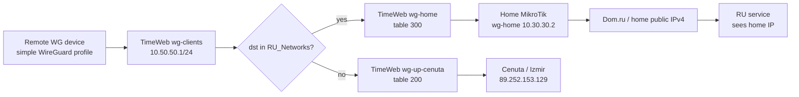

## Назначение

Target outcome: удаленные WireGuard-клиенты подключаются обычным full-tunnel
profile к TimeWeb, но российские IPv4-сети выходят через домашний
MikroTik/Dom.ru по BTH, а остальной публичный IPv4-трафик выходит через
Cenuta.

Задача решает ограничение клиентских устройств: большой список российских
подсетей не хранится на телефоне, ноутбуке или Apple TV. Решение принимается на
TimeWeb, где большой `RU_Networks` может жить как Linux `nft set` / `ipset`.

## Implementation Results

Status на 2026-07-04: implemented.

- TimeWeb backup before mutation: `/opt/wg-router/backups/20260704T144357Z`.
- Persistence/recreate backup: `/opt/wg-router/backups/20260704T155452Z`.
- Runtime script: `/opt/wg-router/apply-ru-bth.sh`.
- Standard entrypoint integration: `/opt/wg-router/commands.sh`.
- Previous `commands.sh` backup: `/opt/wg-router/commands.sh.pre-ru-bth-20260704T155420Z`.
- RU set source: MikroTik `RU_Networks`, normalized into `/opt/wg-router/state/ru_networks_v4.txt`.
- Enabled source clients:
  - `10.50.50.20/32` `sergey-iphone-12`;
  - `10.50.50.21/32` `sveta-iphone`;
  - `10.50.50.22/32` `sergey-macbook`;
  - `10.50.50.23/32` `sergey-ipadpro`.
- Enabled existing legacy `wg0` profiles without client-side reinstall:
  - `10.10.10.8/32` `sveta-mac`;
  - `10.10.10.12/32` `sveta-ipad97`.
- Excluded source client:
  - `10.50.50.24/32` `mikrotik-hap-ax3`.

Verified:

- `10.50.50.20` RU end-to-end test returned home/Dom.ru public IPv4
  `5.18.198.112`.
- Same selector profile non-RU test was confirmed by user as Cenuta behavior.
- Route tests after `commands.sh up`:
  - RU `77.88.55.88` from `.20-.23` -> `wg-home`, table `300`;
  - non-RU `1.1.1.1` from `.20-.23` -> `wg-up-cenuta`, table `200`;
  - replies from `wg-home` to `.20-.23` -> `wg-clients`;
  - `.24` to RU IP remains `wg-up-cenuta`, table `200`.
- Route tests for existing legacy profiles:
  - RU `77.88.55.88` from `10.10.10.8` and `10.10.10.12` -> `wg-home`, table `300`;
  - non-RU `1.1.1.1` from `10.10.10.8` and `10.10.10.12` -> `wg-up-cenuta`, table `200`;
  - replies from `wg-home` to `10.10.10.8` and `10.10.10.12` -> `wg0`.
- Persistence after container recreate:
  - one rule at priority `180`;
  - one rule at priority `190`;
  - `nft` table `inet ru_bth` restored;
  - MikroTik `wg-home` handshake fresh after recreate.

## Текущий Контекст

Фактическое состояние на 2026-07-04:

- TimeWeb `94.241.171.65` обслуживает WireGuard-контуры внутри Docker container
  `wg-relay`.
- `wg-clients` слушает `94.241.171.65:51850`, subnet `10.50.50.0/24`.
- Текущие selector clients `10.50.50.20/32`-`10.50.50.24/32`
  маршрутизируются через Cenuta: table `200` -> `wg-up-cenuta`.
- `wg-up-cenuta` ведет в Cenuta `89.252.153.129:51840`, внешний IPv4
  `89.252.153.129`.
- `wg-home` слушает `94.241.171.65:51830`, subnet `10.30.30.0/24`.
- BTH peer MikroTik имеет `10.30.30.2/32`, home LAN `192.168.88.0/24` и
  default/home egress через Dom.ru.
- На MikroTik есть NAT для BTH subnet `10.30.30.0/24` out WAN.
- На MikroTik все домашние `VPN_Devices` уже перенесены в `CENUTA_Devices`;
  это отдельная домашняя политика и не является клиентским full-tunnel
  решением для удаленных устройств.

Главное ограничение: если удаленное устройство уже отправило packet в
WireGuard tunnel, сервер может выбрать только один из своих downstream egress:
Cenuta, Fornex, TimeWeb public IP или BTH/home. Сервер не может выпустить пакет
через локальный ISP самого устройства.

## Target Architecture



Целевая логика:

- source входит в управляемый список remote clients для RU-via-BTH;
- destination входит в `RU_Networks` -> route через `wg-home`;
- destination не входит в `RU_Networks` -> current Cenuta path через
  `wg-up-cenuta`;
- local/private IPv4 остается исключенным client-side через текущий split
  `AllowedIPs` selector profile;
- IPv6 наружу не маршрутизируется.

## Scope

Включено:

- добавить на TimeWeb управляемый список `RU_Networks` для server-side policy;
- добавить на TimeWeb source-list клиентов, которым включен RU-via-BTH;
- добавить routing mark для `wg-clients` traffic, где `dst in RU_Networks`;
- отправлять marked traffic в table `300` / `wg-home`;
- добавить SNAT out `wg-home` к адресу `10.30.30.1`, чтобы MikroTik
  использовал уже существующий BTH NAT;
- добавить обратное route exception для ответов к `10.50.50.0/24`, чтобы они
  возвращались в `wg-clients`, а не обратно в table `300`;
- проверить по счетчикам, conntrack и end-to-end IP.

Не делаем:

- не меняем клиентский протокол: остается WireGuard;
- не храним `RU_Networks` на устройствах;
- не используем публичный IP TimeWeb как основной RU egress;
- не меняем домашний MikroTik без необходимости;
- не трогаем Fornex;
- не маршрутизируем IPv6 наружу;
- не копируем private keys, preshared keys, QR-коды или полные client configs в
  Obsidian.

## Initial Client Scope

Начальный production-scope должен быть ограниченным:

- применить RU-via-BTH только к реальным remote selector clients:
  - `10.50.50.20/32` `sergey-iphone-12`;
  - `10.50.50.21/32` `sveta-iphone`;
  - `10.50.50.22/32` `sergey-macbook`;
  - `10.50.50.23/32` `sergey-ipadpro`.
- не включать `10.50.50.24/32` `mikrotik-hap-ax3` на первом этапе.

Причина исключения `10.50.50.24`: это MikroTik/Home side selector client.
Домашние устройства уже делают RU bypass на MikroTik до выхода в
`wg-cenuta`. Повторный RU-via-BTH для этого source может создать ненужный
hairpin и усложнить диагностику.

Legacy clients на `wg0` (`10.10.10.0/24`) не включать в первый slice. Если
нужно, их лучше мигрировать на selector clients или делать второй отдельный
этап с теми же правилами для `wg0`.

## Design Details

### Routing Decision On TimeWeb

На TimeWeb внутри container `wg-relay` нужна логика:

```text
iif wg-clients
src in ru_bth_clients
dst in ru_networks_v4
=> mark 0x30
=> lookup table 300
=> out wg-home
```

Рекомендуемый route-rule порядок:

```bash
ip rule add to 10.50.50.0/24 lookup main priority 180
ip rule add fwmark 0x30 table 300 priority 190
```

Почему нужен rule `to 10.50.50.0/24 lookup main`:

- в текущем BTH-контуре уже есть правило `iif wg-home lookup 300 priority 300`;
- ответы из home/MikroTik приходят в container через `wg-home`;
- после обратного NAT destination должен стать `10.50.50.x`;
- без более раннего exception ответ может снова попасть в table `300` и уйти
  обратно в `wg-home` вместо `wg-clients`.

### NAT

На TimeWeb RU-via-BTH traffic должен SNAT-иться перед выходом в `wg-home`:

```text
src 10.50.50.20-23 -> src 10.30.30.1, out wg-home
```

Зачем:

- MikroTik уже умеет NAT-ить BTH subnet `10.30.30.0/24` out WAN;
- не нужно добавлять на MikroTik route back для `10.50.50.0/24`;
- не нужно добавлять на MikroTik NAT для selector subnet;
- rollback остается в основном на TimeWeb.

### Forwarding

Нужно явно разрешить forwarding:

```text
wg-clients -> wg-home
wg-home -> wg-clients
```

Текущие generated rules для `wg-clients` разрешают конкретным clients выход в
`wg-up-cenuta`; RU-via-BTH добавляет второй allowed egress только для
российских destinations.

### RU Networks Source Of Truth

Для первого внедрения источник должен совпадать с текущим поведением MikroTik:

- снять текущий `RU_Networks` с MikroTik;
- нормализовать IPv4 CIDR/range в файл на TimeWeb, например
  `/opt/wg-router/state/ru_networks_v4.txt`;
- загрузить его в `nft set` с `flags interval`.

Отдельная будущая задача: автоматическое обновление RU-подсетей из выбранного
источника. В первом slice лучше не смешивать routing change и новый data feed.

### Persistence Model

Правила нельзя вносить только вручную в runtime container, потому что
`docker compose up --force-recreate` и `/opt/wg-router/commands.sh up` могут
сбросить runtime state.

Рекомендуемая реализация:

- добавить управляемый скрипт `/opt/wg-router/apply-ru-bth.sh`;
- хранить state-файлы:
  - `/opt/wg-router/state/ru_networks_v4.txt`;
  - `/opt/wg-router/state/ru_bth_clients.tsv`;
- расширить `/opt/wg-router/commands.sh` командами:
  - `apply-ru-bth`;
  - `test-ru-bth <client-ip> <ru-ip> <non-ru-ip>`;
- вызывать `apply-ru-bth` после `up` / `refresh-clients`;
- включить новые state/config files в `/opt/wg-router/backups/<timestamp>/`.

## Execution Plan

### 0. Read-only baseline

Task: подтвердить live-состояние до любых изменений.

Команды:

```bash
ssh -i .local/ssh/codex_timeweb_audit_20260628 -o IdentitiesOnly=yes root@94.241.171.65
docker exec wg-relay wg show
docker exec wg-relay ip rule
docker exec wg-relay ip route show table 200
docker exec wg-relay ip route show table 300
docker exec wg-relay iptables -S
docker exec wg-relay iptables -t nat -S
```

MikroTik read-only:

```routeros
/interface wireguard peers print detail where interface=wg-home
/ip firewall nat print stats where comment~"Back To Home"
/ip firewall filter print stats where comment~"WG-Home|fasttrack"
```

Acceptance:

- `wg-clients`, `wg-up-cenuta`, `wg-home` active;
- TimeWeb table `200` default via `wg-up-cenuta`;
- TimeWeb table `300` default via `wg-home`;
- MikroTik `wg-home` has fresh or recoverable handshake;
- no current production outage.

Stop-lines:

- `wg-home` handshake stale and cannot be restored;
- table `300` missing;
- BTH NAT on MikroTik missing;
- `wg-relay` not running.

### 1. Backup and rollback checkpoint

Task: создать rollback point до TimeWeb mutation.

Команды:

```bash
sudo /opt/wg-router/commands.sh backup
docker exec wg-relay ip rule > /root/timeweb-pre-ru-bth-ip-rule.txt
docker exec wg-relay iptables-save > /root/timeweb-pre-ru-bth-iptables-save.txt
```

MikroTik backup не обязателен, если MikroTik не меняется. Но перед первым
end-to-end лучше зафиксировать read-only output BTH NAT/filter counters в
рабочем логе.

Acceptance:

- root-only backup создан;
- текущие runtime rules сохранены;
- rollback commands подготовлены.

Stop-lines:

- backup не создается;
- нет места на диске;
- `/opt/wg-router/commands.sh backup` не включает новые state paths после
  изменения backup coverage.

### 2. Подготовить RU set и client source set без включения маршрутизации

Task: создать managed state files и проверить загрузку set без влияния на
трафик.

Scope:

- создать `/opt/wg-router/state/ru_networks_v4.txt` из текущего MikroTik
  `RU_Networks`;
- создать `/opt/wg-router/state/ru_bth_clients.tsv` только с тестовым client IP
  на первом этапе;
- не добавлять route mark rules до проверки синтаксиса.

Acceptance:

- файл RU сетей содержит только IPv4 CIDR/range;
- нет `0.0.0.0/0`;
- нет private/local ranges, если они не являются осознанным исключением;
- nft/ipset load проходит в dry-run или пустой test namespace.

Stop-lines:

- список содержит `0.0.0.0/0`;
- список содержит слишком широкие агрегаты вне РФ;
- source clients включают `10.50.50.24` на первом этапе.

### 3. Добавить route exceptions and mark rules

Task: добавить routing mechanics без включения всех clients.

Нужные элементы внутри `wg-relay`:

```bash
ip rule add to 10.50.50.0/24 lookup main priority 180
ip rule add fwmark 0x30 table 300 priority 190
```

Нужные nft/iptables semantics:

```text
mark: iif wg-clients, src in ru_bth_clients, dst in ru_networks_v4 -> mark 0x30
forward allow: wg-clients -> wg-home
forward allow: wg-home -> wg-clients
snat: src in ru_bth_clients, dst in ru_networks_v4, out wg-home -> 10.30.30.1
```

Acceptance:

- `ip rule` order:
  - `to 10.50.50.0/24 lookup main` выше `fwmark 0x30`;
  - `fwmark 0x30 table 300` выше selector source rules `220`-`224`;
  - existing `iif wg-home table 300 priority 300` остается ниже reply
    exception.
- `ip route get <RU_IP> from <client_ip> iif wg-clients mark 0x30` показывает
  `dev wg-home`;
- `ip route get <non_RU_IP> from <client_ip> iif wg-clients` продолжает
  показывать `dev wg-up-cenuta` через table `200`;
- `ip route get <client_ip> iif wg-home` показывает `dev wg-clients`.

Stop-lines:

- route reply to `10.50.50.0/24` идет в `wg-home`;
- non-RU traffic начинает идти в `wg-home`;
- marked RU traffic не уходит в table `300`;
- forwarding rules конфликтуют с existing selector NAT.

### 4. Enable one test client

Task: включить RU-via-BTH для одного remote selector client.

Рекомендуемый первый client:

- `sergey-macbook` `10.50.50.22/32`, если он доступен для ручных тестов.

Не включать сразу:

- `sergey-iphone-12`;
- `sveta-iphone`;
- `sergey-ipadpro`;
- `mikrotik-hap-ax3`.

Acceptance:

- TimeWeb nft/iptables counters растут только при обращении тестового client к
  RU IP;
- MikroTik BTH NAT counter растет;
- non-RU counter через `wg-up-cenuta` продолжает расти для того же client.

Stop-lines:

- тестовый client теряет общий интернет;
- `wg-home` handshake деградирует;
- BTH remote access ломается;
- MikroTik CPU/load растет аномально.

### 5. End-to-end tests

Task: доказать split behavior с реального client.

RU test:

```text
https://yandex.ru/internet/
```

Expected:

- внешний IPv4: home/Dom.ru, например `5.18.x.x`;
- не `89.252.153.129`;
- не `94.241.171.65`.

Non-RU test:

```bash
curl -4 https://api.ipify.org
```

Expected:

- внешний IPv4: Cenuta `89.252.153.129`.

IPv6 test:

```bash
curl -6 --max-time 8 https://api64.ipify.org
```

Expected:

- no IPv6 egress, unless a separate IPv6 design is approved.

Server-side checks:

```bash
docker exec wg-relay ip rule
docker exec wg-relay ip route get 77.88.55.88 from 10.50.50.22 iif wg-clients mark 0x30
docker exec wg-relay ip route get 1.1.1.1 from 10.50.50.22 iif wg-clients
docker exec wg-relay ip route get 10.50.50.22 iif wg-home
docker exec wg-relay nft list ruleset
```

MikroTik checks:

```routeros
/ip firewall nat print stats where comment~"Back To Home"
/interface wireguard peers print detail where interface=wg-home
```

Stop-lines:

- Yandex/RU test shows Cenuta;
- non-RU test shows home/Dom.ru;
- replies loop or stall after first packets;
- IPv6 unexpectedly works through TimeWeb or Cenuta.

### 6. Enable remaining remote selector clients

Task: расширить source set после успешного single-client slice.

Add:

- `10.50.50.20/32`;
- `10.50.50.21/32`;
- `10.50.50.23/32`.

Keep excluded:

- `10.50.50.24/32` until a separate reason exists.

Acceptance:

- каждый включенный client:
  - RU -> home/Dom.ru;
  - non-RU -> Cenuta;
  - no IPv6 egress;
- BTH access remains operational;
- current MikroTik home CENUTA routing remains operational.

### 7. Persistence and reboot simulation

Task: убедиться, что правила переживают `commands.sh up` / container recreate.

Commands:

```bash
sudo /opt/wg-router/commands.sh backup
sudo /opt/wg-router/commands.sh up
sudo /opt/wg-router/commands.sh apply-ru-bth
docker exec wg-relay ip rule
docker exec wg-relay nft list ruleset
```

Acceptance:

- after recreate, RU-via-BTH rules restored;
- selector clients remain present;
- `wg-up-cenuta` and `wg-home` handshakes recover;
- route checks from step 5 still pass.

Stop-lines:

- `commands.sh up` drops RU-via-BTH state;
- backup omits `ru_networks_v4.txt` or `ru_bth_clients.tsv`;
- route rules duplicate on repeated apply.

### 8. Documentation

Task: зафиксировать sanitized final state.

Update:

- `VPN_HLD.md`;
- `TimeWeb_Configuration.md`;
- `TimeWeb_Parameters.md`;
- this workplan status/results;
- `docs/catalog.md`, if needed.

Do not store:

- private keys;
- preshared keys;
- QR codes;
- full client configs.

## Rollback Plan

Fast rollback on TimeWeb:

```bash
docker exec wg-relay ip rule del fwmark 0x30 table 300 priority 190 || true
docker exec wg-relay ip rule del to 10.50.50.0/24 lookup main priority 180 || true
docker exec wg-relay nft delete table inet ru_bth || true
```

If implementation uses iptables/ipset instead of nft:

```bash
docker exec wg-relay iptables -t mangle -D PREROUTING ... || true
docker exec wg-relay iptables -t nat -D POSTROUTING ... || true
docker exec wg-relay iptables -D FORWARD ... || true
```

Operational rollback:

- clear `ru_bth_clients.tsv`;
- run `commands.sh apply-ru-bth`;
- verify all selector clients return to existing Cenuta behavior.

Expected after rollback:

- RU and non-RU from selector clients both exit via Cenuta;
- `wg-home` continues serving normal BTH;
- MikroTik requires no rollback if it was not changed.

## Risks And Mitigations

| Risk | Impact | Mitigation |
| --- | --- | --- |
| Reply loop because of existing `iif wg-home table 300` | RU traffic stalls | Add priority `to 10.50.50.0/24 lookup main` before BTH rule; test `ip route get <client> iif wg-home`. |
| Home uplink bottleneck | RU services slower | Start with one client; monitor throughput and MikroTik CPU. |
| Home Internet outage | RU services fail for remote clients | Keep quick rollback to Cenuta-only; later consider fallback route. |
| RU IP list drift | Some RU services still show Cenuta | Keep list update process separate and test with known IPs. |
| Global CDN for Russian domain resolves outside RU | Domain goes Cenuta | This is expected for IP-based split; add FQDN exception only as a separate design. |
| BTH remote access regression | Remote support path breaks | Verify existing BTH clients before and after; do not alter `wg-home` peer keys. |
| Docker recreate loses rules | Split stops after maintenance | Manage rules through `/opt/wg-router/commands.sh`, not manual runtime only. |

## Definition Of Done

- Selected remote WireGuard clients do not store `RU_Networks` locally.
- RU IPv4 destinations from selected clients exit through home/Dom.ru via
  TimeWeb `wg-home`.
- Non-RU IPv4 destinations from selected clients exit through Cenuta.
- `10.50.50.24` MikroTik selector client remains excluded unless explicitly
  approved.
- Existing BTH remote access still works.
- Existing home MikroTik `CENUTA_Devices` routing still works.
- IPv6 egress remains disabled/not working.
- Runtime rules survive `commands.sh up` or are automatically re-applied.
- Rollback returns selector clients to Cenuta-only behavior.
- No secrets are stored in Obsidian.
