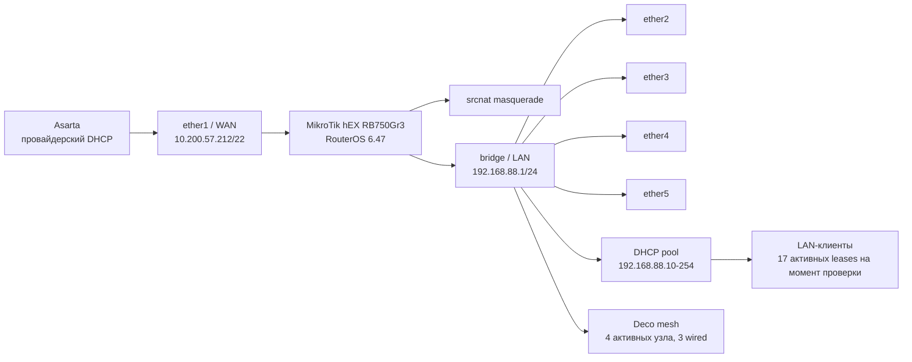
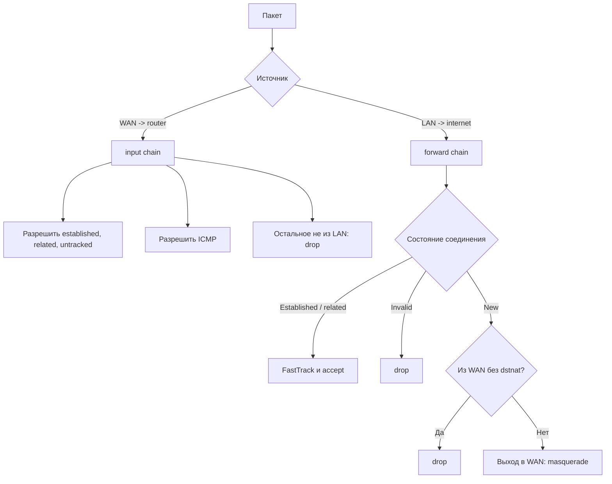

## Назначение и статус

Документ описывает фактически наблюдаемую конфигурацию MikroTik hEX
`RB750Gr3` на площадке **Орехово, Детская 11**. Данные сняты read-only
командами `2026-08-11` после сохранения snapshot `20260811T074020Z`.

Это не проект целевой сети и не инструкция на изменение конфигурации. Все
рекомендации ниже имеют статус **не применено** до отдельного решения.

Связанная карточка: [Орехово, Детская 11: MikroTik](<Orekhovo_Detskaya_11_MikroTik.md>).

## Границы и идентификация

| Параметр | Значение |
| -------- | -------- |
| Площадка | Орехово, Детская 11 |
| Провайдер | Asarta |
| RouterOS identity | `MikroTik Root` |
| Устройство | MikroTik hEX `RB750Gr3`, serial `8AFF0A501C19` |
| RouterOS | `6.47 stable`, build `2020-06-02` |
| Время наблюдения | `2026-08-11`, около `08:10 UTC` |
| Конфигурационный snapshot | `20260811T074020Z` |
| Полные технические файлы | `Dropbox/System/Mikrotik/current/orekhovo-router/` |

В Obsidian не хранятся пароли, private keys и бинарный `.backup`. В Dropbox
сохранены sanitized export, binary backup и проверенный SHA-256 manifest.

## Схема сети

Физическая привязка портов `ether2`-`ether5` конкретным Deco не подтверждена.
Нельзя выводить ее только из статистики трафика или названий DHCP-клиентов без
отдельной проверки на месте.

### Deco mesh

По информации владельца Wi-Fi сеть обслуживает Deco mesh: три узла подключены
к MikroTik по Ethernet. Live-проверка `2026-08-11` обнаружила четыре
отвечающих узла с динамическими DHCP-адресами:

| IP на момент проверки | Доступность | Management interface |
| --------------------- | ----------- | -------------------- |
| `192.168.88.18` | ICMP, HTTP и HTTPS доступны | Узел `d11`; локальная панель подтверждена, требует аутентификацию |
| `192.168.88.24` | ICMP, HTTP и HTTPS доступны | Требует аутентификацию |
| `192.168.88.26` | ICMP, HTTP и HTTPS доступны | Требует аутентификацию |
| `192.168.88.42` | ICMP, HTTP и HTTPS доступны | Требует аутентификацию |

IP не являются резервированными и могут измениться. Статус mesh, назначение
главного Deco, способ соединения четвертого узла и прошивки не установлены без
входа в административную панель.

Сопоставление DHCP MAC с bridge host table MikroTik на момент проверки:

| Deco IP | MAC | Порт, на котором MikroTik изучил MAC |
| ------- | --- | ------------------------------------ |
| `192.168.88.18` (`d11`) | `1C:3B:F3:9F:23:80` | `ether3` |
| `192.168.88.24` | `1C:3B:F3:9F:1B:98` | `ether2` |
| `192.168.88.42` | `1C:3B:F3:9F:27:34` | `ether4` |
| `192.168.88.26` | `E4:C3:2A:0E:3B:08` | `ether3` |

Два MAC на `ether3` не доказывают два прямых кабеля: второй узел может быть
за `d11` или за небольшим Ethernet-коммутатором. Физическую схему нужно
подтвердить отключением кабеля по одному, когда это будет допустимо.

## L2 и адресация

- `ether1` - единственный WAN-порт; DHCP client активен.
- `ether2`, `ether3`, `ether4`, `ether5` входят в `bridge` с аппаратным
  offload. `ether2` также несет MAC bridge.
- VLAN filtering выключен; сеть единая, untagged, PVID `1`.
- RSTP включен, IGMP snooping выключен.
- LAN адрес роутера: `192.168.88.1/24` на `bridge`.
- DHCP server `defconf` работает на `bridge`, lease time `10m`, диапазон
  `192.168.88.10-192.168.88.254`.
- Статических DHCP leases нет. На момент проверки было 17 динамических leases.

Сеть Орехово использует ту же подсеть `192.168.88.0/24`, что и площадка
Нахимова 11. Это две независимые географические сети. Прямой Site-to-Site VPN
или статическая маршрутизация между ними без смены подсети либо тщательно
спроектированного NAT недопустимы.

## WAN, DNS и маршрут по умолчанию

| Элемент | Наблюдаемое состояние |
| ------- | --------------------- |
| WAN адрес | `10.200.57.212/22` по DHCP на `ether1` |
| WAN gateway | `10.200.56.1` |
| Default route | `0.0.0.0/0` через `10.200.56.1`, distance `1` |
| Provider DNS | `185.108.208.6`, `45.155.147.254` динамически от DHCP |
| DNS proxy роутера | `allow-remote-requests=yes` |
| Публичный адрес по IP Cloud | `194.190.196.148` на момент проверки |

WAN-интерфейс имеет приватный адрес `10.200.57.212/22`, а IP Cloud наблюдает
другой публичный адрес. Это указывает на NAT выше роутера; доступность входящих
подключений из интернета нельзя считать гарантированной. Проверка или настройка
port-forward требует отдельного теста с внешней сети и согласования с Asarta.

## Действующие правила обработки трафика

### Firewall filter

- `input`: принимает established/related/untracked, ICMP; invalid отбрасывает;
  весь иной доступ к самому роутеру разрешен только из interface-list `LAN`.
- `forward`: fasttracks и принимает established/related/untracked; invalid
  отбрасывает; новые соединения из `WAN` без `dstnat` отбрасывает.
- Специальных разрешений, port-forward и пользовательских filter/mangle rules
  нет.
- IPsec policy rules присутствуют как стандартные, но активных IPsec-туннелей
  не обнаружено.

### NAT и routing

- Единственное NAT-правило: `srcnat masquerade` при выходе через interface-list
  `WAN`.
- Policy routing, mangle rules, VPN interfaces и VPN peers отсутствуют.
- UPnP, web proxy, SOCKS proxy и Netwatch выключены; scheduler и custom scripts
  отсутствуют.

Следствие: сейчас весь LAN-трафик идет через Asarta по единственному default
route. Избирательной маршрутизации по устройствам, странам или VPN нет.

## Диагностика линии Asarta: контрольный срез

Проверка выполнена `2026-08-11 11:45` по местному времени через Mac,
подключенный к LAN площадки. Изменений в конфигурацию не вносилось. На Mac
при этом был активен локальный VPN `utun4` с адресом `10.50.50.31`; маршрут к
внешним адресам и к `10.200.56.1` шел через `utun4`, а маршрут к
`192.168.88.1` - напрямую через Wi-Fi `en1`.

| Проверка | Результат | Вывод |
| -------- | --------- | ----- |
| Mac -> `192.168.88.1` | 20/20, `0.0%` потерь, среднее `3.993 ms` | LAN и доступ к MikroTik стабильны в момент проверки |
| Mac -> `10.200.56.1` | 20/20 тайм-аутов, маршрут также ушел через `utun4` | Этот тест не проверил шлюз Asarta: локальный VPN перехватил маршрут |
| Mac -> `1.1.1.1` | 20/20, `0.0%` потерь, среднее `117.955 ms`, через `utun4` | Локальный VPN и его внешний путь стабильны; Asarta этим тестом не проверена |
| Mac -> `8.8.8.8` | 20/20, `0.0%` потерь, среднее `121.116 ms`, через `utun4` | Второй внешний контроль через локальный VPN стабилен; Asarta этим тестом не проверена |
| DNS через `192.168.88.1` | `NOERROR`, ответ за `14 ms` | DNS proxy MikroTik работает |
| HTTPS -> `api.ipify.org` | HTTP `200`, публичный адрес `89.252.153.129`, через `utun4` | TCP/HTTPS через локальный VPN работает; это не публичный адрес Asarta |

На MikroTik в тот же период `ether1` имел `link-ok`, скорость `1Gbps`, полный
дуплекс и `link-downs=0`; DHCP на `ether1` был в состоянии `bound` с адресом
`10.200.57.212/22`, шлюзом `10.200.56.1` и активным default route.

Срез подтверждает работу LAN, самого MikroTik, DHCP на `ether1` и физического
Ethernet-соединения с оборудованием Asarta. Полноценная проверка интернета
именно через Asarta в этот момент не выполнена, поскольку локальный VPN забрал
маршрут внешнего трафика. Поэтому по текущему срезу нельзя утверждать, что
линия Asarta полностью исправна или что она была причиной прошлых сбоев.

Даже корректный срез без VPN не исключал бы кратковременные оптические обрывы
или деградацию линии в другое время. MikroTik hEX подключен к оборудованию провайдера по
Ethernet и не показывает оптические уровни, LOS, BER и счетчики ошибок PON.
Для этого нужны данные ONT/медиаконвертера или диагностика Asarta.

### Что уже можно различать имеющимися средствами

- Потеря `192.168.88.1` указывает на проблему LAN, Wi-Fi/Deco или самого
  роутера, а не на оптику провайдера.
- Доступный MikroTik при недоступных внешних адресах без активного VPN указывает
  на участок `ether1`/DHCP/Asarta выше роутера.
- Link down на `ether1` указывает на Ethernet-сегмент между MikroTik и
  оборудованием Asarta, но не позволяет различить кабель, порт, ONT или оптику.
- Стабильный `ether1` при потерях внешнего трафика больше похож на проблему
  выше Ethernet-линка: ONT, оптическая линия, сеть доступа или маршрутизация
  провайдера.
- Стабильный ICMP при жалобах на качество не исключает перегрузку, потери TCP,
  проблемы отдельных направлений или DNS; нужны одновременные пробы нескольких
  целей и фиксация времени.

Проверить шлюз `10.200.56.1` прямо с MikroTik текущим пользователем нельзя:
RouterOS требует право `test` для `/ping`, а `codex_audit` намеренно ограничен
правами `read,ssh`. Расширять права для этого разового теста не требуется.

Для чистой проверки Asarta нужен Mac или другой клиент LAN без активного VPN:
перед тестом маршрут к `1.1.1.1` должен показывать `en1`, а публичный адрес
не должен быть `89.252.153.129`. Отключать VPN автоматически не следует, чтобы
не потерять текущую связь; это можно сделать только в согласованное окно либо
использовать отдельное устройство.

### Данные, которые нужно собрать при следующем сбое

1. Точное местное время начала и окончания проблемы.
2. Одновременно проверить `192.168.88.1`, `1.1.1.1`, `8.8.8.8`, DNS через
   `192.168.88.1` и HTTPS-запрос.
3. Снять с MikroTik состояние `ether1`, DHCP client, default route, counters и
   журнал интерфейса.
4. Сохранить состояние Deco, особенно события `eth0 link up/down` на главном
   узле. В текущем логе `d11` такие события уже встречаются, но они не совпали
   с зафиксированным `ether1 link-down` MikroTik и потому пока не доказывают
   оптическую неисправность.
5. Запросить у Asarta по этому временному окну LOS/LOF, оптические уровни RX/TX,
   BER/CRC, историю переподнятия сессии и состояние ONT/порта.

Для доказательства периодической деградации полезен непрерывный внешний
мониторинг с интервалом 5-10 секунд, который отдельно записывает время,
потери и задержку до роутера, двух внешних IP, DNS и HTTPS. Сейчас такой
мониторинг не настроен; текущие данные являются разовыми контрольными срезами.

## Управление и безопасность

| Поверхность | Текущее состояние | Ограничение |
| ----------- | ----------------- | ----------- |
| SSH | Включен, TCP/22 | Firewall допускает доступ только с LAN |
| WinBox | Включен, TCP/8291 | Firewall допускает доступ только с LAN |
| WebFig HTTP | Включен, TCP/80 | Незашифрованный протокол; доступен из LAN |
| Telnet, FTP, API | Включены | Firewall закрывает WAN, но сервисы доступны в LAN |
| WebFig HTTPS, API-SSL | Выключены | Сертификат не настроен |
| SSH forwarding | Выключен | Соответствует read-only доступу агента |
| `codex_audit` | Отдельная read-only группа `ssh,read` | Нет `write`, `sensitive`, `password`, `reboot` |

Входящий доступ с WAN к management-сервисам блокируется текущим `input` rule.
Однако IP service objects не имеют адресного ограничения, поэтому любой клиент
LAN теоретически может обращаться к включенным Telnet, FTP, HTTP и API. Это
не авария при текущем firewall, но поверхность управления шире необходимой.

## Наблюдения надёжности

- Логи фиксируют несколько перезагрузок без корректного shutdown `2026-08-02`,
  `2026-08-09` и `2026-08-10`, с причиной `probably power outage`.
- Текущие `info`, `error` и `warning` направлены в action `memory` (RAM), а
  `critical` выводится в console `echo`; disk logging не настроен. Удаление
  старых записей `/log` не освободит внутренние `4.9 MiB` flash и не является
  способом очистки диска.
- На момент проверки доступно около `4.9 MiB` из `16.3 MiB` внутреннего
  хранилища; snapshot сохраняется и копируется сразу в Dropbox System.
- RouterOS `6.47` и RouterBOOT `3.41` существенно устарели. Обновление не
  выполнялось и должно планироваться отдельной работой с rollback-планом,
  окном обслуживания и проверкой совместимости.
- NTP client явно выключен; DHCP client запрашивает NTP от провайдера. Точность
  времени и источник синхронизации требуют отдельной проверки перед анализом
  журналов по времени.

### Сохраненный лог Deco `d11`

Исходный лог сохранен в Dropbox System:
`System/Mikrotik/current/orekhovo-router/logs/deco-d11-system-log-20260811T082335Z.txt`.
Файл содержит `5862` строки; SHA-256:
`20e51f4098ef2c097e3f1620e70a57a4911ec4881696e8a5a38d315edd33a17e`.

Важные наблюдения по актуальному фрагменту `2026-08-11`:

- `eth0` Deco многократно переходил `link up/link down`; рядом фиксируются
  `wanDetection` и короткие изменения состояния интерфейса. Это подозрение на
  нестабильность uplink/кабеля/порта либо ошибку firmware WAN detection, но не
  доказательство конкретной причины.
- Клиент с MAC `76:46:8D:21:C2:C9` многократно associate/disassociate между
  каналами `1` и `36`. В журнале это сопровождается ошибками `Invalid beacon
  report`, `Failed to get uplink rssi` и `apsd_check_eth_has_neigh`.
- Есть много `Pubkey auth succeeded for 'root'` с источником
  `192.168.88.24`. В контексте mesh это похоже на внутреннее управление
  узлами; считать это внешним взломом без проверки роли `.24` нельзя.
- Есть повторяющиеся `ntp check error` из старого фрагмента `2024-07-19` и
  `uci: Entry not found` в актуальном фрагменте. Они указывают на проблемы
  firmware/служебных конфигураций, но не показывают сбой MikroTik.
- Записей о фактической перезагрузке Deco в сохраненном логе не найдено.

Сейчас это диагностический сигнал средней важности. Следующий безопасный тест
для подтверждения физической причины: в согласованное окно наблюдать журнал и
счетчики `ether2`-`ether4` MikroTik при поочередном физическом отключении
каждого Ethernet-кабеля Deco. Без такого окна настройки не менять.

## Принятые операционные правила

1. Любое изменение только после отдельного подтверждения, свежего sanitized
   export и binary backup, с Safe Mode для интерактивных изменений.
2. `codex_audit` остается read-only. Права `write` не расширяются ради backup
   или диагностики; binary backup создает `admin` по необходимости.
3. Полные backups и конфигурации находятся в Dropbox System; Obsidian хранит
   описание, схему и ссылки на snapshot, но не секреты.
4. Для доступа использовать SSH alias `mikrotik-orekhovo` и отдельный
   `known_hosts_orekhovo`. Нельзя использовать общий host key для
   `192.168.88.1`, потому что тот же адрес есть на другой площадке.
5. Не публиковать SSH, WinBox или WebFig в интернет и не добавлять dst-nat
   без отдельного решения по management VPN.
6. При объединении площадок сначала устранить конфликт подсетей
   `192.168.88.0/24`; добавление обычного маршрута не решает проблему.
7. После каждого изменения обновлять этот документ, карточку площадки и
   snapshot в `Dropbox/System/Mikrotik/current/orekhovo-router/`.

## Очередь улучшений (не применено)

1. Подтвердить физическую топологию: что подключено к `ether2`-`ether5`, где
   находится основной Wi-Fi/mesh, какой Deco является главным и нужен ли
   отдельный management-сегмент.
2. Подготовить план обновления RouterOS/RouterBOOT с резервной копией,
   питанием и проверкой после перезагрузки.
3. После согласования отключить неиспользуемые LAN management services
   (минимум Telnet, FTP, HTTP и API) либо ограничить их management-подсетью.
4. Проверить необходимость локального DNS proxy и то, какие DNS фактически
   получают клиенты по DHCP.
5. Для удалённого доступа использовать отдельный management VPN с уникальной
   подсетью, а не проброс портов.

## Проверка актуальности

Конфигурация динамична: WAN IP, DHCP leases, public IP, firewall counters,
uptime и журналы устаревают. Перед работой опираться на новый live-check и
обновлять snapshot; статические правила выше отражают состояние на дату
наблюдения.
