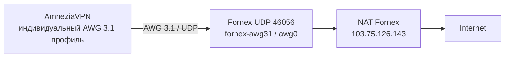

> Storage migrated 2026-10-10. Current entry point: [Quick Guide](../quick-start.md); private configuration/backups: [storage rules](storage-and-transfer.md). Dated paths below describe their original release, not current masters.


# Fornex AWG 3.1: эксплуатация

## Текущая версия и границы

На Fornex `103.75.126.143` работает самостоятельно управляемый контейнер **fornex-awg31**, UDP **46056**, сеть `10.83.1.0/24`. 13 сентября 2026 старый **amnezia-awg2** удален по подтвержденному списку пользователя. UDP 46055 больше не является рабочим входом AWG2.

**Не удалялись обычный WireGuard, wg-exit, другие Amnezia-контейнеры и профили TimeWeb REALITY.** Вывод AWG2 из эксплуатации не означает вывод WG из эксплуатации.

Мастер: `services/transport/fornex-awg31/`. Актуальный fleet: 11 peers, перечислены в [TimeWeb_VPN_Registry](<../registry/tunnels.md>). MacBook Sergey/iPhone Sergey проверены пользователем; девять остальных выпущены, но приемка на устройствах пока не подтверждена. AWG31 peer Mac Mini M4 Sergey (`10.83.1.4/32`) перевыпущен с новым ключом 15 сентября 2026.

## Схема



Этот путь не проходит через TimeWeb и не выбирает Cenuta/BTH. В Amnezia имя старой записи сервера не связано с новым контейнером. Новый профиль импортируется отдельно из своего `Fornex-AWG31-*.conf`.

## Параметры

| Параметр | Значение |
| --- | --- |
| Server config | `/opt/fornex-awg31/awg0.conf`, RO bind в контейнер |
| Local config | `services/transport/fornex-awg31/release/awg0.conf` |
| Peer addresses | `.1, .2, .4–.12`; `.3` отозванный тестовый peer |
| DNS / MTU | `1.1.1.1, 1.0.0.1` / 1280 |
| Client capture | IPv4 default и `::/0`; не доказательство IPv6 egress |
| Restart policy | `unless-stopped` |
| Limits | 256 MiB, pids 128, логи 2 x 2 MiB |
| Device | userspace AWG, `/dev/net/tun`, NET_ADMIN |
| Image | Закрепленный ID в `image-id.txt`, Dockerfile и source сохранены в System |

Базовая сборка взята из материалов тега AmneziaVPN 5.0.1.5. Строка daemon `0.0.20250522` сама по себе не доказывает AWG2: поддержку 3.1 проверяли по параметрам и передаче данных. Параметры защиты заголовков являются частью секретной конфигурации и здесь не публикуются.

## Обычные действия

**Импорт:** на конкретном устройстве открыть AmneziaVPN, импортировать предназначенный ему файл из `.local/clients`, подключить и проверить внешний IP/сайты. Не импортировать один ключ одновременно на несколько устройств.

**Удаление старой записи:** отключить старое соединение и удалить его локальную запись в приложении. Не выбирать действие удаления сервера/всех протоколов на Fornex. Сервер AWG2 уже удален; повторное серверное удаление не требуется.

**Новый клиент/отзыв:** сначала свежий backup и сверка нынешних 11 peers, затем адресный diff runtime/persistent/master и публикации. Универсального обслуживаемого генератора для текущего fleet пока нет. Старые `prepare.py`, `deploy.py`, `finalize.py`, `expand_fleet.py` теперь отказывают до действий. Использовать [VPN_Maintenance_and_Backup](<maintenance-and-backup.md>) и отдельно проверенный текущий changeset.

## Read-only диагностика

Команды выполняются в SSH-сессии **Fornex**, не на TimeWeb:

```sh
docker inspect --format '{{.Name}} {{.State.Status}} {{.State.StartedAt}} {{.HostConfig.RestartPolicy.Name}}' fornex-awg31
docker port fornex-awg31
docker exec fornex-awg31 awg show awg0 latest-handshakes
docker exec fornex-awg31 awg show awg0 transfer
docker stats --no-stream fornex-awg31
sha256sum /opt/fornex-awg31/awg0.conf
```

Не использовать `awg show ... dump` в публичном журнале: dump может содержать приватный/PSK-материал. Handshake и счетчики не заменяют проверку сайтов на клиенте. `verify.py` не read-only: тестовый сеанс с существующим ключом способен вызвать endpoint roaming.

## Server-side мониторинг

Локальный exporter `services/monitoring/vpn-connectivity/probe/wg_peer_probe.py`
параллельно с TimeWeb опрашивает `fornex-awg31/awg0` отдельным ограниченным
read-only SSH-key. Он читает только `allowed-ips`, `transfer` и
`latest-handshakes`; полный `dump`, конфиг, ключи и доступ к устройствам не
используются. В Grafana Fornex peer маркируются `source="fornex-awg31"` и могут
выбираться как текущий активный тоннель устройства наравне с TimeWeb WG.

Ошибка Fornex не удаляет последний успешный TimeWeb-срез и наоборот. После 45 s
без нового среза источник становится ненаблюдаемым, поэтому карточка не должна
утверждать, что активного тоннеля нет. Handshake/counters доказывают только
видимость peer со стороны сервера, а не работу браузера, DNS, IPv6 или
fail-closed на устройстве.

## Проверки и откат

После миграции выполнен ограниченный server-side smoke с загрузкой/выгрузкой; до миграции пользователь подтвердил MacBook/iPhone. Не выдавать такой тест за подтверждение остальных девяти устройств или сети из Турции.

Старый `rollback.sh` теперь **заблокирован до Docker-команд**: он не останавливает AWG31 и не возвращает AWG2. Восстановление требует отдельного плана по `backup/` / `retirement-backup/`, проверки образа, Docker metadata, конфигов и точного сетевого diff; полный drill не выполнен. Общий Docker/firewall/route flush запрещен.

В retirement-backup сохранены и действующие AWG31 credentials первых двух клиентов/сервера; это секретный архив, а не только набор отозванных AWG2-ключей. Старый общий REALITY backup payload не включает новый AWG31 и должен быть обновлен перед использованием для свежей полной копии.

Связи: [VPN_Configuration_Registry](<../registry/configuration.md>), [Fornex_Parameters](<../hosts/fornex/Fornex_Parameters.md>), [VPN_HLD](<../architecture/overview.md>).
