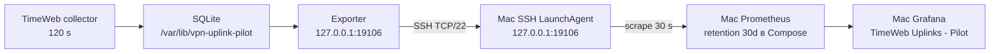

> Storage migrated 2026-10-10. Current entry point: [Quick Guide](../quick-start.md); private configuration/backups: [storage rules](storage-and-transfer.md). Dated paths below describe their original release, not current masters.

## Текущий статус

Открытые ограничения высокого приоритета: [TimeWeb_Monitoring_Backlog](<../reference/TimeWeb_Monitoring_Backlog.md>).

**2026-09-23: сбор восстановлен после сбоя примерно с 11:00 местного
времени.** FLEX добавил правила и маршруты в `wg-relay`, которых не было в
guard manifest: pilot отклонял циклы как `helper_pre_manifest_invalid`.
После точного обновления baseline потребовалось обновить закрепленный SHA
batch helper в pilot config. Слот 09:54 UTC прошел; обе серии имеют
`probe_valid=1`, `reason=ok`. VPN-маршруты не менялись. Прошлый пробел на
графике останется: Prometheus не восстанавливает не собранные пробы.

**Локальный просмотр запущен 2026-09-14:** Docker Desktop, существующие
Grafana/Prometheus images (без pull), LaunchAgent
`com.sergey.timeweb-uplink-tunnel`. Проверено в интерфейсе: Cenuta UP,
Fornex UP, Exporter / SSH CONNECTED; Prometheus target timeweb-uplink-pilot UP.
[Открыть дашборд](http://127.0.0.1:3000/d/timeweb-uplink-pilot/timeweb-uplinks-pilot?orgId=1&from=now-30m&to=now&timezone=browser&refresh=10s).
Новые пробы раз в 120 s, scrape 30 s, обновление страницы 10 s.
Отдельный Mac host-probe на 9105 не запускался: его target DOWN ожидаем
и не означает отказ TimeWeb. До реализации history sync прошлые пропуски
локального Prometheus автоматически не заполняются.

**2026-09-15: сбор на TimeWeb работает и включен в автозапуск.** Collector и
exporter имеют `active / enabled`; loopback `/readyz` вернул storage `ok`.
Текущие метрики Cenuta/Fornex: `state=1`, `observation_fresh=1`, `reason=ok`.
После точечного stability rollout слоты `06:22` и `06:24 UTC` записаны
`UP / ok`. История хранится 7 дней. Локальные сервисы Mac и SQL history sync
этим запуском не менялись. Подробности: [TimeWeb_Uplink_Resume_2026-09-14](<../history/TimeWeb_Uplink_Resume_2026-09-14.md>).

**2026-09-18: клиентское наблюдение WG-TW-CEN.** На MacBook Sergey обычный
`WG-TW-CEN` снова штатно передает полезный трафик без изменений с нашей
стороны после проблем предыдущего дня. Это согласуется с гипотезой о
временном внешнем факторе, но не устанавливает его причину. Подробная запись
и план наблюдения: [agents/history/WG_TW_CEN_Observation_2026-09-18](<../history/WG_TW_CEN_Observation_2026-09-18.md>).
Это проверка полного клиентского маршрута, которая остается вне покрытия
данного server-side пилота.

### Исторический снимок 13 сентября

**На 2026-09-13 14:45:01 UTC пилот TimeWeb остановлен, автозапуск отключен.**
Источник: sanitized live snapshot (source reference not migrated),
поле `time_utc=2026-09-13T14:45:01.429720+00:00`, `hosts.timeweb.monitoring`.

- `vpn-uplink-pilot.service`: `inactive / dead / disabled`.
- `vpn-uplink-exporter.service`: `inactive / dead / disabled`.
- Каталоги `/var/lib/vpn-uplink-guards` и `/var/lib/vpn-uplink-pilot` существуют.
  Содержимое SQLite, последний цикл, coverage, целостность и активность guards
  этим снимком не проверены.
- В списке units второе `enabled` является preset, а не фактическим автозапуском:
  конкретный `UnitFileState` обоих сервисов равен `disabled`.
- Установка и короткая проверка пилота 2026-09-11 относятся к истории:
  [agents/history/TimeWeb_Uplink_Pilot_Deployment_2026-09-11](<../history/TimeWeb_Uplink_Pilot_Deployment_2026-09-11.md>).
  Это не текущий работающий мониторинг и не завершенная production-приемка.

На Mac исходный аудит 14:45:01 UTC не обнаружил TCP listeners на проверенных портах
**3000, 9090, 9105, 19106**. Это ограниченное наблюдение на время снимка,
не проверка всех портов; `19107` не обследовался.

**`local_docker=""` недостоверен как свидетельство отсутствия контейнеров.**
В `audit.py` для `docker ps -a` сохранен только `.stdout`, returncode
проигнорирован, stderr не включен в snapshot. Неуспешный Docker CLI/доступ
к daemon может дать такой же пустой результат, как пустой список контейнеров.
Из этого поля нельзя заключить ни «контейнеров нет», ни «Docker остановлен».
У локального вызова `lsof` также не сохранены returncode/stderr: формулировка
про listeners относится только к результату данного аудита.

**Дополнение 2026-09-13 15:19:59 UTC:**
supplement.json (source reference not migrated)
сохраняет returncode/stdout/stderr. `lsof` для TCP LISTEN на
**3000, 9090, 9105, 19106, 19107** вернул `rc=1`, пустые stdout/stderr:
listeners на этих портах не обнаружены на время дополнения. `docker ps -a`
вернул `rc=1`: сокет `~/.docker/run/docker.sock` отсутствовал, подключение
к Docker API не удалось. Это не доказывает отсутствие контейнеров или
остановку всех Docker daemon/contexts. Дополнение не меняет ограничения
исходного аудита и не является новой проверкой серверных units.

В отфильтрованном `local_launchagents` есть только приложение AmneziaVPN,
monitoring agents не показаны. Наличие plist на диске, загрузка агента
и работа HTTP API проверяются отдельно.

Ошибка `command missing` / `command not found` / exit 127 означает
недоступность диагностической команды, а не отказ VPN или сервиса.
Сам этот снимок не содержит такой ошибки в перечисленных monitoring-полях.

## Что измеряет пилот

Два направления: **TimeWeb -> Cenuta** и **TimeWeb -> Fornex**, IPv4 HTTPS
через соответствующий WireGuard uplink. Это не мониторинг полного пути
клиента, не проверка VLESS/REALITY, браузера, ВКС или всех протоколов.

Master находится в [System/timeweb-uplinks](<../../services/monitoring/timeweb-uplinks/README.md>).
Описание ниже сверено с локальным кодом. Для точечного rollout 15 сентября
хэши четырех переданных файлов сверены с TimeWeb; `storage.py` и `exporter.py`
намеренно не сравниваются с master, потому что имеют отдельную установленную
ревизию.

- Цикл TimeWeb: **120 s**; общий deadline **45 s**; устаревание наблюдения **180 s**.
- HTTPS: connect timeout 3 s, общий curl timeout 5 s.
- Mac Prometheus job `timeweb-uplink-pilot`: scrape **30 s**, timeout 8 s.
- Дашборд пилота: refresh **10 s**. Это чтение данных, а не новые пробы.
- Отдельный Mac `vpn-host-probe`: scrape **10 s**, не 120 s.

Три последовательных полных валидных отказа подтверждают DOWN.
Два последовательных цикла с хотя бы одной успешной HTTPS-целью закрывают
outage; при оставшихся предупреждениях статус DEGRADED. Подтверждение
отказа занимает ориентировочно 4-6 минут плюс время проб, восстановления
2-4 минуты. Это оценки штатного расписания, не SLA. Ошибка одного batch
записывается как `UNKNOWN`, но не отменяет следующий 120-секундный слот.
Обрыв на 20-30 секунд между пробами может быть невидим.

## Состояния и границы показаний

- **UP**: две независимые HTTPS-цели успешны, наблюдение валидно, нет предупреждений.
- **DEGRADED**: частичная доступность, диагностическое предупреждение или неподтвержденный эпизод.
- **DOWN**: подтвержденный отказ проверяемого HTTPS-доступа; не установлен виновник.
- **UNKNOWN**: недостаточно достоверных данных, невалидная проба или stale.
- **NO DATA / HTTP 503 / scrape down**: недоступен источник мониторинга,
  а не доказан отказ двух uplinks.

Свежий handshake и peer ICMP не доказывают HTTPS-доступ. Handshake age
фиксируется на момент измерения, не является непрерывным счетчиком.
Неуспешная корректная проба отличается от отказа helper выполнить проверку.
Exit 0 helper означает валидность наблюдения, а не успех curl.
HTTP duration, включая timeout, не является сетевым RTT.

### Диагностика WG и WSS-резерв

Для каждого защищенного batch фиксируются WG peer-счетчики до и после двух
HTTPS-проб. В Prometheus доступны `vpn_uplink_wg_peer_transfer_bytes`,
`vpn_uplink_wg_peer_transfer_delta_bytes` и
`vpn_uplink_wg_one_way_suspect`. Последняя метрика означает только, что в
контролируемом batch заметен односторонний обмен; keepalive и фоновый трафик
не позволяют считать ее самостоятельным доказательством блокировки.

Поле `Транспорт` отображается непосредственно в карточках **Cenuta** и
**Fornex**: `NATIVE UDP` или `WSS BACKUP`. Для Fornex консоль управления также
показывает отдельную строку `Xray`: режим и endpoint userspace WG outbound;
`WSS BACKUP` допустим только когда relay и Xray переключены согласованно.
Отдельной карточки транспорта нет.
Ручные контроллеры WSS не вызываются мониторингом. Будущий автоматический
переход возможен только из `NATIVE UDP` в `WSS BACKUP` после двух
последовательных отказов обеих HTTPS-целей, stale handshake, здорового control
и признака отказа внутреннего peer ICMP либо односторонней WG-передачи.
Возврат на UDP пока остается ручным; при UNKNOWN/stale/невалидных guards
автоматика запрещена.

В master `storage.current()` переводит старое наблюдение в UNKNOWN.
Но exporter с `--health-file` может вернуть HTTP 503 при устаревшем health
или ошибке хранения еще до выдачи `/metrics` и `/api/current`.
Поэтому обещать обязательный JSON UNKNOWN после остановки collector нельзя.
`/healthz` проверяет HTTP-процесс, не VPN; `/readyz` проверяет доступность
хранилища/health, не успешность сетевых проб.

## Хранение и доставка

Схема доставки: серверные collector/exporter запущены 14 сентября;
локальная цепочка требует отдельного запуска и проверки.

**Сбор без Mac возможен только при работающем collector TimeWeb.**
Сейчас он выключен: новых циклов от этого сервиса нет. Существование
каталога не доказывает, что история сохранена полностью.

Серверная политика master: `retention_days=7`, очистка после цикла.
Это скользящее окно измерений, не hard size quota и не гарантия семи суток
coverage. Остановленный collector не выполняет очистку; старые данные могут
сохраняться дольше. Текущее состояние и незавершенные инциденты не удаляются
как обычные старые циклы. SQLite может повторно использовать страницы,
но размер файла не обязан уменьшаться; WAL и журналы учитываются отдельно.

Серверный Prometheus не входил в развернутый пилот. **30d** в локальном
Compose относится к Mac Prometheus, а не к TimeWeb SQLite.
API summary/incidents допускает диапазон до 30 дней, но не восстанавливает
удаленные или никогда не записанные измерения.

Обычный scrape не подкачивает пропущенные точки. Код локального history-cache
и incremental API реализован как кандидат, но его deployment и подключение
Grafana не подтверждены: [TimeWeb_Uplink_History_Sync_Plan](<../reference/TimeWeb_Uplink_History_Sync_Plan.md>).
При остановленном серверном exporter подкачка через него невозможна.

Оценка 2026-09-11: синтетические 7 суток, 10 080 строк, 4 915 200 байт
(4,6875 MiB). Резерв 50 MiB был оценкой, не квотой.
Это не семь фактических суток эксплуатации и не актуальный запас диска.

## Просмотр и дальнейшие действия

[Дашборд пилота](http://127.0.0.1:3000/d/timeweb-uplink-pilot) доступен только
при работающем локальном стеке. Ссылка не подтверждает его доступность сейчас.
Основной дашборд Mac остается отдельным: [VPN_Connectivity_Monitoring_Quick_Guide](<VPN_Connectivity_Monitoring_Quick_Guide.md>).

В рамках этого ревью службы, пробы, SSH и установки не запускаются.
Для согласованного возобновления сначала нужны свежий audit namespace/guards,
сверка master и установленного кода, состояние SQLite и backup.
Старый manifest после reboot/recreate автоматически не применять:
[TimeWeb_Uplink_Guards_Quick_Guide](<TimeWeb_Uplink_Guards_Quick_Guide.md>).

WG/firewall ABA не закрыт универсально: быстрое изменение с возвратом может
не попасть в pre/post snapshots. Пилот требует отдельного конфига,
`--pilot`, `deployment_mode=pilot` и `allow_snapshot_scope=true`.
Это явное ограничение достоверности, а не разрешение production.
Нельзя устранять UNKNOWN отключением проверки пути или продлением старого DNS snapshot.

Порядок дальнейшей приемки: [TimeWeb_Uplink_Monitoring_Architecture_and_Plan](<../architecture/TimeWeb_Uplink_Monitoring_Architecture_and_Plan.md>).
