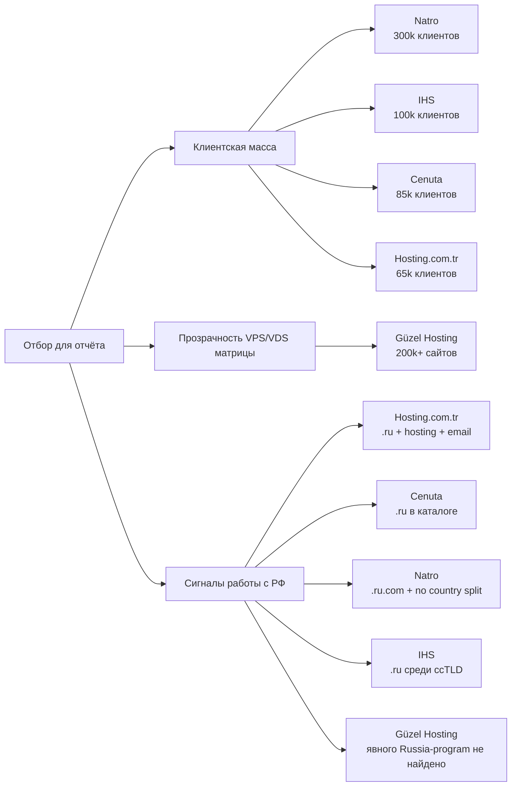

# Турецкие хостинг‑провайдеры уровня Fornex

## Исполнительное резюме

На июнь 2026 года турецкий рынок удобно разделить на две группы. Первая — массовые бренды с большой клиентской базой и широкой линейкой услуг для SMB: **Natro, IHS, Cenuta и Hosting.com.tr**. Вторая — поставщики с более скромно раскрываемой клиентской метрикой, но с очень сильной и прозрачной серверной матрицей; в этот слот для сравнения с Fornex логичнее всего попадает **Güzel Hosting**. Именно эти пять я использую в основном сравнении, потому что они одновременно дают shared/VPS/VDS/dedicated-покрытие и достаточно прозрачные официальные страницы тарифов. По независимой рыночной сводке 2026 года по клиентской базе лидируют Natro, IHS, Cenuta и Hosting.com.tr; Güzel добавлен вместо Atak Domain, потому что у Atak я смог уверенно подтвердить shared-hosting и сильный Russia-facing доменный бизнес, но не сопоставимую открытую таблицу текущих VPS/VDS-планов для apples-to-apples сравнения. citeturn35search0turn22search2turn19search2turn22search4turn36view2

Если приоритет — **работать с российскими доменами, российской аудиторией и не упереться в явные гео-ограничения**, то в текущем пуле самые сильные сигналы дают **Hosting.com.tr** и **Cenuta**: оба публично продают **.ru**-домены, а Hosting.com.tr прямо пишет, что для **.ru** предоставляет и hosting, и e-mail, и поддерживает как физлиц, так и юрлиц. Natro и IHS выглядят нейтрально‑доступными для проектов, связанных с РФ, но их Russia-signal слабее и в основном выражен через широкий каталог ccTLD и отсутствие найденного публичного geo-ban; у Güzel явной Russia-facing программы в проверенных официальных материалах я не нашёл. В официальных корпоративных материалах выбранной пятёрки подтверждённой **российской собственности или российской корпоративной аффилированности** я не обнаружил; у Natro официально раскрыта принадлежность к европейской группе **team.blue**. citeturn29search1turn25search0turn34view0turn27search5turn34view1

По цене 2GB‑класс сильнее всего выглядит **Cenuta**: официальный 2 GB VPS/Cloud начинается от **113,35 TRY в месяц**, что заметно ниже рынка. Самый понятный и сбалансированный вариант для Russia-facing задач — **Hosting.com.tr VPS Small**: 2 vCPU, 2 GB RAM, 50 GB disk, без setup fee, с несколькими международными локациями и понятной 1m/1y/2y сеткой. **Natro XCloud Small** удобен, если нужен крупный массовый бренд, встроенные snapshot/backup и понятный self-service. **Güzel Hosting** дороже, но компенсирует это хорошей прозрачностью турецких VPS-тарифов, бесплатной установкой панелей и сильной operational-поддержкой. **IHS** остаётся крупным игроком, но его 2GB‑класс на публичной странице раскрыт хуже: для него приходится брать ближайший нижний план и оценивать кастомную 2GB-конфигурацию. citeturn32view0turn33view0turn34view0turn36view0turn12search4turn10view0turn10view1

Для пересчёта в евро я использую ориентир **EUR/TRY ≈ 53,27** на **22 июня 2026 года**; значения в EUR ниже поэтому даны как приблизительные. Там, где провайдер сам показывает TRY и USD, я сохраняю официальный TRY с сайта и добавляю приблизительный EUR для удобства закупки. citeturn28search4

## Логика отбора и сигналы работы с Россией

Для выбора я взял комбинацию из двух критериев. Первый — **наблюдаемая рыночная масса**: независимая сводка hostings.info по Турции на 2026 год ставит **Natro** на первое место с 300 тыс. клиентов, **IHS** на второе со 100 тыс., **Cenuta** на третье с 85 тыс. и **Hosting.com.tr** на четвёртое с 65 тыс. клиентов. Второй — **прозрачность и полнота серверных продуктовых страниц**, чтобы можно было честно сравнить shared/VPS/dedicated/cloud по Fornex-подобной логике. По этому второму критерию **Güzel Hosting** особенно силён: компания официально заявляет, что её инфраструктуре доверяют **200 000+ веб‑сайтов**, а VPS/VDS/dedicated-линейка раскрыта прозрачнее, чем у части брендов, формально стоящих выше по клиентскому ранжиру. citeturn35search0turn36view2

Ниже — компактная карта отбора и Russia-signal. Она показывает не «абсолютный рейтинг», а именно то, как я свёл вместе клиентскую массу, продуктовую прозрачность и пригодность для Russia-facing сценариев. citeturn35search0turn29search1turn25search0turn34view0turn27search5turn36view0

В прикладном смысле рынок сейчас делится так. **Hosting.com.tr** — самый явный выбор, если вам важно не только «чтобы не блокировали РФ», но и чтобы провайдер открыто работал с **.ru** и прямо предлагал хостинг под такие зоны. **Cenuta** — самый дешёвый нормальный 2GB‑класс среди проверенных и при этом не боится держать **.ru** у себя в доменном каталоге. **Natro** и **IHS** выглядят более универсальными и корпоративно‑нейтральными: они не позиционируют себя как «Russia-specialists», но в проверенных материалах не показывают явного национального гео-запрета; у Natro есть даже формулировка, что для XCloud «между странами нет различий». **Güzel Hosting** хорош как серверный провайдер, но с точки зрения именно Russia-facing сигнала он слабее других участников пятёрки. citeturn29search1turn25search0turn34view0turn27search5turn36view0

## Сводное сравнение 2GB‑эквивалентов

В таблице ниже я свожу именно **2GB‑эквивалент**. Если официальный план на 2 GB отсутствует, я помечаю строку как **оценка** и отдельно оговариваю логику.

| Провайдер | Статус 2GB-плана | План / конфигурация | CPU / RAM | Диск | Трафик / сеть | Локация | ОС / панели | Backup / snapshot / IP | Цена в TRY | Цена в EUR | Биллинг | Setup / промо / примечание | Источник |
|---|---|---|---|---|---|---|---|---|---:|---:|---|---|---|
| **Cenuta** | официальный | **VPS II** | 1 CPU Xeon Gold / 2 GB DDR4 | 50 GB NVMe SSD | firewall, Tier III, BGP; тариф трафик не лимитирован в карточке не раскрыт | Турция | Windows / Linux / BSD / Custom ISO | 2 free snapshots; restore из панели; IPv4+IPv6/BGP поддерживаются для cloud/dedicated/colo | **113,35 TRY/мес.** | **≈ €2,13** | на странице видна помесячная цена | явный setup fee не указан; самый дешёвый официальный 2GB-класс в выборке | citeturn32view0turn32view1 |
| **Hosting.com.tr** | официальный | **VPS Small** | 2 Core / 2 GB | 50 GB disk, NVMe storage platform | unlimited in/out, 200 Mbps | TR / DE / UK / FR / US | Windows / Linux; free control panel; VPS management web UI | 1 dedicated IP; root; IPv6 не заявлен на странице VPS | **373,53 TRY/мес.** или **2 238,39 TRY/год** | **≈ €7,01/мес.** или **≈ €42,02/год** | 1m / 1y / 2y | **Kurulum Ücreti Yok**; при 1y и 2y заметно падает effective monthly | citeturn33view0 |
| **Natro** | официальный | **XCloud Small** | 1 vCPU / 2 GB | 40 GB SSD | 100 Mbit, unlimited traffic | точная DC‑локация на странице не раскрыта | Linux / Windows; easy management panel; Plesk promo | free backup + 1 free snapshot + 1 IP; IPv6 не заявлен | **416,74 TRY/мес.** | **≈ €7,82** | на странице видна текущая monthly price | первые 3 месяца Windows и/или Plesk бесплатно для campaign packages; no public annual grid in parsed page | citeturn34view0 |
| **Güzel Hosting** | официальный | **TR‑VPS‑3** | 2 CPU / 2 GB | 40 GB SSD | 2 TB / month, 100 Mbit | Турция | Linux/CentOS/Ubuntu; бесплатная установка cPanel / Plesk / DirectAdmin / Cyberpanel / CWP | advanced VPS panel; reset/console/reinstall; IPv4/IPv6 не заявлены; backup-механика не раскрыта в карточке VPS | **566,90 TRY/мес.** | **≈ €10,64** | monthly / 3m / 6m / yearly | на странице указана **скидка 17%** для 6m и yearly; у компании на сайте прямо сказано, что цены без НДС | citeturn36view0turn36view2 |
| **IHS** | **оценка** | рекомендуемый 2GB‑эквивалент на базе публичного VPS/Cloud entry | ориентир: 1 vCPU / **2 GB** | ориентир: 20–40 GB SSD | entry VPS публикуется как 1 TB; cloud/VDS кастомизируется | Turkey, Vodafone data center | AlmaLinux 8/9, Ubuntu 22.04/24.04, Windows 2025; cPanel / Plesk / Webmin | free setup; migration free; R1Soft backup как доп. услуга; IP/IPv6 явно не раскрыты | **≈ 320–325 TRY/мес.** | **≈ €6,0–6,1** | public monthly shown; annual grid не раскрыт | точного 2GB public SKU на просмотренных страницах нет; это аналитическая оценка между 1GB VPS starter и cloud/VDS floor | citeturn12search4turn10view0turn10view1turn12search11 |

С практической точки зрения эта таблица показывает три разные стратегии. **Cenuta** — это aggressively cheap 2GB‑класс. **Hosting.com.tr** и **Natro** — mid-market варианты с более «взрослой» продуктовой упаковкой и лучшей предсказуемостью для международных проектов. **Güzel Hosting** стоит дороже, но выигрывает в прозрачности турецкого VPS‑ассортимента и в панели/операционной поддержке. **IHS** я бы рассматривал скорее тогда, когда вам нужен крупный турецкий бренд с корпоративной инфраструктурой и вы готовы добирать конфигурацию через кастомизацию. citeturn32view0turn33view0turn34view0turn36view0turn10view0turn10view1

## Профили провайдеров

**Hosting.com.tr** — один из самых сильных кандидатов именно для сценария «турецкий провайдер, но проект ориентирован на российских клиентов или на русский интернет‑периметр». Компания основана в 2004 году, официально пишет о **110k+ участниках, 75k+ сайтов и 2k+ серверах**, а её VPS-линейка даёт пять локаций — Турция, Германия, Великобритания, Франция и США. Для Russia-facing кейсов особенно важно, что Hosting.com.tr публично продаёт **.RU**, разрешает регистрацию и физлицам и юрлицам, описывает transfer/renewal-цикл и прямо пишет, что для **.ru** предоставляет хостинг и e-mail. Это не «российская аффилированность», а именно **коммерческая готовность обслуживать русскоязычные и/или РФ-связанные цифровые активы**. По 2GB‑классу лучший fit — **VPS Small**: 2 Core, 2 GB RAM, 50 GB disk, unlimited traffic, 200 Mbps, 1 выделенный IP, root, free control panel, **без setup fee**. Биллинг прозрачный: 1 месяц, 1 год, 2 года. Если вам нужно сочетание «понятный VPS + .ru поддержка + multi-location», это, пожалуй, самый ровный вариант из всей пятёрки. citeturn33view2turn33view0turn29search1

**Cenuta** — самый агрессивный price/performance‑игрок среди отобранных. В официальной рыночной сводке у него **85k клиентов**, а на собственных VPS/Cloud-страницах он показывает очень прозрачную KVM/CloudStack-матрицу, Tier III, snapshot, firewall, панель управления сервером и длинный список ОС — от AlmaLinux и Ubuntu до BSD и Custom ISO. Для вашей задачи это один из самых удобных вариантов, потому что **официальный 2GB‑план существует и в VPS, и в Cloud**: **VPS II / Cloud II** — 1 CPU Xeon Gold, 2 GB DDR4, 50 GB NVMe SSD, 2 free snapshots, firewall support. Дополнительный Russia-signal — то, что в доменном каталоге Cenuta есть **.ru**, то есть провайдер по крайней мере не сторонится российской доменной зоны. Формально российской аффилированности не видно; по смыслу это **турецкий независимый price/performance-хостер**, пригодный для дешёвого развёртывания русскоязычных сервисов без явных публичных geo-red flags. citeturn35search0turn32view0turn32view1turn25search0turn24search9

**Natro** — крупнейший массовый бренд в этой выборке по наблюдаемой клиентской базе: рыночная сводка даёт ему **300k клиентов**, а официальный раздел «О нас» подтверждает, что компания является частью **team.blue**. Это важно с точки зрения аффилированности: у Natro есть **европейская групповая аффилированность**, но не российская. Для Russia-facing проектов Natro интересен не ownership-линком, а operational-политикой: на странице XCloud VPS компания прямо пишет, что для cloud/VPS «между странами нет различий», а продуктовая линейка включает 2GB‑план **XCloud Small** с 1 vCPU, 2 GB RAM, 40 GB SSD, 100 Mbit unlimited traffic, free backup, 1 free snapshot и 1 IP. Дополнительно есть Linux/Windows-выбор и промо на первые 3 месяца Windows/Plesk для campaign-пакетов. Слабое место — на просмотренной странице не так прозрачно раскрыты long-term billing options, как у Hosting.com.tr. Сильные стороны — масштаб бренда, self-service, snapshot и отсутствие найденного country split. citeturn35search0turn34view1turn34view0

**Güzel Hosting** — наиболее «прозрачный турецкий серверный практик» в выборке. Официально компания заявляет, что её инфраструктуре доверяют **200 000+ сайтов**, а публичные страницы чётко разделяют **Public Cloud (VPS)**, **Private Cloud (VDS)**, dedicated и shared. Для турецкой 2GB‑задачи есть прямой план **TR‑VPS‑3**: 2 CPU, 2 GB RAM, 40 GB SSD, 2 TB/мес., 100 Mbit. С точки зрения ops это один из самых удобных вариантов: по тикету бесплатно ставятся **cPanel, Plesk, DirectAdmin, Cyberpanel или CentOS Web Panel**, а в панели доступны reboot/reset, console access, reinstall и метрики RAM/CPU/traffic. Отдельно важно, что Güzel открыто работает и с зарубежным контуром: зарубежные Public Cloud услуги строятся на партнёрстве с **DigitalOcean**, с локациями США / Европа / Сингапур. Это не Russia-link, а скорее признак международной зрелости. В reviewed materials я **не нашёл** у Güzel явной Russia-facing программы, поэтому с точки зрения связки «Турция + работа с РФ» он уступает Hosting.com.tr и Cenuta, но как качественный локальный VPS/VDS-провайдер выглядит очень сильно. citeturn36view2turn36view0turn26search2

**IHS** — крупный турецкий бренд второго эшелона в этой выборке по клиентской массе, с **100k клиентов** в независимой рыночной сводке и заметным уклоном в корпоративный тон продукта. Официальные серверные страницы говорят о Tier III‑среде, размещении в **Vodafone Veri Merkezi**, бесплатной установке, бесплатной миграции и выборе Linux/Windows. На VPS‑странице есть чёткий **starter**: 1 CPU / 1 GB / 20 GB SSD / 1 TB от **$3.45 / 160.18 TRY**, а home-page отдельно показывает, что cloud начинается от **$7 / 325.01 TRY**. Публичного готового **2 GB VPS SKU** в просмотренных страницах я не увидел, поэтому для сравнения строю **оценку**: если вам нужен именно 2GB‑класс, разумно просить у IHS кастомный Linux VPS/Cloud на **1 vCPU, 2 GB RAM и 20–40 GB SSD** с бюджетом порядка **320–325 TRY в месяц**. Отдельный плюс для Russia-facing задач — IHS в своих доменных материалах прямо перечисляет **.RU** среди поддерживаемых ccTLD. Минус — меньше ценовой прозрачности на нижнем VPS-уровне по сравнению с Cenuta, Natro и Hosting.com.tr. citeturn35search0turn10view0turn10view1turn12search4turn27search5turn12search11

## Выводы для закупки

Если ваша главная задача — **аналог Fornex в Турции с максимальной пригодностью для русскоязычного бизнеса**, то я бы расставил короткий shortlist так. **Первое место — Hosting.com.tr**: не потому что он самый дешёвый, а потому что он даёт лучший баланс из явной поддержки **.ru**, мультилокационного VPS, понятной long-term сетки и отсутствия setup fee. **Второе — Cenuta**: если бюджет критичен и нужна именно экономичная машина 2 GB с очень приличным набором серверных функций, это лучший price/performance в выборке. **Третье — Natro**: это ставка на масштаб, известность бренда и аккуратную XCloud-упаковку; для части закупок это может быть психологически и операционно удобнее, чем более «острые» дешёвые бренды. citeturn29search1turn33view0turn32view0turn34view0

**Güzel Hosting** я бы выбирал тогда, когда важнее **локальный турецкий VPS/VDS с хорошей ручной поддержкой, бесплатной установкой панелей и понятной серверной страницей**, чем явно выраженный Russia-signal. **IHS** — вариант для корпоративного шортлиста, где важны бренд и дата-центр, но нижний сегмент VPS у вас всё равно будет доуточняться через sales/custom config. Если же вам принципиально нужен именно провайдер с максимально открыто выраженной коммерческой связью с российским контуром, то стоит иметь в виду, что **Atak Domain** в рыночной сводке идёт высоко и официально пишет, что обслуживает глобальные бренды, в том числе в России; однако для полноценного Fornex-подобного серверного сопоставления мне не хватило на его официальных страницах такой же прозрачной текущей VPS/VDS-матрицы, как у включённой пятёрки. citeturn36view0turn10view0turn35search0turn22search2

Итог в одной фразе: **для «Турция + русскоязычный бизнес + разумная инфраструктурная прозрачность» лучший универсальный выбор сейчас — Hosting.com.tr; для минимизации бюджета — Cenuta; для крупного mass-market бренда — Natro; для локального quality VPS — Güzel Hosting; для корпоративной кастомизации — IHS**. citeturn33view0turn32view0turn34view0turn36view0turn10view0